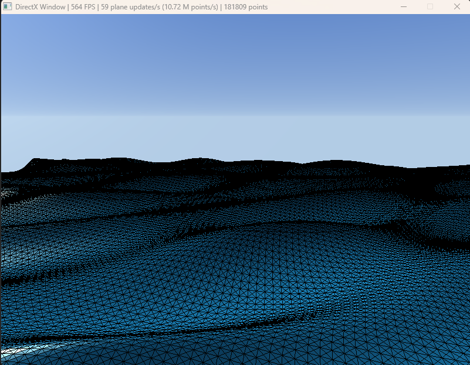

# 2026-10-11

Day 4 of working on my PhD prototype.
Before today, I only calculated the z position (height) for the Gerstner algorithm.
I wanted to add a steepness parameter, so I now calculate the x, y and z positions.

You know what, since it's my diary, I have a confession to make. Honestly, I'm not even sure
if I really want to do the PhD degree.
During the first year of my master's, I went on an exchange program abroad. And it's the same school I'm aiming for.
I have never felt happier than during that year abroad and my only wish is to come back there. I feel like the
PhD is just a pretext to go back, even though I'm passionate about my subject.

**What I did**
- Added x and y calculation for sharper waves
- Added a steepness parameter
- Made a configurable skybox (AI generated)
- Basic configurable chunk generation (AI generated)

**Problems met**
- I don't understand the HLSL shaders that Claude generated. I will have to learn it
for the water shader part that includes:
    - foam
    - reflectance
    - scattered light

**What I will do**
- Add a log file and a viewer for it
- FFT algorithm implementation
