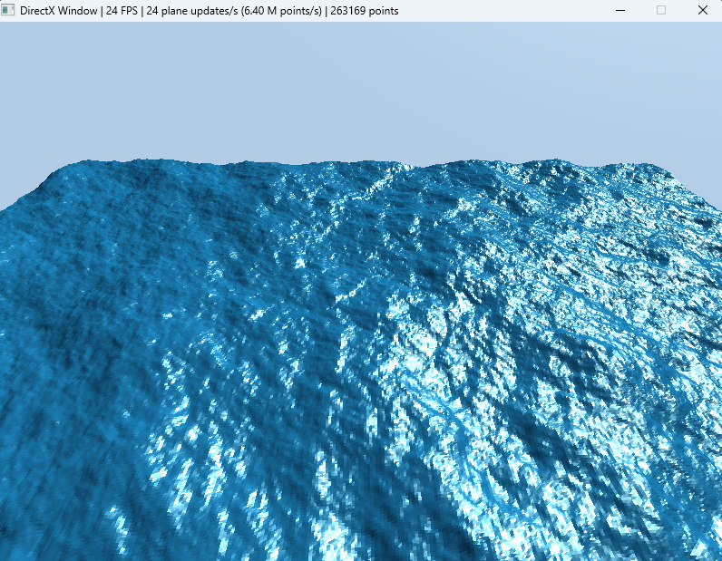

# 2026-10-17

**Day 5 of working on my PhD prototype.**
Well, in fact it's been almost a week that I have been working on FFT waves.

Isn't it beautiful?
I have done a lot of research to implement it and it's still not as perfect as it should be.
For now, my calculations are essentially computed on the CPU and not on the GPU. I will have to learn how to use the GPU to do it.
What I want to do is keep the "initFFTSpectrum" function computed on the CPU and the rest on the GPU:
- fft2d, which is the Cooley-Tukey algorithm
- fftTimeEvo, which is the time evolution
I still don't exactly get how the Cooley-Tukey algorithm works, but I think I understand the basic idea. I will continue my research on the subject.

In order to achieve the actual render, I mostly learned from Acerola's video "I Tried Simulating The Entire Ocean" on YouTube (https://www.youtube.com/watch?v=yPfagLeUa7k&t=877s) and from other videos. I also read Jerry Tessendorf's work and a bunch of articles online.
For the interactive part of the project, I will research the Lattice Boltzmann method.

**What I did**
- CPU-oriented FFT algorithm

**Problems met**
- I kinda suck at maths after all

**What I will do**
- GPU-oriented FFT
- Research on Lattice Boltzmann
- Understand the Cooley-Tukey algorithm
