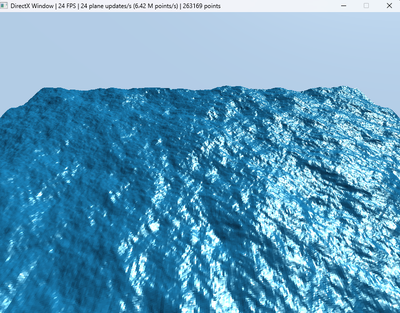
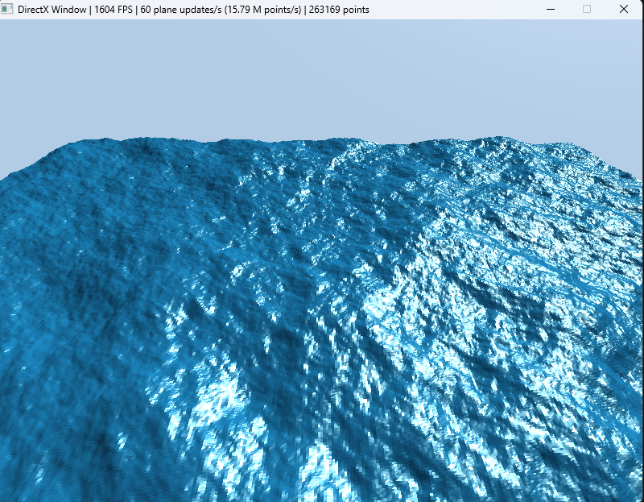

# 2026-11-6

**Day 6 of working on my PhD prototype.**
Its been two weeks I didn't commit on this repo.
Lately I applied to a Nintendo 64 Water Competition organized by the youtuber Kaze Emanuar. You can check what I did on this video :
[link](https://youtu.be/XJCf9CYbKRQ?si=eEH1vdAtIhxUL0e6)
I mostly used gerstner for it since the nintendo 64 is not very performant.

Regarding the project I have ben working on the GPU-oriented FFT calculation.
With CPU: 

With GPU:

**What I did**
- GPU-oriented FFT algorithm

**Problems met**
- I really need to understand the code, I code lost in the gpu libraries and the HLSL scripting.

**What I will do**
- Understand the code
- foam effect
- light through waves
- fog effect
