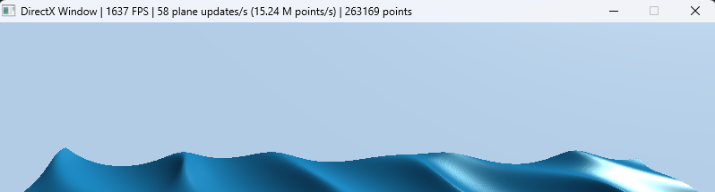
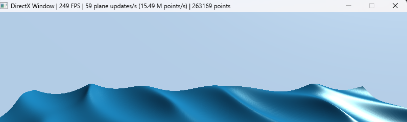

# 2026-11-7

**Day 7 of working on my PhD prototype.**
Today, my goal was to understand the use of the GPU for FFT. I used AI to teach me and explain each line.
After reviewing the code, I decided to code the calculation of gerstner the same way.

With GPU:

Without GPU:

Its really incredible how fast it is and how many FPS we are saving. Using it will be a great help to save computation
for the interactive parts of the water.

**What I did**
- GPU-oriented Gerstner algorithm
- Understand GPU computation.

**Problems met**
- I got lost in the gpu libraries.

**What I will do**
- foam effect
- light through waves
- fog effect
