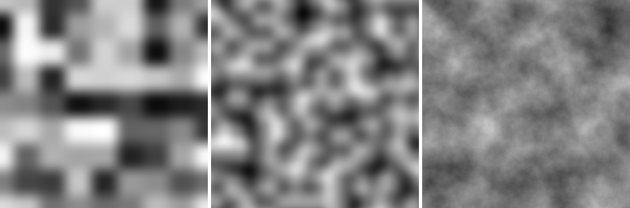
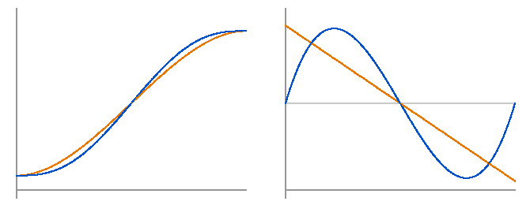
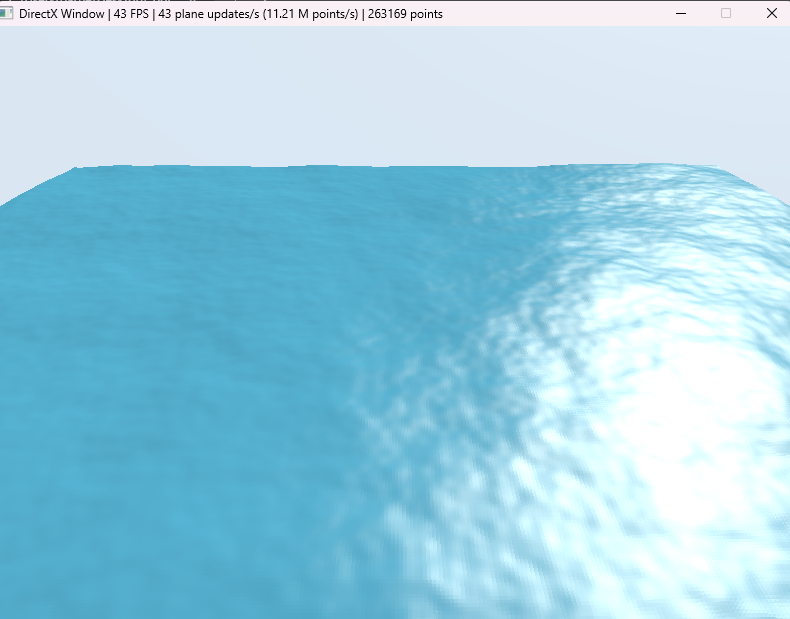
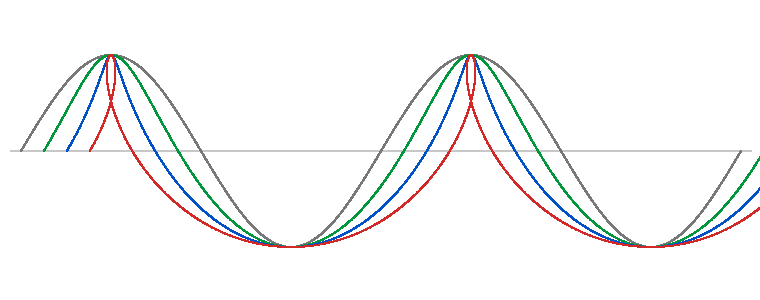
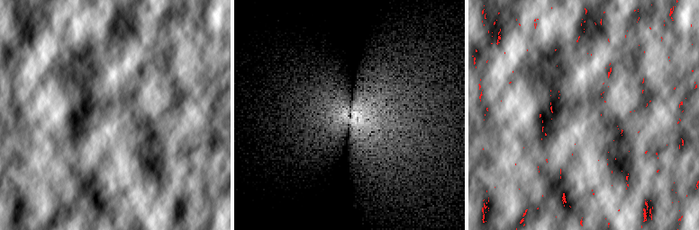

# Lot 0 — Cours particulier : Perlin, Gerstner, FFT… et flottabilité

Cours pour comprendre, **avec les maths**, les trois façons de fabriquer une surface d'eau dans ton projet (**Perlin**, **Gerstner**, **FFT**), puis comment faire **flotter** un objet dessus. Il prépare le tutoriel « Rendering the seas » (lots 1 et 2) mais se lit seul.

> **Comment ce cours est construit.** Chaque module suit : *motivation → intuition → équations (numérotées, avec tableau de symboles) → dérivation courte → lien avec TON code → exercices*. Chaque exercice est **repliable** : tu lis l'énoncé, tu cherches, et tu ouvres **seulement ce dont tu as besoin** : *Indice 1* (un coup de pouce), *Indice 2*, *Indice 3* (presque la réponse), puis le *Corrigé* (avec le raisonnement).

---

## Comment lire ce document

**Étiquettes de confiance** (les mêmes que dans le lot 1) :

- ✅ **vérifié** : formule démontrée dans le texte et/ou **testée numériquement** (programme compilé et exécuté, résultat cité), ou code compilé et lancé sur une copie de ton projet.
- ⚠️ **reconstruit** : déduit de la littérature ou de mon calcul, non testé tel quel. Je le dis chaque fois.
- ❓ **non vérifié** : de mémoire, à contrôler (avec l'endroit où regarder). **Toutes les références bibliographiques sont ❓** : je ne peux pas les ouvrir ici.

**Ce que j'ai concrètement testé pour ce lot** (programmes dans `C:\Users\barbe\Desktop\_gdc_tools\lot0\`, hors de ton dépôt ; les extraits utiles sont recopiés dans les corrigés) :

1. Un `perlin2d` de référence : valeur aux nœuds, plage et écart type sur 10⁶ points, saut de dérivée seconde (smoothstep contre quintique), dérivées analytiques, bruit tuilable, isotropie, pente spectrale d'un fBm.
2. Gerstner : formules de pente, de jacobien et de vitesse contre différences finies ; borne de non-bouclage ; paramètres de ta config ; itération de point fixe.
3. FFT : DFT naïve, FFT récursive et Stockham (la logique exacte de ton `csFFT`) ; propagation, variance, damier, jacobien du choppy **avec ton `fft.cpp`**.
4. Flottabilité : Archimède par intégration de pression, pilonnement 1D, corps rigide 3D (roulis, tangage), houle Gerstner, champ FFT, relecture GPU→CPU avec un vrai device D3D11.

**Aucun fichier de ton projet n'a été modifié.** Seuls ce document et `docs/figures/lot0-*.png` ont été créés.

### ⚠️ Trois constats sur ton code (mesurés, détaillés dans les modules)

| # | Constat | Où |
|---|---|---|
| 1 | Dans `config.json`, `w = 1.0` pour les trois vagues Gerstner, alors que la dispersion donne $\sqrt{gk}=1{,}213\ ;\ 1{,}401\ ;\ 0{,}990$. Tes vagues ne se propagent donc pas à la vitesse « physique ». | Module B, exercice B1 |
| 2 | Avec la convention actuelle de `fftTimeEvo` / `csTimeEvo`, **les vagues dominantes avancent dans le sens opposé à la direction `w` du vent** (mesuré : $-6{,}25$ m/s pour un vent $+x$). | Module C, exercice C7 |
| 3 | Avec `position += lambda * D` et $\mathbf D=-i\,\hat{\mathbf k}\,h$, **`lambda > 0` aplatit les crêtes** et resserre les creux (jacobien moyen $1{,}26$ aux crêtes, $0{,}76$ aux creux pour $\lambda=+1$). Pour des crêtes aiguës il faut `lambda < 0` dans cette convention. | Module C, exercice C9 |

Je ne modifie pas ton code ; les constats 2 et 3 viennent d'une même racine (le signe de la transformée), et le cours t'explique comment les corriger toi-même.

---

## Table des matières

| Module | Titre | Exercices |
|---|---|---|
| [0](#module-0--mode-demploi-et-prérequis) | Mode d'emploi et prérequis | 6 |
| [A](#module-a--perlin) | Bruit de Perlin | 9 |
| [B](#module-b--gerstner) | Vagues de Gerstner | 8 |
| [C](#module-c--fft-océanique) | FFT océanique (Tessendorf) | 9 |
| [D](#module-d--flottabilité-buoyancy) | Flottabilité (buoyancy) | 9 |
| [E](#module-e--synthèse-et-mini-projet) | Synthèse, lectures, mini-projet | — |
| [Annexe](#annexe--ce-que-je-nai-pas-pu-vérifier) | Ce que je n'ai pas pu vérifier | — |

---

## Notation

| Symbole | Sens | Unités | Dans ton projet |
|---|---|---|---|
| $g$ | pesanteur | 9,81 m/s² | `g` (`calculus.hpp:12`), `G` dans les shaders |
| $k$ | nombre d'onde $2\pi/\lambda$ | rad/m | `k` (Gerstner), `k_mag` (FFT) |
| $\mathbf k=(k_x,k_y)$ | vecteur d'onde | rad/m | `kx`, `kz` (FFT) : **`kz` est l'axe $y$ du monde** |
| $\lambda$ | longueur d'onde | m | — (≠ `lambda` du choppy !) |
| $\omega$ | pulsation | rad/s | `w` (Gerstner), `omega` (FFT) |
| $A$ | amplitude verticale | m | `A` |
| $\mathbf D$ | direction de propagation (Gerstner, unitaire) | — | `D` ; ≠ déplacement FFT (noté $\mathbf D_{fft}$ quand il y a ambiguïté) |
| $s$ | steepness du projet | — | `s` |
| $Q$ | steepness « classique » (Gerstner) | — | $s=Q\,A\,k$ (module B) |
| $\hat h(\mathbf k,t)$ | amplitude complexe d'un mode | m | `ht` |
| $N,\ L_{size},\ \Delta$ | grille, taille, pas | —, m, m | `N`, `planeSize`, $\Delta=L_{size}/N$ |
| $\lambda_{ch}$ | choppiness | — | `lambda` dans `config.json` |
| $\rho,\ V,\ m$ | masse volumique de l'eau, volume, masse | kg/m³, m³, kg | — |

**Axes** : $z$ vers le haut ; $x,y$ horizontaux ; l'eau au repos est en $z=0$ (`basezpos`).

---

# Module 0 — Mode d'emploi et prérequis

## 0.1 Motivation

Les trois méthodes de ton projet sont trois réponses à la question « *comment calculer la hauteur $h(x,y,t)$ de l'eau ?* » :

| Méthode | Idée en une ligne | Physique |
|---|---|---|
| **Perlin** | du bruit lissé, sommé à plusieurs échelles | aucune |
| **Gerstner** | quelques ondes sinusoïdales exactes, avec mouvement circulaire des particules | une onde, exacte |
| **FFT** | des milliers d'ondes sinusoïdales d'un spectre statistique | spectre réaliste |

Il faut quatre outils maths : les nombres complexes, les séries de Fourier, l'échantillonnage, et la notion de spectre. Tu en as déjà vu une partie (voir ton `diary/questions.md` §1) : je ne reprends que ce qui sert.

## 0.2 Euler et rotations (rappel de 3 lignes)

$$e^{i\theta}=\cos\theta+i\sin\theta \tag{0.1}$$

Multiplier un complexe par $e^{i\theta}$ le fait **tourner** de $\theta$ dans le plan complexe. Une onde $e^{i(kx-\omega t)}$ est donc un point qui tourne ; sa partie réelle est $\cos(kx-\omega t)$.

$$\cos\psi=\tfrac12\big(e^{i\psi}+e^{-i\psi}\big),\qquad \sin\psi=\tfrac1{2i}\big(e^{i\psi}-e^{-i\psi}\big) \tag{0.2}$$

C'est (0.2) qui explique pourquoi un champ **réel** exige des modes en paires $\pm\mathbf k$ conjuguées (ton `questions.md` §1.3).

## 0.3 Séries de Fourier et périodicité

Une fonction $f$ de période $L$ s'écrit comme somme de modes :

$$f(x)=\sum_{n\in\mathbb Z}c_n\,e^{2\pi i\,n x/L},\qquad c_n=\frac1L\int_0^Lf(x)\,e^{-2\pi i\,nx/L}\,dx \tag{0.3}$$

Seuls les $n$ **entiers** sont autorisés : $e^{2\pi i\,n x/L}$ ne se raccorde en $x=L$ que si $n$ est entier. Conséquence directe pour ton projet : *une grille FFT de taille `planeSize` ne contient que des nombres d'onde $k=2\pi n/L_{size}$*, d'où $k_{min}=2\pi/200=0{,}0314$ rad/m ✅.

**Théorème de Parseval** (utile pour les variances) : pour une fonction réelle de moyenne nulle,

$$\frac1L\int_0^L f(x)^2dx=\sum_n|c_n|^2 \tag{0.4}$$

Pour une somme de sinusoïdes $\sum_i a_i\cos(k_ix+\phi_i)$ de fréquences distinctes, la variance vaut donc $\sum_i a_i^2/2$ ✅.

## 0.4 Échantillonnage et Nyquist

Échantillonner à pas $\Delta$ ne permet de représenter que les longueurs d'onde $\lambda\ge2\Delta$, c'est-à-dire

$$k\le k_{max}=\frac{\pi}{\Delta} \tag{0.5}$$

Au-delà, l'onde est **repliée** (aliasing) vers un nombre d'onde plus bas. Pour ta grille FFT ($N=512$, $L_{size}=200$ m) : $\Delta=0{,}3906$ m, $k_{max}=8{,}0425$ rad/m, $\lambda_{min}=0{,}78125$ m ✅.

## 0.5 Spectre et hasard

Un **spectre** $P(\mathbf k)$ dit « quelle énergie (variance) porte chaque nombre d'onde ». Fabriquer une mer réaliste, c'est tirer au hasard les amplitudes des modes avec une variance donnée par le spectre. Un tirage gaussien $\xi\sim\mathcal N(0,1)$ multiplié par $\sqrt{P}$ donne un mode de variance $P$.

## 0.6 Les trois méthodes, en une phrase de maths chacune

$$\underbrace{h=\sum_j g^j\,n(\ell^j\mathbf x)}_{\text{Perlin (fBm)}}\qquad \underbrace{h=\sum_{i=1}^{M}A_i\sin(\mathbf k_i\!\cdot\!\mathbf p-\omega_it)}_{\text{Gerstner, }M\sim3\text{ à }16}\qquad \underbrace{h=\mathrm{Re}\!\!\sum_{\mathbf k}\hat h(\mathbf k,t)\,e^{i\mathbf k\cdot\mathbf x}}_{\text{FFT, }N^2\sim10^5\text{ modes}} \tag{0.6}$$

## 0.7 Exercices

**Exercice 0.1 ⭐ — Nyquist de ta grille**

Ta grille FFT a `cellsnumber = 512` sur `planesize = 200`. Calcule le pas $\Delta$, la longueur d'onde minimale représentable et $k_{max}$. Même question pour `cellsnumber = 256`.

<details><summary>Indice 1 (coup de pouce)</summary>

Le pas est la taille d'une maille. Une onde a besoin d'au moins deux échantillons par période.

</details>

<details><summary>Indice 2</summary>

$\lambda_{min}=2\Delta$ et $k=2\pi/\lambda$.

</details>

<details><summary>Indice 3 (presque la réponse)</summary>

$\Delta=200/512=0{,}390625$ m, donc $\lambda_{min}=0{,}78125$ m.

</details>

<details><summary>Corrigé</summary>

Pour $N=512$ : $\Delta=200/512=0{,}390625$ m ; $\lambda_{min}=2\Delta=0{,}78125$ m ; $k_{max}=2\pi/\lambda_{min}=\pi/\Delta=8{,}0425$ rad/m ✅.
Pour $N=256$ : $\Delta=0{,}78125$ m ; $\lambda_{min}=1{,}5625$ m ; $k_{max}=4{,}0212$ rad/m. Diviser la résolution par 2 divise $k_{max}$ par 2 : on perd la moitié du spectre en nombre d'onde (et donc les petites vagues).

</details>

**Exercice 0.2 ⭐ — Rotation complexe**

Calcule $(1+i)\,e^{i\pi/2}$ et donne son module. Que fait la multiplication par $e^{i\pi/2}$ ?

<details><summary>Indice 1 (coup de pouce)</summary>

$e^{i\pi/2}=\cos(\pi/2)+i\sin(\pi/2)$.

</details>

<details><summary>Indice 2</summary>

Cela vaut $i$. Développe $(1+i)\cdot i$ avec $i^2=-1$.

</details>

<details><summary>Indice 3 (presque la réponse)</summary>

$(1+i)i=i+i^2=-1+i$.

</details>

<details><summary>Corrigé</summary>

$e^{i\pi/2}=i$, donc $(1+i)i=i+i^2=-1+i$. Le module de $1+i$ est $\sqrt2$ ; celui de $-1+i$ aussi : une multiplication par $e^{i\theta}$ **conserve le module** et **tourne** de $\theta$ (ici $+90^\circ$ : $1+i$ à $45^\circ$ devient $-1+i$ à $135^\circ$). C'est exactement ce que fait `csTimeEvo` à chaque pas : il fait tourner chaque mode de $\omega t$ sans changer son amplitude.

</details>

**Exercice 0.3 ⭐ — Coefficients de Fourier d'un cosinus**

Donne les coefficients $c_n$ de $f(x)=a\cos(2\pi\,3x/L)$ dans (0.3).

<details><summary>Indice 1 (coup de pouce)</summary>

Utilise (0.2) pour écrire le cosinus avec des exponentielles.

</details>

<details><summary>Indice 2</summary>

Compare terme à terme avec $c_n e^{2\pi i nx/L}$.

</details>

<details><summary>Indice 3 (presque la réponse)</summary>

Deux modes non nuls, aux indices $n=+3$ et $n=-3$.

</details>

<details><summary>Corrigé</summary>

$a\cos(2\pi\,3x/L)=\tfrac a2e^{2\pi i\,3x/L}+\tfrac a2e^{-2\pi i\,3x/L}$. Donc $c_{3}=c_{-3}=a/2$ et tous les autres sont nuls. Le spectre d'une sinusoïde réelle est une **paire de pics conjugués** ($c_{-3}=\overline{c_3}$ ici réel). C'est la symétrie hermitienne.

</details>

**Exercice 0.4 ⭐⭐ — Symétrie hermitienne (N = 4)**

Pour $x=[1,2,3,4]$, la DFT directe est $X_k=\sum_{n=0}^{3}x_ne^{-2\pi ikn/4}$. Calcule $X_1$ et $X_3$ et vérifie $X_3=\overline{X_1}$.

<details><summary>Indice 1 (coup de pouce)</summary>

Pour $N=4$, $e^{-2\pi i/4}=-i$. Les puissances de $-i$ : $1,-i,-1,i$.

</details>

<details><summary>Indice 2</summary>

$X_1=1\cdot1+2(-i)+3(-1)+4(i)$.

</details>

<details><summary>Indice 3 (presque la réponse)</summary>

Regroupe parties réelle et imaginaire : $(1-3)+(-2+4)i$.

</details>

<details><summary>Corrigé</summary>

$X_1=1-2i-3+4i=-2+2i$. Pour $X_3$ : les puissances de $e^{-2\pi i\cdot3/4}=i$ sont $1,\,i,\,-1,\,-i$, donc $X_3=1+2i-3-4i=-2-2i$. On le voit aussi sans calcul : $e^{-2\pi i\,3n/4}=e^{+2\pi i\,n/4}$ (période 4) est le **conjugué** de $e^{-2\pi i\,n/4}$, et comme les $x_n$ sont réels, $X_3=\overline{X_1}=-2-2i$ ✅ (programme : $X=[10,\,-2+2i,\,-2,\,-2-2i]$). En général $X_{N-k}=\overline{X_k}$ pour une entrée réelle : c'est pourquoi ton code lit `h0[(N-m)%N][(N-n)%N]` (« l'indice opposé »).

</details>

**Exercice 0.5 ⭐⭐ — Couture d'une onde non périodique**

Ta vague Gerstner n°1 a $k=0{,}15$ rad/m, direction $\approx(1;0{,}1)$ normalisée. Si tu évaluais cette onde sur un carré de côté 200 m en la recollant périodiquement, quelle serait la **discontinuité** à la couture $x=0\leftrightarrow x=200$ (le long de $x$, à $y$ fixé) en unités de l'amplitude $A$ ?

<details><summary>Indice 1 (coup de pouce)</summary>

L'onde est $A\sin(kD_x x+\dots)$. À la couture, tu compares la phase en $x=200$ avec celle en $x=0$.

</details>

<details><summary>Indice 2</summary>

Calcule $kD_x\cdot200$ puis réduis modulo $2\pi$.

</details>

<details><summary>Indice 3 (presque la réponse)</summary>

$kD_x\cdot200\approx29{,}9$ rad ; $\bmod\ 2\pi$ donne un angle voisin de $4{,}7$ rad.

</details>

<details><summary>Corrigé</summary>

$D_x=1/\sqrt{1{,}01}=0{,}995$, donc $kD_x L=0{,}15\times0{,}995\times200=29{,}85$ rad $=4{,}75\times2\pi$ : **pas entier** (le programme donne $4{,}7510$ tours, §B.8). La partie fractionnaire $0{,}751$ tour correspond à un déphasage de $0{,}751\times2\pi=4{,}72$ rad entre les deux bords : à la couture, $\sin(\varphi_0+4{,}72)-\sin\varphi_0$ peut atteindre $2A\sin(4{,}72/2)\approx1{,}4A$ selon $\varphi_0$. Un champ qui n'est pas périodique sur la tuile crée donc une **marche visible** (jusqu'à $\sim1{,}4A=2$ m ici). Pour que ça se raccorde, $kD_xL$ doit être un multiple de $2\pi$ : voir B.8.

</details>

**Exercice 0.6 ⭐⭐ — Variance d'une somme de sinusoïdes**

Les trois vagues de ta config ont $A=1{,}5\ ;\ 1{,}7\ ;\ 1{,}3$. Estime l'écart type de la hauteur par (0.4). Compare avec la valeur mesurée sur 5000 points aléatoires (monde, $t=1{,}7$) : $1{,}883$ m.

<details><summary>Indice 1 (coup de pouce)</summary>

La variance d'une sinusoïde d'amplitude $a$ est $a^2/2$.

</details>

<details><summary>Indice 2</summary>

Les trois vagues ont des nombres d'onde différents : leurs variances s'additionnent.

</details>

<details><summary>Indice 3 (presque la réponse)</summary>

$\sigma^2=(1{,}5^2+1{,}7^2+1{,}3^2)/2$.

</details>

<details><summary>Corrigé</summary>

$\sigma^2=(2{,}25+2{,}89+1{,}69)/2=3{,}415$, soit $\sigma=1{,}848$ m. Mesure : $1{,}883$ m ✅, soit $+1{,}9\,\%$. L'écart vient du déplacement horizontal (les points du monde ne coïncident pas avec les points de repos) et de l'échantillon fini. Ce calcul est le même que pour la FFT : $\sigma^2$ = somme des variances de tous les modes (§C.9).

</details>

---

# Module A — Perlin

## A.1 Motivation

Dans ton projet, `perlin` est sélectionnable (`config.hpp:99`) mais **pas implémenté** : la surface reste plate (README, « Status »). Le bruit de Perlin ne simule pas la physique de l'eau ; il sert à produire du **relief pseudo-aléatoire, continu, bon marché, contrôlable et tuilable**. On l'utilise pour : un **état de mer très bon marché** (ton projet N64 de `diary/2026-11-06.md` partait de cette contrainte), des **détails** (normales fines), des **masques** (zones d'écume, rafales de vent) et de la **déformation de domaine**.

## A.2 Intuition : bruit de valeur contre bruit de gradient

On pose un **réseau** (grille) de points entiers. Deux manières de « remplir » l'espace entre eux :

- **Bruit de valeur** : on tire une *valeur* aléatoire à chaque nœud et on interpole. Le résultat a des blocs visibles alignés sur la grille, et sa valeur aux nœuds est quelconque (figure, panneau de gauche).
- **Bruit de gradient (Perlin)** : on tire un *vecteur gradient* aléatoire à chaque nœud ; la contribution d'un nœud en un point est le **produit scalaire** du gradient avec le vecteur « nœud → point ». La valeur est **exactement 0 aux nœuds**, et le motif est plus « organique » (panneau du milieu). Le panneau de droite est un fBm (§A.6).


*Fig. A-1 : bruit de valeur (gauche), bruit de gradient (milieu), fBm 6 octaves (droite). Même réseau pour les deux premiers.*

## A.3 L'algorithme, équation par équation

Pour un point $\mathbf p=(x,y)$ : $\mathbf i=(\lfloor x\rfloor,\lfloor y\rfloor)$ est le coin bas-gauche de la cellule, $\mathbf f=\mathbf p-\mathbf i\in[0,1)^2$.

$$n_{c}=\mathbf g_{c}\cdot(\mathbf f-\mathbf c),\qquad \mathbf c\in\{(0,0),(1,0),(0,1),(1,1)\} \tag{A.1}$$

$$u=\mathrm{fade}(f_x),\quad v=\mathrm{fade}(f_y),\qquad \mathrm{fade}(t)=6t^5-15t^4+10t^3 \tag{A.2}$$

$$n(\mathbf p)=(1-v)\big[(1-u)n_{00}+u\,n_{10}\big]+v\big[(1-u)n_{01}+u\,n_{11}\big] \tag{A.3}$$

| Symbole | Sens | Détail |
|---|---|---|
| $\mathbf g_c$ | gradient (vecteur unitaire) du nœud $\mathbf i+\mathbf c$ | choisi par **hachage** des coordonnées du nœud |
| $n_c$ | contribution du coin $c$ | produit scalaire : grand si le gradient « pointe vers le point » |
| $u,v$ | poids d'interpolation lissés | remplacent le $f$ linéaire |

**Le hachage.** La table de permutation de Perlin est un tableau $p[0..255]$ contenant $0..255$ mélangés, **répété deux fois** (512 entrées) pour ne pas avoir à réduire un indice. Le gradient d'un nœud $(i,j)$ est

$$\mathbf g=G\big[\,p\big[p[\,i\ \&\ 255\,]+(j\ \&\ 255)\big]\ \&\ 7\,\big] \tag{A.4}$$

où $G$ liste 8 directions unitaires (axes et diagonales). `& 255` est un modulo 256 (la même astuce que ton `t & (Ns-1)`, `questions.md` §3.1). Tout est **déterministe** : la même graine redonne le même bruit.

## A.4 Propriétés (mesurées ✅)

| Propriété | Résultat | Preuve ou mesure |
|---|---|---|
| Valeur aux nœuds | $n=0$ | si $\mathbf f=\mathbf 0$ : $u=v=0$ donc $n=n_{00}=\mathbf g\cdot\mathbf 0=0$ ✅ ; mesuré : $0{,}0$ |
| Plage | $\approx\pm\tfrac{\sqrt2}{2}=\pm0{,}7071$ | mesuré sur $10^6$ points : min $-0{,}7060$, max $0{,}7020$ ✅ ; **non démontré** que c'est la borne exacte ⚠️ |
| Moyenne, écart type | $0{,}0002$ ; $0{,}2154$ | mesuré ✅ (8 gradients unitaires) |
| Tuilable | possible | $\max|n(x)-n(x+8)|=2{,}4\cdot10^{-15}$ avec période 8 ✅ (§A.8) |
| Isotropie | presque | variance de la dérivée directionnelle : $0{,}3885\ ;\ 0{,}3859\ ;\ 0{,}3888\ ;\ 0{,}3921\ ;\ 0{,}3955$ pour $0^\circ,22{,}5^\circ,45^\circ,67{,}5^\circ,90^\circ$ ; autocorrélation à $r=0{,}5$ : $0{,}287$ (axe) contre $0{,}280$ (diagonale) ✅. Écarts $\lesssim 2{,}5\,\%$ : *faible* anisotropie due au réseau |

La plage $\pm\sqrt2/2$ se comprend : au centre d'une cellule, si les quatre gradients pointent vers le centre, chaque produit scalaire vaut $|\,(\pm\tfrac12,\pm\tfrac12)\,|=\tfrac{\sqrt2}2$ et $n=0{,}7071$ (exercice A4).

## A.5 Pourquoi un polynôme de lissage d'ordre 5 ?

L'interpolation naïve a un défaut : avec $\mathrm{smoothstep}(t)=3t^2-2t^3$ la dérivée **première** est continue entre cellules, mais la dérivée **seconde** ne l'est pas. Avec le polynôme quintique de (A.2) elle l'est :

$$\mathrm{fade}'(t)=30\,t^2(t-1)^2,\qquad \mathrm{fade}''(t)=60\,t\,(2t-1)(t-1) \tag{A.5}$$

$$\mathrm{smoothstep}'(t)=6t(1-t),\qquad \mathrm{smoothstep}''(t)=6-12t \tag{A.6}$$

(A.5) s'annule en $t=0$ et $t=1$ (dérivées premières *et* secondes nulles aux nœuds) ; (A.6) vaut $+6$ en $t=0$ et $-6$ en $t=1$ : **saut de 12**. Pourquoi ça compte : la dérivée seconde sert à éclairer (les normales sont des dérivées premières, mais leurs *variations* — la courbure — se voient dans les reflets) et à calculer des écumes ou des ombrages. **Mesuré sur une ligne de ton bruit** ($y=0{,}37$, à $\pm10^{-4}$ d'un nœud, ✅) :

| Interpolation | $\partial_{xx}n$ avant le nœud | après | saut |
|---|---|---|---|
| quintique | $+0{,}0001$ | $-0{,}0054$ | $-0{,}0055$ (≈ 0) |
| smoothstep | $+0{,}4616$ | $-5{,}3228$ | $-5{,}78$ |


*Fig. A-2 : à gauche fade (orange : smoothstep, bleu : quintique) ; à droite leurs dérivées secondes. La droite orange est le saut en $t=0$ et $t=1$ ; la courbe bleue part et revient à 0.*

## A.6 Octaves : le fBm

Un seul bruit a une seule échelle. Pour imiter la nature on **somme** des copies à fréquences croissantes (*fractional Brownian motion*) :

$$h(\mathbf x)=\sum_{j=0}^{J-1}g^{\,j}\;n\!\big(\ell^{\,j}\mathbf x\big) \tag{A.7}$$

| Symbole | Nom courant | Sens | Valeurs usuelles |
|---|---|---|---|
| $J$ | octaves | nombre de couches | 4 à 8 |
| $\ell$ | lacunarity | facteur de fréquence entre octaves | 2 |
| $g$ | gain / persistance | facteur d'amplitude entre octaves | 0,5 |

**Lien avec le spectre.** Avec $\ell=2$ et $g=2^{-H}$, l'octave $j$ a pour fréquence $f_j=f_02^j$ et pour amplitude $2^{-Hj}$. Son énergie est $\propto 2^{-2Hj}$ et sa bande de fréquences $\propto f_j$, donc la **densité spectrale de puissance** à $f_j$ est $\propto 2^{-2Hj}/2^{j}\propto f_j^{-(2H+1)}$ :

$$S(f)\propto f^{-(2H+1)}\qquad (\ell=2,\ g=2^{-H}) \tag{A.8}$$

**Mesuré ✅** (fBm 8 octaves ; ligne périodique de 16 cellules ; 300 lignes moyennées ; pente log-log entre fréquences successives doublées) :

| gain | $H$ | pente prédite $-(2H+1)$ | pente mesurée |
|---|---|---|---|
| 0,7071 | 0,5 | $-2$ | $-1{,}85$ ; $-2{,}15$ ; $-1{,}85$ ; $-2{,}13$ ; $-1{,}91$ |
| 0,5 | 1 | $-3$ | $-2{,}91$ ; $-3{,}09$ ; $-2{,}91$ ; $-3{,}05$ ; $-2{,}93$ |

**Piège de mesure** : sur un signal **non périodique**, la coupure aux bords ajoute un plancher en $f^{-2}$ qui fausse tout (j'ai d'abord trouvé $-2{,}9$ pour les deux gains). Il faut mesurer sur un bruit **tuilable** (§A.8) ou fenêtrer.

**Variantes** (définitions courantes, ⚠️ variables selon les auteurs) : *turbulence* $\sum g^j|n(\ell^j\mathbf x)|$ (plis nets) ; *ridged* $\sum g^j\big(1-|n(\ell^j\mathbf x)|\big)^2$ (crêtes aiguës). Pour une mer, le ridged fait des crêtes mais ce n'est **pas** physique.

**Décaler les octaves.** Si toutes les octaves partagent l'origine, leurs nœuds coïncident (tous les $n$ valent 0 aux entiers) et un motif de quadrillage ressort. On ajoute un **décalage** par octave (ex. $17\,j$, $31\,j$ dans mon code §A.10).

## A.7 Dérivées analytiques

Utile pour les normales. Avec $w_{00}=(1-u)(1-v)$, $w_{10}=u(1-v)$, $w_{01}=(1-u)v$, $w_{11}=uv$ et $u'=\mathrm{fade}'(f_x)$, comme $\partial_xn_c=g_{c,x}$ :

$$\frac{\partial n}{\partial x}=\sum_c\Big[\,w_c\,g_{c,x}+\frac{\partial w_c}{\partial x}\,n_c\Big],\quad \frac{\partial w_{00}}{\partial x}=-u'(1-v),\ \frac{\partial w_{10}}{\partial x}=u'(1-v),\ \frac{\partial w_{01}}{\partial x}=-u'v,\ \frac{\partial w_{11}}{\partial x}=u'v \tag{A.9}$$

(et symétriquement pour $y$). Erreur maximale par rapport aux différences finies sur 20 000 points : $1{,}5\cdot10^{-9}$ ✅. Pour (A.7) : $\nabla h=\sum_jg^j\ell^j\,(\nabla n)(\ell^j\mathbf x)$ (règle de la chaîne).

## A.8 Bruit tuilable

Pour que le motif se répète tous les $P$ cellules, on réduit les coordonnées entières des nœuds modulo $P$ **avant** de hacher : `cx = ((cx % P) + P) % P`. Pour un fBm tuilable de période $P$, la période de l'octave $j$ est $P\,\ell^j$, donc **$\ell$ doit être entier**. ✅ (mesuré : $2{,}4\cdot10^{-15}$).

## A.9 Perlin pour la mer : ce qu'il donne et ce qu'il ne donne pas

| Ce que Perlin donne | Ce qui lui manque |
|---|---|
| hauteur directe, bon marché (pas de FFT), tuilable | **relation de dispersion** : les vagues ne se propagent pas ($\omega\ne\sqrt{gk}$) |
| contrôle par octaves, amplitude, échelle | **déplacement horizontal** (crêtes aiguës) |
| dérivées analytiques → normales | spectre du vent, direction dominante, houle organisée |

**Comment l'animer.** (1) **Défilement** : $n\big((x+vt)/\lambda,\,y/\lambda\big)$ : simple, c'est ce que je fais en §A.10 (donc $\partial_th=v\,\partial_xh$) ; (2) **bruit 3D** avec le temps comme 3ᵉ coordonnée (⚠️ non testé ici : il faut un gradient 3D, p. ex. les 12 vecteurs d'arête du cube d'après Perlin 2002 ❓) ; (3) **déformation de domaine** $n(\mathbf p+\alpha\,n_2(\mathbf p))$ : brise la régularité.

**Où l'utiliser dans une mer** : (a) une **houle bon marché** (une surface lisse à grande échelle) ; (b) des **détails** sous la résolution de la FFT ; (c) des **masques** d'écume ou de vent modulant l'amplitude de la FFT ; (d) des **perturbations** pour casser la répétition visible d'un Gerstner.

## A.10 L'intégrer dans TON projet

Les six étapes (la liste de « Adding a wave method » de ton README) :

1. **Config** : ajoute une structure `PerlinConfig` (amplitude, longueur d'onde, octaves, lacunarité, gain, vitesse, graine) dans `config.hpp` ; membre `PerlinConfig p;` dans `Config`.
2. **Lecture** : dans `loadConfig` (`config.cpp`), une branche `if (method.value("name","") == "perlin")` copiant les clés.
3. **Calcul** : `source/calculus/perlin.cpp` avec `Vertex perlinWaveHeight(const Vertex&, float time, const PerlinConfig&)` ; déclaration dans `calculus.hpp`.
4. **Appel** : dans `Plane::update` (`plane.cpp`), `if (config.selectedmethod == "perlin") { ... vertices_[i] = perlinWaveHeight(base_[i], time, config.p); }`.
5. **Makefile** : `source/calculus/perlin.cpp` dans `SRCS`. (`"perlin"` est déjà dans `selectablemethods`.)
6. **config.json** : une entrée `{ "name": "perlin", "amplitude": 1.5, "wavelength": 40.0, "octaves": 5, "lacunarity": 2.0, "gain": 0.5, "speed": 2.0, "seed": 1 }` et `"selectedmethod": "perlin"`.

Ce que j'ai testé ✅ : j'ai appliqué ces six étapes à **une copie** de ton projet, compilé avec ton `Makefile` (`-Wall -Wextra`, aucun avertissement) et lancé : la mer ondule doucement (figure A-3). Le code complet est dans le corrigé de l'exercice A8. Ce n'est **qu'une** solution : à toi d'écrire la tienne (exercice A5 d'abord).


*Fig. A-3 : `selectedmethod: "perlin"` (amplitude 1,5 m, longueur 40 m, 5 octaves), sur une copie du projet.*

**Version GPU.** Le calcul tient dans `vsMain` comme celui de Gerstner : un cbuffer `useGpuPerlin`, `amplitude`, `wavelength`, `time`, `speed`. Il n'y a pas de table de permutation à envoyer si l'on remplace le hachage par un **hash entier** (PCG). Le code HLSL de l'exercice A9 **compile** (D3DCompile `vs_5_0`, ✅) ; je ne l'ai **pas** comparé numériquement au CPU (le hachage diffère, donc les valeurs aussi).

## A.11 Exercices

**Exercice A1 ⭐ — Deux courbes de lissage**

Calcule $\mathrm{fade}(0{,}25)$ (quintique, A.2) et $\mathrm{smoothstep}(0{,}25)$. Laquelle « démarre » le plus doucement ? Pourquoi ça se voit sur la dérivée seconde ?

<details><summary>Indice 1 (coup de pouce)</summary>

$t^3=0{,}015625$, $t^4=0{,}00390625$, $t^5=0{,}0009765625$.

</details>

<details><summary>Indice 2</summary>

smoothstep $=3t^2-2t^3$.

</details>

<details><summary>Indice 3 (presque la réponse)</summary>

Quintique : $6(0{,}0009766)-15(0{,}0039063)+10(0{,}015625)$.

</details>

<details><summary>Corrigé</summary>

Quintique : $0{,}005859-0{,}058594+0{,}156250=0{,}103516$. Smoothstep : $3(0{,}0625)-2(0{,}015625)=0{,}15625$ ✅ (programme : $0{,}103516$ et $0{,}156250$). La quintique reste plus près de 0 au début : elle est « plate » à l'ordre 2 en $t=0$ (sa dérivée seconde s'annule), alors que celle du smoothstep vaut $+6$. Ce plat d'ordre supérieur est ce qui rend le bruit $C^2$ entre cellules (A.5).

</details>

**Exercice A2 ⭐ — Une cellule à la main**

Dans une cellule, les gradients des quatre coins sont $\mathbf g_{00}=(1,0)$, $\mathbf g_{10}=(0,1)$, $\mathbf g_{01}=(-1,0)$, $\mathbf g_{11}=(0,-1)$. Calcule $n(0{,}25;\,0{,}5)$ avec la quintique.

<details><summary>Indice 1 (coup de pouce)</summary>

Commence par $n_c=\mathbf g_c\cdot(\mathbf f-\mathbf c)$ pour chaque coin, avec $\mathbf f=(0{,}25;0{,}5)$.

</details>

<details><summary>Indice 2</summary>

$n_{00}=0{,}25$, $n_{10}=(0,1)\cdot(-0{,}75;0{,}5)$, etc. Puis $u=\mathrm{fade}(0{,}25)=0{,}103516$, $v=\mathrm{fade}(0{,}5)=0{,}5$.

</details>

<details><summary>Indice 3 (presque la réponse)</summary>

$n_{00}=0{,}25$, $n_{10}=0{,}5$, $n_{01}=-0{,}25$, $n_{11}=0{,}5$. Interpole d'abord en $x$ (avec $u$), puis en $y$ (avec $v$).

</details>

<details><summary>Corrigé</summary>

$n_{00}=0{,}25$ ; $n_{10}=(0,1)\cdot(-0{,}75;\,0{,}5)=0{,}5$ ; $n_{01}=(-1,0)\cdot(0{,}25;\,-0{,}5)=-0{,}25$ ; $n_{11}=(0,-1)\cdot(-0{,}75;\,-0{,}5)=0{,}5$.
En $x$ : $a=n_{00}+u(n_{10}-n_{00})=0{,}25+0{,}103516\times0{,}25=0{,}275879$ ; $b=n_{01}+u(n_{11}-n_{01})=-0{,}25+0{,}103516\times0{,}75=-0{,}172363$.
En $y$ : $n=a+v(b-a)=0{,}275879+0{,}5(-0{,}448242)=\mathbf{0{,}051758}$ ✅ (programme).

</details>

**Exercice A3 ⭐⭐ — Continuité $C^2$**

Démontre que les polynômes (A.5) rendent la dérivée seconde de $n$ continue entre cellules, et que le smoothstep ne le fait pas.

<details><summary>Indice 1 (coup de pouce)</summary>

Entre deux cellules voisines, $t$ passe de 1 (fin de la cellule de gauche) à 0 (début de celle de droite). Il faut comparer les dérivées de fade en 1 et en 0.

</details>

<details><summary>Indice 2</summary>

Calcule $\mathrm{fade}'$ et $\mathrm{fade}''$ en $0$ et en $1$ avec (A.5). Même chose pour le smoothstep avec (A.6).

</details>

<details><summary>Indice 3 (presque la réponse)</summary>

$\mathrm{fade}'(0)=\mathrm{fade}'(1)=0$, $\mathrm{fade}''(0)=\mathrm{fade}''(1)=0$ ; mais $\mathrm{smoothstep}''(0)=+6$, $\mathrm{smoothstep}''(1)=-6$.

</details>

<details><summary>Corrigé</summary>

$n=\sum_cw_c(u,v)\,n_c$ : $\partial_{xx}n=\sum_c\big[\partial_{xx}w_c\,n_c+2\,\partial_xw_c\,g_{c,x}+w_c\cdot0\big]$ (car $n_c$ est linéaire en $x$). Les termes $\partial_xw_c\propto u'$ et $\partial_{xx}w_c\propto u''$. À la frontière entre deux cellules, $u$ vaut 1 d'un côté et 0 de l'autre. Si $u'(0)=u'(1)=0$ et $u''(0)=u''(1)=0$, alors $\partial_{xx}n=0$ des **deux** côtés (les deux termes ci-dessus disparaissent) : la dérivée seconde est continue (et vaut 0 aux nœuds, ce que la mesure confirme). La dérivée première reste $\sum_cw_cg_{c,x}$ où les poids valent 0 ou 1 : elle donne le gradient du nœud partagé, identique des deux côtés. Pour le smoothstep, $u''(0)=+6\ne u''(1)=-6$ : il reste un terme $\partial_{xx}w_c\,n_c$ de signe opposé de part et d'autre, donc un **saut** de $\partial_{xx}n$. ✅ mesuré : saut $-5{,}78$ pour le smoothstep, $-0{,}0055$ pour la quintique (§A.5).

</details>

**Exercice A4 ⭐⭐ — La plage de valeurs**

(a) Montre que $n$ peut atteindre $\sqrt2/2$ au centre d'une cellule. (b) Pourquoi le minimum et le maximum observés sur $10^6$ points ($-0{,}7060$ et $0{,}7020$) sont-ils *proches* de cette valeur sans l'atteindre ?

<details><summary>Indice 1 (coup de pouce)</summary>

Au centre, $\mathbf f=(\tfrac12,\tfrac12)$ et les poids valent $\tfrac14$ chacun.

</details>

<details><summary>Indice 2</summary>

Il faut que les quatre gradients pointent *vers* le centre : $\mathbf g_{00}=(\tfrac{\sqrt2}2,\tfrac{\sqrt2}2)$, etc.

</details>

<details><summary>Indice 3 (presque la réponse)</summary>

Pour (b) : combien de configurations de gradients (sur $8^4$) atteignent cela, et quelle est la probabilité de tomber *exactement* au centre ?

</details>

<details><summary>Corrigé</summary>

(a) Au centre, $n_c=\mathbf g_c\cdot(\mathbf f-\mathbf c)$ avec $|\mathbf f-\mathbf c|=\sqrt{(\tfrac12)^2+(\tfrac12)^2}=\tfrac{\sqrt2}2$. Si $\mathbf g_c$ pointe vers le centre (donc est parallèle à $\mathbf f-\mathbf c$), $n_c=\tfrac{\sqrt2}2$ pour les quatre coins, et $n=\sum_c\tfrac14\cdot\tfrac{\sqrt2}2=\tfrac{\sqrt2}2$. Avec les 8 directions du code, les quatre diagonales $(\pm s,\pm s)$ permettent cette configuration. (b) Elle exige une combinaison précise de 4 gradients (probabilité $8^{-4}\times$ le nombre de combinaisons favorables, ici $1/4096$) **et** un point exactement au centre : sur $10^6$ points aléatoires on s'en approche ($0{,}706$) sans l'atteindre. Je n'ai **pas** démontré que $\sqrt2/2$ est la borne supérieure globale ⚠️ ; c'est ce que suggèrent la mesure et l'argument ci-dessus.

</details>

**Exercice A5 ⭐⭐ — Écris `perlin2d`**

En C++ (programme console, **hors** de ton projet), écris `double noise(double x, double y, int period = 0)` d'après (A.1)–(A.4), avec une table de permutation de 512 entrées et 8 gradients unitaires. Vérifie : (1) $n=0$ aux nœuds entiers ; (2) sur $10^6$ points de $[0,200)^2$ : min, max, moyenne, écart type ; (3) tuilage de période 8.

<details><summary>Indice 1 (coup de pouce)</summary>

Structure : `floor`, partie fractionnaire, boucle sur les 4 coins (`i = c & 1`, `j = c >> 1`), produit scalaire, `fade`, deux `lerp`.

</details>

<details><summary>Indice 2</summary>

La table : `std::iota` sur 256 entiers, `std::shuffle` avec un `std::mt19937(seed)`, puis recopie dans `p[i] = t[i & 255]` pour $i<512$.

</details>

<details><summary>Indice 3 (presque la réponse)</summary>

Gradient du coin : `G[ p[ p[cx & 255] + (cy & 255) ] & 7 ]` ; pour le tuilage, remplace `cx`, `cy` par `((c % period) + period) % period`.

</details>

<details><summary>Corrigé</summary>

```cpp
#include <algorithm>
#include <cmath>
#include <cstdio>
#include <numeric>
#include <random>
#include <vector>

struct Perlin {
    int p[512];
    explicit Perlin(unsigned seed) {
        std::vector<int> t(256);
        std::iota(t.begin(), t.end(), 0);
        std::shuffle(t.begin(), t.end(), std::mt19937(seed));
        for (int i = 0; i < 512; i++) p[i] = t[i & 255];
    }
    static double fade(double t) { return t * t * t * (t * (t * 6 - 15) + 10); }
    static void grad(int h, double& gx, double& gy) {                    // 8 directions unitaires
        const double s = 0.70710678118654752;
        const double G[8][2] = {{1, 0}, {-1, 0}, {0, 1}, {0, -1}, {s, s}, {-s, s}, {s, -s}, {-s, -s}};
        gx = G[h & 7][0]; gy = G[h & 7][1];
    }
    // period > 0 : bruit tuilable de période `period` cellules (en x et en y)
    double noise(double x, double y, int period = 0) const {
        int ix = (int)std::floor(x), iy = (int)std::floor(y);
        double fx = x - ix, fy = y - iy, n[4];
        for (int c = 0; c < 4; c++) {
            int i = c & 1, j = c >> 1, cx = ix + i, cy = iy + j;
            if (period > 0) { cx = ((cx % period) + period) % period; cy = ((cy % period) + period) % period; }
            double gx, gy; grad(p[p[cx & 255] + (cy & 255)], gx, gy);
            n[c] = gx * (fx - i) + gy * (fy - j);
        }
        double u = fade(fx), v = fade(fy);
        double a = n[0] + u * (n[1] - n[0]), b = n[2] + u * (n[3] - n[2]);
        return a + v * (b - a);
    }
};
```

Programme de test (la partie `main`) : boucle sur les nœuds entiers puis tirage de $10^6$ points avec `std::mt19937(3)` et `std::uniform_real_distribution<double>(0, 200)`. **Résultat obtenu ✅** (graine 7 de la table) :

```
max |n| aux noeuds entiers = 0.0e+00 (attendu 0)
1e6 points : min = -0.7060, max = 0.7020, moyenne = 0.00015, ecart type = 0.2154
tuilable (periode 8) : max |n(x) - n(x+8)| = 2.4e-15 ; sans periode : 0.551
```

Si tu trouves $\sigma\approx0{,}2154\pm0{,}002$, c'est bon. Une autre graine ou un autre jeu de 8 gradients change un peu les décimales mais pas l'ordre de grandeur.

</details>

**Exercice A6 ⭐⭐⭐ — Pente spectrale d'un fBm**

Montre que, pour $\ell=2$ et $g=2^{-H}$, la densité spectrale du fBm (A.7) décroît en $f^{-(2H+1)}$. Prédit la pente pour $g=0{,}5$ et compare avec la mesure. Pourquoi faut-il un bruit *tuilable* pour la mesurer ?

<details><summary>Indice 1 (coup de pouce)</summary>

Un seul octave est un « paquet » d'énergie autour de sa fréquence. Compte l'énergie par octave.

</details>

<details><summary>Indice 2</summary>

Énergie de l'octave $j$ $\propto$ (amplitude)$^2=g^{2j}$ ; largeur de bande $\propto$ sa fréquence centrale $f_0\ell^j$.

</details>

<details><summary>Indice 3 (presque la réponse)</summary>

Densité $=$ énergie / largeur de bande $=g^{2j}/(f_02^j)$ ; exprime-la en fonction de $f_j=f_02^j$ avec $g=2^{-H}$.

</details>

<details><summary>Corrigé</summary>

$g^{2j}=2^{-2Hj}=(f_j/f_0)^{-2H}$ et la largeur de bande $\propto f_j$, donc $S(f_j)\propto f_j^{-2H}/f_j=f_j^{-(2H+1)}$. Pour $g=0{,}5$ : $H=1$, pente prédite $-3$ ; **mesure** ✅ : $-2{,}91$ ; $-3{,}09$ ; $-2{,}91$ ; $-3{,}05$ ; $-2{,}93$ (moyenne $\approx-2{,}98$). Pour $g=0{,}7071$ ($H=0{,}5$) : prédite $-2$, mesurée $-1{,}85$ à $-2{,}15$ ✅. Un signal non périodique coupe brutalement aux bords : la **fuite spectrale** ajoute un plancher en $f^{-2}$ qui domine aux hautes fréquences et donne $\approx-2{,}9$ quel que soit le gain (ce que j'ai observé d'abord). Un bruit tuilable de période égale à la fenêtre de mesure n'a pas de coupure.

</details>

**Exercice A7 ⭐⭐⭐ — Dérivées analytiques**

Établis (A.9) pour $\partial n/\partial y$ et écris le code qui retourne $(n,\partial_xn,\partial_yn)$. Comment le valider ?

<details><summary>Indice 1 (coup de pouce)</summary>

Dérive (A.3) par rapport à $y$ en notant que seul $v$ dépend de $y$ (via $f_y$) et que $\partial_yn_c=g_{c,y}$.

</details>

<details><summary>Indice 2</summary>

Les poids dépendent de $v$ : $\partial_yw_{00}=-(1-u)v'$, $\partial_yw_{10}=-uv'$, $\partial_yw_{01}=(1-u)v'$, $\partial_yw_{11}=uv'$, avec $v'=\mathrm{fade}'(f_y)=30f_y^2(f_y-1)^2$.

</details>

<details><summary>Indice 3 (presque la réponse)</summary>

$\partial_yn=\sum_c[w_cg_{c,y}+\partial_yw_c\,n_c]$. Validation : comparer à $[n(y+h)-n(y-h)]/(2h)$ avec $h\sim10^{-5}$.

</details>

<details><summary>Corrigé</summary>

D'après (A.3), $n=\sum_cw_cn_c$ avec $w_c$ produit de $(1-u)$ ou $u$ par $(1-v)$ ou $v$ ; $u$ ne dépend que de $x$ et $v$ que de $y$. Donc $\partial_yw_{00}=(1-u)\cdot(-v')$, $\partial_yw_{10}=u\cdot(-v')$, $\partial_yw_{01}=(1-u)v'$, $\partial_yw_{11}=uv'$ ; et $\partial_yn=\sum_c[w_cg_{c,y}+\partial_yw_cn_c]$. Code (en pseudo-C++, les noms de (A.1)–(A.3)) :

```cpp
double w[4] = {(1-u)*(1-v), u*(1-v), (1-u)*v, u*v};
double dwx[4] = {-du*(1-v), du*(1-v), -du*v, du*v};
double dwy[4] = {-(1-u)*dv, -u*dv, (1-u)*dv, u*dv};
for (int c = 0; c < 4; c++) { ax += w[c]*gx[c] + dwx[c]*nn[c]; ay += w[c]*gy[c] + dwy[c]*nn[c]; }
```

où `du = 30 fx²(fx−1)²`, `dv = 30 fy²(fy−1)²`. **Validation ✅** : sur 20 000 points aléatoires, l'écart maximal avec les différences finies centrées ($h=10^{-5}$) est $1{,}5\cdot10^{-9}$.

</details>

**Exercice A8 ⭐⭐ — Branche Perlin dans ton projet**

Applique les six étapes de §A.10. Contrôle : `make` sans avertissement ; `selectedmethod: "perlin"` donne une surface qui ondule ; changer `seed` change le motif ; `speed: 0` fige les vagues.

<details><summary>Indice 1 (coup de pouce)</summary>

Copie la structure de `gerstner.cpp` (même signature) et de la branche `gerstner` dans `Plane::update`.

</details>

<details><summary>Indice 2</summary>

La table de permutation dépend de la graine : construis-la une seule fois (statique) et reconstruis-la si `p.seed` change.

</details>

<details><summary>Indice 3 (presque la réponse)</summary>

Anime avec `x = (vertex.x + speed*time)/wavelength` ; normalise la somme des octaves par la somme des amplitudes pour que la hauteur reste dans $\pm$amplitude ; décale chaque octave (`+17*o`, `+31*o`).

</details>

<details><summary>Corrigé</summary>

`source/calculus/perlin.cpp` (testé sur une copie de ton projet, ✅ compile sans avertissement, tourne) :

```cpp
#include "calculus/calculus.hpp"

#include <algorithm>
#include <cmath>
#include <numeric>
#include <random>

namespace {

// Table de permutation de Perlin : 0..255 mélangés, répétés deux fois (512 entrées).
struct Permutation {
    int p[512];
    explicit Permutation(int seed) {
        std::vector<int> t(256);
        std::iota(t.begin(), t.end(), 0);
        std::mt19937 rng(seed);
        std::shuffle(t.begin(), t.end(), rng);
        for (int i = 0; i < 512; i++) p[i] = t[i & 255];
    }
};

void gradient(int h, float& gx, float& gy) {
    static const float s = 0.70710678f;
    static const float G[8][2] = {{1, 0}, {-1, 0}, {0, 1}, {0, -1}, {s, s}, {-s, s}, {s, -s}, {-s, -s}};
    gx = G[h & 7][0];
    gy = G[h & 7][1];
}

float fade(float t) { return t * t * t * (t * (t * 6.0f - 15.0f) + 10.0f); }

float noise2(const Permutation& P, float x, float y) {
    int ix = static_cast<int>(std::floor(x)), iy = static_cast<int>(std::floor(y));
    float fx = x - std::floor(x), fy = y - std::floor(y);
    float n[4];
    for (int c = 0; c < 4; c++) {
        int i = c & 1, j = c >> 1;
        float gx, gy;
        gradient(P.p[P.p[(ix + i) & 255] + ((iy + j) & 255)], gx, gy);
        n[c] = gx * (fx - i) + gy * (fy - j);
    }
    float u = fade(fx), v = fade(fy);
    float a = n[0] + u * (n[1] - n[0]);
    float b = n[2] + u * (n[3] - n[2]);
    return a + v * (b - a);
}

} // namespace

Vertex perlinWaveHeight(const Vertex& vertex, float time, const PerlinConfig& p) {
    static int seedUsed = -1;
    static Permutation* table = nullptr;
    if (table == nullptr || seedUsed != p.seed) {
        delete table;
        table = new Permutation(p.seed);
        seedUsed = p.seed;
    }
    float x = (vertex.x + p.speed * time) / p.wavelength;   // le bruit défile le long de x
    float y = vertex.y / p.wavelength;

    float sum = 0.0f, amplitude = 1.0f, frequency = 1.0f, norm = 0.0f;
    for (int o = 0; o < p.octaves; o++) {
        sum += amplitude * noise2(*table, x * frequency + 17.0f * o, y * frequency + 31.0f * o);
        norm += amplitude;
        amplitude *= p.gain;
        frequency *= p.lacunarity;
    }
    Vertex result = vertex;
    result.z = vertex.z + p.amplitude * sum / norm / 0.7071f;   // ~ [-amplitude, +amplitude]
    return result;
}
```

Les autres modifications (✅ appliquées sur la copie) : dans `config.hpp`, avant `FFTConfig`, la structure

```cpp
struct PerlinConfig {
    float amplitude = 1.0f;     // hauteur maximale des vagues (m)
    float wavelength = 40.0f;   // taille de la plus grande cellule du bruit (m)
    int octaves = 5;
    float lacunarity = 2.0f;
    float gain = 0.5f;
    float speed = 1.0f;         // vitesse de défilement du bruit (m/s)
    int seed = 1;
    std::string process = "cpu";
};
```

et `PerlinConfig p;` dans `Config` ; dans `config.cpp`, un bloc `if (method.value("name", "") == "perlin") { config.p.amplitude = method.value("amplitude", config.p.amplitude); … }` (une ligne par champ) ; dans `calculus.hpp` : `Vertex perlinWaveHeight(const Vertex& vertex, float time, const PerlinConfig& p);` ; dans `Plane::update` : `if (config.selectedmethod == "perlin") { for (std::size_t i = 0; i < base_.size(); i++) vertices_[i] = perlinWaveHeight(base_[i], time, config.p); }` ; `source/calculus/perlin.cpp` dans `SRCS`. Pourquoi les décalages `17*o`, `31*o` : sans eux, toutes les octaves valent 0 aux mêmes entiers, ce qui crée un quadrillage résiduel (§A.6).

</details>

**Exercice A9 ⭐⭐ — Le même bruit en HLSL**

Écris `perlin2(float2 p)` et `fbm(...)` en HLSL pour `vsMain`, avec un **hash entier** à la place de la table de permutation. Contrôle : ça compile en `vs_5_0` ; `perlin2` vaut 0 en tout point entier.

<details><summary>Indice 1 (coup de pouce)</summary>

Il faut une fonction `uint pcg(uint v)` (hash 32 bits) et un gradient unitaire $(\cos\alpha,\sin\alpha)$ où $\alpha$ vient du hash.

</details>

<details><summary>Indice 2</summary>

Mélange les deux coordonnées entières : `pcg(asuint(cell.x) + pcg(asuint(cell.y)))`. `asuint` réinterprète les bits d'un `int` (même pour des coordonnées négatives).

</details>

<details><summary>Indice 3 (presque la réponse)</summary>

Angle : `(h & 0xFFFF) * (6.28318530718 / 65536.0)`. Le reste est (A.1)–(A.3) avec `lerp`.

</details>

<details><summary>Corrigé</summary>

```hlsl
uint pcg(uint v) {
    uint state = v * 747796405u + 2891336453u;
    uint word = ((state >> ((state >> 28u) + 4u)) ^ state) * 277803737u;
    return (word >> 22u) ^ word;
}

float2 gradientAt(int2 cell) {
    uint h = pcg(asuint(cell.x) + pcg(asuint(cell.y)));
    float angle = (h & 0xFFFFu) * (6.28318530718 / 65536.0);   // un angle quelconque : gradient unitaire
    return float2(cos(angle), sin(angle));
}

float fade(float t) { return t * t * t * (t * (t * 6.0 - 15.0) + 10.0); }

float perlin2(float2 p) {
    float2 fl = floor(p);
    int2 c = (int2)fl;
    float2 f = p - fl;
    float n00 = dot(gradientAt(c + int2(0, 0)), f - float2(0.0, 0.0));
    float n10 = dot(gradientAt(c + int2(1, 0)), f - float2(1.0, 0.0));
    float n01 = dot(gradientAt(c + int2(0, 1)), f - float2(0.0, 1.0));
    float n11 = dot(gradientAt(c + int2(1, 1)), f - float2(1.0, 1.0));
    float2 u = float2(fade(f.x), fade(f.y));
    return lerp(lerp(n00, n10, u.x), lerp(n01, n11, u.x), u.y);
}

float fbm(float2 p, int octaves, float lacunarity, float gain) {
    float sum = 0.0, amp = 1.0, norm = 0.0;
    for (int o = 0; o < octaves; o++) {
        sum += amp * perlin2(p + float2(17.0 * o, 31.0 * o));
        norm += amp;
        amp *= gain;
        p *= lacunarity;
    }
    return sum / norm;
}
```

Intégré dans un `vsMain` simple (`position.z += amplitude * fbm((position.xy + float2(speed*time, 0)) / wavelength, 5, 2.0, 0.5) / 0.7071;`), ce code **compile** en `vs_5_0` ✅ (D3DCompile, 4096 octets de bytecode). Je n'ai pas vérifié numériquement les valeurs contre le CPU ⚠️. Le « 0 aux entiers » est garanti par la structure (A.1)–(A.3), pas par le hash.

</details>

---

# Module B — Gerstner

## B.1 Motivation

Tu as déjà codé Gerstner (CPU : `gerstner.cpp` ; GPU : boucle de `vsMain` + `gerstner_gpu.*`). Ici on répond à trois questions que le code ne dit pas : **d'où vient la formule**, **quand elle est valable** (paramètres, boucles, tuilage) et **comment s'en servir** (normales, jacobien, hauteur en un point du monde).

## B.2 D'où vient le mouvement circulaire (dérivation courte)

Considère une onde linéaire en eau profonde qui avance dans la direction $+x$ : $\eta(x,t)=A\sin\varphi$, $\varphi=kx-\omega t$. On cherche un écoulement irrotationnel de potentiel $\Phi$ qui (i) vérifie Laplace $\Phi_{xx}+\Phi_{zz}=0$, (ii) décroît avec la profondeur, (iii) satisfait la condition cinématique à la surface $\partial_t\eta=\partial_z\Phi$ en $z=0$. La solution est

$$\Phi(x,z,t)=-\frac{A\omega}{k}\,e^{kz}\cos\varphi \tag{B.1}$$

Vérifications : $\Phi_{xx}+\Phi_{zz}=-\tfrac{A\omega}{k}(-k^2+k^2)e^{kz}\cos\varphi=0$ ✓ ; en $z=0$, $\partial_z\Phi=-A\omega\cos\varphi=\partial_t\eta$ ✓. La vitesse des particules d'eau est

$$u=\partial_x\Phi=A\omega\,e^{kz}\sin\varphi,\qquad w=\partial_z\Phi=-A\omega\,e^{kz}\cos\varphi \tag{B.2}$$

En suivant une particule de position de repos $(x_0,z_0)$ (approximation du premier ordre), on intègre en $t$ avec $\varphi=kx_0-\omega t$ ; comme $\tfrac{d}{dt}\cos\varphi=\omega\sin\varphi$ et $\tfrac{d}{dt}\sin\varphi=-\omega\cos\varphi$ :

$$\xi=\int u\,dt=A\,e^{kz_0}\cos\varphi,\qquad \zeta=\int w\,dt=A\,e^{kz_0}\sin\varphi \tag{B.3}$$

**La particule décrit donc un cercle de rayon $Ae^{kz_0}$** (rayon $A$ en surface, qui décroît en $e^{kz_0}$ avec la profondeur). Enfin la condition dynamique à la surface (Bernoulli linéarisé $\partial_t\Phi+g\eta=0$ en $z=0$) donne $-\tfrac{A\omega^2}{k}\sin\varphi+gA\sin\varphi=0$ :

$$\omega^2=g\,k \tag{B.4}$$

C'est la **relation de dispersion en eau profonde** ✅ (dérivation complète ci-dessus). On en tire la vitesse de phase $c=\omega/k=\sqrt{g/k}$ et la vitesse de groupe $c_g=d\omega/dk=\tfrac12\sqrt{g/k}=c/2$. *Extension* ⚠️ (formule classique, non testée ici) : en profondeur $h$ finie, $\omega^2=gk\tanh(kh)$.

> **Ce que la dérivation ne dit pas.** Elle est du premier ordre (faible pente). Gerstner (1802 ❓) a montré que le mouvement circulaire est en fait une solution *exacte* des équations d'Euler (écoulement rotationnel) ; je ne le démontre pas ici ⚠️. Le modèle de ton code est cette surface, avec en plus un paramètre de forme.

## B.3 La surface de ton code : steepness et trochoïde

Pour une direction unitaire $\mathbf D$, la phase est $\varphi_i=k_i\,\mathbf D_i\!\cdot\!\mathbf p-\omega_it$ ($\mathbf p$ = position de repos) et ton code calcule (`gerstner.cpp:10-14`, `vsMain`) :

$$\mathbf P(\mathbf p,t)=\Big(\ \mathbf p+\sum_i\frac{s_i}{k_i}\,\mathbf D_i\cos\varphi_i\ ,\ \ \sum_iA_i\sin\varphi_i\ \Big) \tag{B.5}$$

La forme « classique » (GPU Gems ❓) est $\mathbf p+\sum Q_iA_i\mathbf D_i\cos\varphi_i$ avec $Q\in[0,1]$. Les deux coïncident si **le déplacement horizontal $s/k$ égale $QA$**, soit

$$s=Q\,A\,k \tag{B.6}$$

$Q=1$ est le **cercle exact** de (B.3) ($s=kA$) ; $Q<1$ : ellipse plus « ronde » ; $Q>1$ : ellipse **allongée horizontalement** (non physique : crêtes exagérées, boucles possibles). La courbe $(p+QA\cos p,\ A\sin p)$ est une **trochoïde** ; pour $Q=1$ et $kA<1$ des crêtes aiguës, à $kA=1$ une pointe (cycloïde).


*Fig. B-1 : profil d'une vague ($A=0{,}8$, $k=1$). Gris $Q=0$ (sinusoïde pure) ; vert $Q=0{,}5$ ; bleu $Q=1$ (cercle exact) ; rouge $Q=1{,}5$ : **boucle** à la crête ($s=1{,}2>1$).*

| Symbole | Sens | Unités | Dans ton code |
|---|---|---|---|
| $\mathbf p$ | position de **repos** du point de maillage | m | `vertex.x/y` (monde, avec le décalage des chunks) |
| $\mathbf P$ | position déplacée | m | résultat |
| $s_i$ | steepness du projet | — | `s` |
| $Q_i$ | steepness classique | — | $s/(Ak)$ |

## B.4 Ce que ta config contient réellement (✅ calculé)

| Vague | $k$ | $\lambda=2\pi/k$ | $A$ | $s$ | $kA$ | $Q=s/(kA)$ | $s/k$ (m) vs $A$ (m) |
|---|---|---|---|---|---|---|---|
| 1 | 0,15 | 41,9 m | 1,5 | 0,3 | 0,225 | **1,333** | 2,00 vs 1,50 |
| 2 | 0,20 | 31,4 m | 1,7 | 0,3 | 0,340 | 0,882 | 1,50 vs 1,70 |
| 3 | 0,10 | 62,8 m | 1,3 | 0,2 | 0,130 | **1,538** | 2,00 vs 1,30 |

Les vagues 1 et 3 ont $Q>1$ : le déplacement horizontal dépasse l'amplitude verticale, comme une mer très « chaotique » ; ce n'est pas le cercle de (B.3). Ce n'est pas une erreur (choix artistique), mais il faut le savoir.

**⚠️ `w` dans ta config (constat 1).** Tu as `w = 1.0` pour les trois vagues, alors que (B.4) impose $\omega=\sqrt{gk}$ : $1{,}213\ ;\ 1{,}401\ ;\ 0{,}990$. Avec `w=1`, la vitesse de phase vaut $\omega/k=6{,}67\ ;\ 5{,}00\ ;\ 10{,}00$ m/s au lieu de $8{,}09\ ;\ 7{,}00\ ;\ 9{,}90$ m/s (✅ calculé) : les vagues 1 et 2 sont 18 % et 29 % trop lentes. Ton README dit « pour l'eau profonde $w=\sqrt{9{,}81k}$ » : la config ne l'applique pas. Ça compte pour la flottabilité (vitesse orbitale $=A\omega$, module D).

## B.5 Normales, pente et jacobien analytiques

On dérive (B.5) par rapport à la position de repos. Avec

$$M=I-\sum_is_i\sin\varphi_i\ \mathbf D_i\mathbf D_i^{T},\qquad \mathbf g=\sum_iA_ik_i\cos\varphi_i\ \mathbf D_i \tag{B.7}$$

on a $\partial\mathbf P_{xy}/\partial\mathbf p=M$ et $\partial P_z/\partial\mathbf p=\mathbf g$ (✅ vérifié contre différences finies : écart max $1{,}8\cdot10^{-8}$ pour $M$, $3{,}1\cdot10^{-8}$ pour $\det M$). La pente de la surface **déplacée** (exprimée en coordonnées déplacées) et le jacobien du changement de variable valent

$$\mathbf s=M^{-1}\mathbf g,\qquad J=\det M \tag{B.8}$$

(✅ vérifié : j'inverse numériquement la carte $\mathbf p\mapsto\mathbf P_{xy}$ par Newton, je dérive la hauteur obtenue par différences finies, et je trouve le même résultat que $M^{-1}\mathbf g$ à $1{,}6\cdot10^{-9}$ près.) Pour une seule vague de cercle ($Q=1$) : $M=1-kA\sin\varphi$, $\mathbf g\cdot\mathbf D=kA\cos\varphi$, d'où

$$\text{pente}=\frac{kA\cos\varphi}{1-kA\sin\varphi},\qquad |\text{pente}|_{max}=\frac{kA}{\sqrt{1-k^2A^2}}\quad(\sin\varphi=kA) \tag{B.9}$$

(la pente tend vers l'infini quand $kA\to1$ : la pointe de la cycloïde).

## B.6 Quand la surface se « replie » : condition de non-bouclage

La surface boucle (se retourne) où $J=\det M\le0$. **Théorème** (avec $s_i\ge0$ et $\mathbf D_i$ unitaires) : si $\sum_is_i<1$, alors $\det M>0$ partout.
*Preuve* : $M=I-S$ avec $S=\sum_is_i\sin\varphi_i\,\mathbf D_i\mathbf D_i^T$ symétrique. Pour un vecteur unitaire $\mathbf D_i$, $\|\mathbf D_i\mathbf D_i^T\|=1$, donc $\|S\|\le\sum_is_i|\sin\varphi_i|\le\sum_is_i$. Les valeurs propres de $M$ sont $1-\lambda(S)\ge1-\sum_is_i>0$, d'où $\det M>0$. $\square$ ✅ (et 200 000 tirages aléatoires de directions, phases et $s_i$ avec $\sum s_i<1$ : **zéro** violation).

C'est une condition **suffisante, pas nécessaire** : deux vagues *perpendiculaires* de $s=0{,}9$ ($\sum s=1{,}8$) donnent au pire $M=\mathrm{diag}(0{,}1;0{,}1)$, $\det=0{,}01>0$ ✅. Et pour des vagues de **même direction**, dont les phases peuvent s'aligner, elle devient quasi nécessaire : deux vagues de $s=0{,}6$ ($\sum s=1{,}2$) donnent $M=1-1{,}2=-0{,}2<0$ ✅ : boucle. Ta config ($\sum s=0{,}8$) donne, sur 2000 points, $J_{min}=0{,}270$ et $\lambda_{min}(M)=0{,}296$ ✅ (borne théorique $0{,}2$). Ton README dit : « Keep the sum of all the `s` under 1 to avoid loops » : c'est exactement ce théorème.

## B.7 Choisir les paramètres, et le tuilage

- **Longueur d'onde** $\lambda=2\pi/k$ : grandes vagues d'abord (41,9 ; 62,8 m), petites ensuite.
- **Amplitude** : $kA$ est la cambrure ; au-delà de $\approx0{,}4$ (⚠️ ordre de grandeur de la « limite de déferlement », à vérifier) une vague réelle déferle ; ton $kA$ va de 0,13 à 0,34.
- **Directions** : écarts de $\pm30^\circ$ autour du vent pour un aspect naturel.
- **Peu de vagues → répétition visible** : trois sinusoïdes de périodes incommensurables se « recoupent » mais restent régulières.

**Tuilage.** Dans ton projet, la phase utilise la position de repos **dans le monde** (`gerstnerWaveHeight(base_[i], …)`) : les chunks se raccordent donc toujours, sans couture. Le tuilage ne compte que si tu veux **cuire** les vagues dans une texture périodique ou les mélanger à la FFT. Condition : $k\,\mathbf D\cdot(\text{côté},0)\in2\pi\mathbb Z$ et idem en $y$. Avec ta config et $L_{size}=200$ m (✅ calculé) :

| Vague | $kD_xL/2\pi$ | $kD_yL/2\pi$ |
|---|---|---|
| 1 | 4,7510 | 0,4751 |
| 2 | 5,3985 | 3,3741 |
| 3 | 3,0198 | −1,0066 |

Aucun couple n'est entier : **ça ne tuile pas** (la vague 3 est presque tuilable : $3{,}02$ et $-1{,}0066$). Pour construire des vagues tuilables, choisis des **entiers** $(a,b)$ et pose

$$\mathbf k=\frac{2\pi}{L_{size}}(a,b),\qquad k=\frac{2\pi}{L_{size}}\sqrt{a^2+b^2},\qquad \mathbf D=\frac{(a,b)}{\sqrt{a^2+b^2}},\qquad \omega=\sqrt{gk} \tag{B.10}$$

Exemple ✅ : $(a,b)=(5,1)$ : $k=0{,}16019$ rad/m, $\lambda=39{,}22$ m, $\omega=1{,}2536$ rad/s, $\mathbf D=(0{,}9806;\,0{,}1961)$. C'est exactement ce que fait la FFT : des $k$ sur le réseau $2\pi(a,b)/L_{size}$.

## B.8 Gerstner et FFT : la même structure

Une paire de modes FFT $\pm\mathbf k$ avec $h=a\cos\psi$ ($\psi=\mathbf k\cdot\mathbf x-\omega t$) donne (d'après (0.2)) un déplacement $\mathbf D_{fft}=-i\,\hat{\mathbf k}\,h\ \Rightarrow\ \mathbf D_{fft}=a\,\sin\psi\ \hat{\mathbf k}$ (démonstration : exercice B8). Gerstner avec $\eta=A\cos\psi$ s'écrit (changement de phase $\varphi=\psi+\pi/2$, donc $\cos\varphi=-\sin\psi$) $\xi=-\tfrac sk\sin\psi\,\mathbf D$. Les deux ont la même forme ; ils coïncident pour

$$\lambda_{ch}=-Q \tag{B.11}$$

(⚠️ reconstruit, avec la convention de ton code `position += lambda * D`). Le **signe moins** est le constat 3 : voir le module C (exercice C9). Autre conséquence : le `lambda` de la FFT joue le rôle du $Q$ de Gerstner.

## B.9 Avantages et limites

| Avantages | Limites |
|---|---|
| exact en un point (pas de grille), analytique : pente, jacobien, vitesse ✅ | peu de vagues (≤ 16 dans ton GPU) : répétition, aspect « trop propre » |
| crêtes aiguës gratuites | aucun spectre (on choisit tout à la main) |
| coût $O(M)$ par sommet, trivial sur GPU | pas de vraie interaction (les vagues ne « réagissent » pas) |

## B.10 Exercices

**Exercice B1 ⭐ — Dispersion et vitesses de ta config**

Pour les trois vagues ($k=0{,}15\ ;\ 0{,}2\ ;\ 0{,}1$), calcule $\omega=\sqrt{gk}$, $c=\omega/k$, $c_g$ et compare avec `w = 1`.

<details><summary>Indice 1 (coup de pouce)</summary>

(B.4) : $\omega^2=gk$.

</details>

<details><summary>Indice 2</summary>

$c=\omega/k=\sqrt{g/k}$ et $c_g=c/2$. Avec `w = 1`, $c=1/k$.

</details>

<details><summary>Indice 3 (presque la réponse)</summary>

Pour $k=0{,}15$ : $\omega=\sqrt{1{,}4715}\approx1{,}21$.

</details>

<details><summary>Corrigé</summary>

| $k$ | $\omega=\sqrt{gk}$ | $c=\sqrt{g/k}$ | $c_g=c/2$ | $c$ avec $w=1$ |
|---|---|---|---|---|
| 0,15 | 1,213 | 8,09 m/s | 4,05 | 6,67 |
| 0,20 | 1,401 | 7,00 | 3,50 | 5,00 |
| 0,10 | 0,990 | 9,90 | 4,95 | 10,00 |

(✅ calculé). `w = 1` est exact pour $k\approx0{,}102$ ($\omega=\sqrt{gk}=1\Rightarrow k=1/g$). Les vagues courtes ($k$ grand) sont les plus ralenties : $c(w{=}1)/c_{phys}=1/\sqrt{gk}$ = 0,82 ; 0,71 ; 1,01. Corriger : mettre `w` à $1{,}213\ ;\ 1{,}401\ ;\ 0{,}990$.

</details>

**Exercice B2 ⭐ — Le $Q$ de tes vagues**

Calcule $Q=s/(kA)$ pour chaque vague et interprète.

<details><summary>Indice 1 (coup de pouce)</summary>

(B.6) : $s=QAk$.

</details>

<details><summary>Indice 2</summary>

$Q=s/(Ak)$ ; compare le déplacement horizontal $s/k$ à $A$.

</details>

<details><summary>Indice 3 (presque la réponse)</summary>

Vague 1 : $0{,}3/(1{,}5\times0{,}15)$.

</details>

<details><summary>Corrigé</summary>

$Q_1=0{,}3/0{,}225=1{,}333$ ; $Q_2=0{,}3/0{,}34=0{,}882$ ; $Q_3=0{,}2/0{,}13=1{,}538$ ✅. $Q>1$ : le déplacement horizontal ($2{,}0$ m) dépasse l'amplitude verticale ($1{,}5$ m) : orbite ellipse plus large que haute, non physique (le cercle est $Q=1$). Pour des vagues « exactes », mets $s=kA$ : $0{,}225\ ;\ 0{,}34\ ;\ 0{,}13$ (somme $0{,}695<1$ : sans boucle).

</details>

**Exercice B3 ⭐⭐ — Démontre le mouvement circulaire**

À partir de (B.1) retrouve (B.2), (B.3) et (B.4).

<details><summary>Indice 1 (coup de pouce)</summary>

La vitesse est le gradient du potentiel : $u=\Phi_x$, $w=\Phi_z$.

</details>

<details><summary>Indice 2</summary>

Pour intégrer en temps à $x_0$ fixé, utilise $\varphi=kx_0-\omega t$, donc $d\varphi/dt=-\omega$ ; intègre $\sin\varphi$ et $\cos\varphi$.

</details>

<details><summary>Indice 3 (presque la réponse)</summary>

$\int\sin\varphi\,dt=\cos\varphi/\omega$ ; $\int\cos\varphi\,dt=-\sin\varphi/\omega$. Pour (B.4), écris $\partial_t\Phi+g\eta=0$ en $z=0$.

</details>

<details><summary>Corrigé</summary>

$\Phi_x=-\tfrac{A\omega}{k}e^{kz}(-k\sin\varphi)=A\omega e^{kz}\sin\varphi$ ; $\Phi_z=-\tfrac{A\omega}{k}k e^{kz}\cos\varphi=-A\omega e^{kz}\cos\varphi$ (B.2). Intégration : $\xi=A\omega e^{kz_0}\cdot\cos\varphi/\omega=Ae^{kz_0}\cos\varphi$ et $\zeta=-A\omega e^{kz_0}\cdot(-\sin\varphi/\omega)=Ae^{kz_0}\sin\varphi$ (B.3) : $\xi^2+\zeta^2=(Ae^{kz_0})^2$, cercle. Dynamique : $\partial_t\Phi=-\tfrac{A\omega}{k}e^{kz}\cdot\omega\sin\varphi$ (car $\partial_t\cos\varphi=\omega\sin\varphi$) ; en $z=0$, $\partial_t\Phi+g\eta=-\tfrac{A\omega^2}{k}\sin\varphi+gA\sin\varphi=0\Rightarrow\omega^2=gk$ (B.4). $\square$ Sens de rotation : au sommet ($\varphi=\pi/2$), $u=A\omega>0$ : la particule de crête avance dans le sens de propagation.

</details>

**Exercice B4 ⭐⭐ — Pente maximale**

Pour une vague seule avec $Q=1$, montre (B.9) et calcule la pente maximale pour $kA=0{,}5\ ;\ 0{,}9\ ;\ 0{,}99$.

<details><summary>Indice 1 (coup de pouce)</summary>

Pente $=g/M$ avec $M=1-kA\sin\varphi$ et $g=kA\cos\varphi$ (B.7 avec une seule vague, $s=kA$).

</details>

<details><summary>Indice 2</summary>

Dérive $\cos\varphi/(1-a\sin\varphi)$ ($a=kA$) par rapport à $\varphi$ et annule.

</details>

<details><summary>Indice 3 (presque la réponse)</summary>

La dérivée a pour numérateur $a-\sin\varphi$ : extremum en $\sin\varphi=a$.

</details>

<details><summary>Corrigé</summary>

$\dfrac{d}{d\varphi}\dfrac{\cos\varphi}{1-a\sin\varphi}=\dfrac{-\sin\varphi(1-a\sin\varphi)+a\cos^2\varphi}{(1-a\sin\varphi)^2}=\dfrac{a-\sin\varphi}{(1-a\sin\varphi)^2}$ : extremum en $\sin\varphi=a$, où $\cos\varphi=\sqrt{1-a^2}$ et la pente vaut $a\sqrt{1-a^2}/(1-a^2)=a/\sqrt{1-a^2}$. Valeurs : $0{,}5/\sqrt{0{,}75}=0{,}577$ ; $0{,}9/\sqrt{0{,}19}=2{,}065$ ; $0{,}99/\sqrt{0{,}0199}=7{,}018$ ✅ (mesure sur 100 000 phases : $0{,}58\ ;\ 2{,}06\ ;\ 7{,}02$). La pente diverge quand $kA\to1$.

</details>

**Exercice B5 ⭐⭐⭐ — Non-bouclage**

Démontre que $\sum s_i<1\Rightarrow\det M>0$. Donne un contre-exemple à la réciproque, et un cas où $\sum s_i>1$ boucle.

<details><summary>Indice 1 (coup de pouce)</summary>

$M$ est symétrique réelle : $\det M$ est le produit de ses valeurs propres.

</details>

<details><summary>Indice 2</summary>

Borne la plus grande valeur propre de $S=\sum s_i\sin\varphi_i\,\mathbf D_i\mathbf D_i^T$ avec l'inégalité triangulaire sur la norme.

</details>

<details><summary>Indice 3 (presque la réponse)</summary>

$\|\mathbf D\mathbf D^T\|=1$ pour $\|\mathbf D\|=1$. Contre-exemples : vagues perpendiculaires (valeurs propres séparées) et vagues de même direction (phases alignées).

</details>

<details><summary>Corrigé</summary>

Preuve : voir B.6 ($\lambda_{min}(M)\ge1-\sum s_i>0$). Réciproque fausse : $\mathbf D_1=(1,0)$, $\mathbf D_2=(0,1)$, $s_1=s_2=0{,}9$, $\sin\varphi_1=\sin\varphi_2=1$ : $M=\mathrm{diag}(1-0{,}9;\,1-0{,}9)$, $\det=0{,}01>0$ alors que $\sum s=1{,}8$ ✅. Boucle avec $\sum s>1$ : $\mathbf D_1=\mathbf D_2=(1,0)$, $s=0{,}6$ chacune, phases telles que $\sin\varphi_1=\sin\varphi_2=1$ (elles peuvent s'aligner en un point de l'espace) : $M_{xx}=1-1{,}2=-0{,}2$, $\det M=-0{,}2<0$ ✅. Test numérique : 200 000 tirages avec $\sum s<1$, zéro violation de $\lambda_{min}(M)\ge1-\sum s$ (écart minimal observé $3{,}8\cdot10^{-11}$ : la borne est quasiment atteinte).

</details>

**Exercice B6 ⭐⭐ — Rendre une vague tuilable**

Vérifie que ta vague 1 ne tuile pas sur 200 m, puis construis une vague tuilable proche de $\lambda\approx40$ m dirigée vers $(1;0{,}1)$.

<details><summary>Indice 1 (coup de pouce)</summary>

Il faut $kD_xL/2\pi\in\mathbb Z$ et $kD_yL/2\pi\in\mathbb Z$.

</details>

<details><summary>Indice 2</summary>

Choisis des entiers $(a,b)$ avec $b/a\approx0{,}1$ et $2\pi\sqrt{a^2+b^2}/L\approx2\pi/40$.

</details>

<details><summary>Indice 3 (presque la réponse)</summary>

$\sqrt{a^2+b^2}\approx200/40=5$ : essaie $(5,0)$ ou $(5,1)$.

</details>

<details><summary>Corrigé</summary>

Vague 1 : $kD_xL/2\pi=4{,}7510$, $kD_yL/2\pi=0{,}4751$ : non entiers ✅. Avec $(a,b)=(5,1)$ : $k=\tfrac{2\pi}{200}\sqrt{26}=0{,}16019$, $\lambda=39{,}22$ m, $\mathbf D=(0{,}9806;0{,}1961)$ (le $b/a=0{,}2$ au lieu de $0{,}1$ : l'angle passe de $5{,}7^\circ$ à $11{,}3^\circ$). Avec $(5,0)$ : $k=0{,}1571$, $\lambda=40$ m, $\mathbf D=(1,0)$ exactement. On ne peut choisir qu'une direction parmi un ensemble **discret** : c'est la contrepartie du tuilage ; la FFT a les mêmes limites. $\omega=\sqrt{gk}$ (B.10) : pour $(5,1)$, $1{,}2536$ rad/s ✅.

</details>

**Exercice B7 ⭐⭐ — Vérifie $M$, $\mathbf g$, $\mathbf s$ et $J$ numériquement**

Écris (hors projet) un programme qui compare, pour ta config en $t=1{,}7$, les formules (B.7)–(B.8) avec des différences finies. Attendu : écarts $\lesssim10^{-7}$.

<details><summary>Indice 1 (coup de pouce)</summary>

Définis `P(p, t)` comme dans `gerstner.cpp`. Dérive $\mathbf P_{xy}$ en $\mathbf p$ par différences centrées de pas $10^{-6}$.

</details>

<details><summary>Indice 2</summary>

Pour tester la **pente**, ne dérive pas $P_z$ directement : elle est exprimée en coordonnées *déplacées*. Inverse d'abord $\mathbf P_{xy}(\mathbf p)=\mathbf X$ (Newton avec $M$), puis dérive la hauteur obtenue par rapport à $\mathbf X$.

</details>

<details><summary>Indice 3 (presque la réponse)</summary>

Newton : $\mathbf p\leftarrow\mathbf p-M^{-1}(\mathbf P_{xy}(\mathbf p)-\mathbf X)$.

</details>

<details><summary>Corrigé</summary>

Cœur du programme (la formule et sa vérification) :

```cpp
struct W { double k, A, w, s, dx, dy; };            // dx, dy : direction normalisée
// M, g, pente, J analytiques au point de repos (px, py)
for (auto& w : ws) {
    double ph = w.k * (w.dx * px + w.dy * py) - w.w * t, sn = std::sin(ph), cs = std::cos(ph);
    M00 -= w.s * w.dx * w.dx * sn;  M01 -= w.s * w.dx * w.dy * sn;  M11 -= w.s * w.dy * w.dy * sn;
    g0  += w.A * w.k * cs * w.dx;   g1  += w.A * w.k * cs * w.dy;
}
double det = M00 * M11 - M01 * M01;                    // J = det M
double sx = (M11 * g0 - M01 * g1) / det, sy = (-M01 * g0 + M00 * g1) / det;   // s = M^-1 g
```

**Résultats ✅** (2000 points aléatoires dans $[-100,100]^2$, $t=1{,}7$) : $\max|M_{FD}-M|=1{,}8\cdot10^{-8}$ ; $\max|J_{FD}-\det M|=3{,}1\cdot10^{-8}$ ; $\max|\mathbf s_{\text{inversion+FD}}-M^{-1}\mathbf g|=1{,}6\cdot10^{-9}$. Au point $(12{,}3;-4{,}5)$ : pente $(0{,}335020;\ 0{,}085807)$ par les deux méthodes. Pour ta config, $J_{min}=0{,}270$ et $\lambda_{min}(M)=0{,}296$.

</details>

**Exercice B8 ⭐⭐⭐ — Gerstner et FFT**

(a) Pour $h=a\cos(\mathbf k\cdot\mathbf x)$ (une paire de modes $\pm\mathbf k$), calcule $\mathbf D_{fft}=\sum-i\hat{\mathbf k}\hat h\,e^{i\mathbf k\cdot\mathbf x}$. (b) Écris la surface de Gerstner correspondante et donne le $\lambda_{ch}$ de la FFT équivalent.

<details><summary>Indice 1 (coup de pouce)</summary>

Écris $h$ avec deux exponentielles (0.2). Le mode $-\mathbf k$ a un vecteur unitaire $\hat{\mathbf k}\to-\hat{\mathbf k}$.

</details>

<details><summary>Indice 2</summary>

$\mathbf D_{fft}=\hat{\mathbf k}\,\big[-i\tfrac a2e^{i\psi}+i\tfrac a2e^{-i\psi}\big]$ avec $\psi=\mathbf k\cdot\mathbf x$.

</details>

<details><summary>Indice 3 (presque la réponse)</summary>

$e^{i\psi}-e^{-i\psi}=2i\sin\psi$. Compare ensuite $\sin\varphi=\cos\psi$ pour trouver le déphasage de Gerstner.

</details>

<details><summary>Corrigé</summary>

(a) $\mathbf D_{fft}=\hat{\mathbf k}\big[-i\tfrac a2e^{i\psi}+i\tfrac a2e^{-i\psi}\big]=-i\tfrac a2(2i\sin\psi)\hat{\mathbf k}=a\sin\psi\,\hat{\mathbf k}$. (b) Gerstner : $\eta=A\sin\varphi$ ; pour $\eta=A\cos\psi$, prends $\varphi=\psi+\pi/2$ ($\sin\varphi=\cos\psi$, $\cos\varphi=-\sin\psi$). Le déplacement $\tfrac sk\mathbf D\cos\varphi=-\tfrac sk\sin\psi\,\mathbf D$. Identification avec $\lambda_{ch}\,\mathbf D_{fft}=\lambda_{ch}\,a\sin\psi\,\hat{\mathbf k}$ avec $a=A$ : $\lambda_{ch}\,A=-s/k=-QA\Rightarrow\boxed{\lambda_{ch}=-Q}$ (B.11). Conséquence : avec la convention de ton code, la FFT à `lambda > 0` **déplace les points loin des crêtes** (le contraire de Gerstner avec $s>0$). Vérification numérique sur ton champ : exercice C9 ✅.

</details>

---

# Module C — FFT océanique

## C.1 Motivation et vue d'ensemble

Tessendorf (« Simulating Ocean Water » ❓) : au lieu de choisir à la main quelques vagues, on fabrique la surface comme une **somme de dizaines de milliers de sinusoïdes** dont les amplitudes suivent un spectre statistique, et on la calcule d'un coup par transformée de Fourier inverse. Le pipeline de ton projet (`fft.cpp`, `fft_gpu.cpp`) :

```
spectre de Phillips P(k) ──► h0(k) = (ξ_r + i ξ_i)/√2 · √P(k)        (une fois, CPU : initFFTSpectrum)
                                   │
            à chaque pas :  h(k,t) = h0(k) e^{iωt} + conj(h0(−k)) e^{−iωt}     (csTimeEvo)
                                   │         (+ Dx, Dy = −i k/|k| · h)
                                   ▼
                            FFT inverse 2D (lignes puis colonnes : csFFT)
                                   │
                                   ▼
                     hauteur h(x,y,t) (et déplacements) × damier (−1)^(n+m)
```

## C.2 La DFT, son sens, sa normalisation

$$X_k=\sum_{n=0}^{N-1}x_n\,e^{-2\pi i\,kn/N},\qquad x_n=\frac1N\sum_{k=0}^{N-1}X_k\,e^{+2\pi i\,kn/N} \tag{C.1}$$

La première est la transformée **directe** (signe moins), la seconde l'**inverse** (signe plus, avec $1/N$). Dans ton projet l'inverse est **non normalisée** côté GPU (pas de division : « Il n'y a pas de division par N », `fft_gpu.cpp:138`). Côté CPU, `fft1d` divise par $N$ à chaque 1D (`fft.cpp:30-32`), donc par $N^2$ en 2D, et `plane.cpp:98` remultiplie par `N * N` : les deux chemins aboutissent à la même valeur ✅.

**Coût.** La DFT naïve coûte $N^2$ opérations par 1D. Pour $N=512$ : $262\,144$ contre $N\log_2N=4608$ pour la FFT, soit **57 fois** moins ✅ ; en 2D, $N^4$ contre $N^2\log_2N^2$ : **14 564 fois** ✅.

## C.3 Cooley–Tukey : pourquoi $N\log N$

Sépare les indices pairs et impairs. Avec $W=e^{-2\pi i/N}$, $E_k$ et $O_k$ les DFT de taille $N/2$ des échantillons pairs et impairs :

$$X_k=E_k+W^{k}O_k,\qquad X_{k+N/2}=E_k-W^{k}O_k\qquad(0\le k<N/2) \tag{C.2}$$

(car $W^{k+N/2}=-W^k$). Une DFT de taille $N$ devient deux de taille $N/2$ plus $N$ opérations : $T(N)=2T(N/2)+N\Rightarrow N\log_2N$. Le « papillon » $(u,v)\mapsto(u+W^kv,\,u-W^kv)$ est exactement la ligne `x[i+j] = u + v; x[i+j+len/2] = u - v` de ton `fft.cpp` (lignes 20-27). Pour l'itérer en place il faut d'abord **permuter** l'entrée par **inversion de bits** (lignes 8-13 de `fft.cpp`).

## C.4 Stockham : l'algorithme de ton `csFFT`

Ton shader (`fft_gpu.cpp:87-139`) utilise Stockham, une variante **sans inversion de bits** : l'ordre des sorties se range tout seul grâce au calcul de l'indice d'écriture. À chaque passe $N_s=1,2,4,\dots,N/2$, le thread $t\in[0,N/2)$ lit $S[t]$ et $S[t+N/2]$ :

$$k=t\bmod N_s,\qquad \text{dst}=2\,(t-k)+k,\qquad w=e^{+i\pi k/N_s}\ (\text{inverse}),\qquad \begin{cases}S'[\text{dst}]=S[t]+w\,S[t+N/2]\\ S'[\text{dst}+N_s]=S[t]-w\,S[t+N/2]\end{cases} \tag{C.3}$$

Les deux tableaux `S[0]`, `S[1]` alternent (ping-pong, `src ^= 1`). `& (Ns - 1)` est le modulo de ta question §3.1. Après $\log_2N$ passes le résultat est dans l'ordre naturel.

**Vérifié ✅** : j'ai recodé (C.3) sur CPU et comparé à la DFT inverse naïve : écart $6{,}9\cdot10^{-15}$ ($N=8$), $4{,}2\cdot10^{-13}$ ($N=64$), $1{,}8\cdot10^{-11}$ ($N=512$) pour des entrées de taille $\sim1$ (⚠️ ordre de grandeur : l'erreur d'arrondi croît lentement avec $N$ ; elle reste négligeable ici).

## C.5 La FFT 2D est séparable

$$\hat H=F_y\,F_x\,h:\qquad \text{la FFT de chaque ligne, puis de chaque colonne} \tag{C.4}$$

C'est ce que font tes deux `Dispatch(N,1,1)` (`horizontal = 1` puis `0`). Contrôle ✅ : $\cos\!\big(2\pi(3x+2y)/16\big)$ sur une grille $16\times16$ donne **exactement deux pics** en $(k_x,k_y)=(3,2)$ et $(13,14)$ (c'est $(-3,-2)$ modulo 16) d'amplitude $N^2/2=128$.

## C.6 Le spectre de Phillips de TON code

`fft.cpp:63-75` calcule, pour chaque $(n,m)$ de la grille : $k_x=2\pi(n-N/2)/L_{size}$ et $k_y=2\pi(m-N/2)/L_{size}$ (**`kz` dans le code, mais c'est $y$**), $k=\max(|\mathbf k|,10^{-4})$ puis

$$P(\mathbf k)=A\,\frac{e^{-1/(kL)^2}}{k^4}\,(\hat{\mathbf k}\!\cdot\!\hat{\mathbf w})^2\times\begin{cases}0{,}1&\hat{\mathbf k}\cdot\hat{\mathbf w}<0\\1&\text{sinon}\end{cases}\times e^{-0{,}0001\,k},\qquad L=\frac{V^2}{g} \tag{C.5}$$

| Symbole | Sens | Valeur dans ta config |
|---|---|---|
| $A$ | constante d'amplitude (`A`) ; fixe la **hauteur** : $\sigma_h\propto\sqrt A$ ✅ | $5\cdot10^{-6}$ |
| $V$ | vitesse du vent (`V`) | 10 m/s |
| $L=V^2/g$ | plus grande vague engendrée par le vent | $10{,}194$ m ✅ |
| $\hat{\mathbf w}$ | direction du vent normalisée | $(1;0{,}1)/\sqrt{1{,}01}$ |
| $(\hat{\mathbf k}\cdot\hat{\mathbf w})^2$ | favorise les vagues alignées avec le vent | — |
| $0{,}1$ | atténue (en puissance) les vagues « contre le vent » | — |
| $e^{-0{,}0001k}$ | amortissement très faible des hautes fréquences | $\ge0{,}9992$ pour $k\le8$ |

**Physique de (C.5).** $e^{-1/(kL)^2}$ coupe les vagues plus longues que $L$ (un vent de $V$ ne peut pas en créer) ; $1/k^4$ est la décroissance en loi de puissance. **Pic** de $P$ (partie isotrope) : $\tfrac{d}{dk}\big[-\tfrac1{k^2L^2}-4\ln k\big]=0\Rightarrow k_p=\tfrac1{\sqrt2L}=0{,}0694$ rad/m, $\lambda_p=90{,}6$ m, vitesse de phase $\sqrt{g/k_p}=11{,}89$ m/s ✅ (calcul). **Remarque** ❓ (de mémoire, à vérifier chez Tessendorf) : la forme classique contient plutôt un facteur $e^{-k^2\ell^2}$ ($\ell\ll L$) pour couper les très petites vagues ; ton `exp(-k*0.0001)` est linéaire en $k$ et quasi sans effet.

**Bornes de ta grille** ✅ : $k_{min}=2\pi/200=0{,}03142$ rad/m ($\lambda=200$ m), $k_{max}=\pi/\Delta=8{,}0425$ rad/m ($\lambda_{min}=0{,}78$ m). La vague dominante ($\lambda_p=90$ m) tient donc 2,2 fois dans ta tuile : la mer est dominée par très peu de modes de basse fréquence.

## C.7 Tirage aléatoire et évolution temporelle

$$\hat h_0(\mathbf k)=\frac{1}{\sqrt2}\,(\xi_r+i\,\xi_i)\sqrt{P(\mathbf k)},\qquad \xi\sim\mathcal N(0,1),\qquad E\big|\hat h_0\big|^2=P \tag{C.6}$$

(car $E|\xi_r+i\xi_i|^2=2$). Puis, avec $\omega=\sqrt{gk}$ :

$$\hat h(\mathbf k,t)=\hat h_0(\mathbf k)\,e^{+i\omega t}+\overline{\hat h_0(-\mathbf k)}\,e^{-i\omega t} \tag{C.7}$$

**La sortie est réelle.** $\hat h(-\mathbf k,t)=\hat h_0(-\mathbf k)e^{i\omega t}+\overline{\hat h_0(\mathbf k)}e^{-i\omega t}=\overline{\hat h(\mathbf k,t)}$ : le spectre est hermitien, donc l'iFFT est réelle ✅ (mesuré : $\max|\hat h(-\mathbf k)-\overline{\hat h(\mathbf k)}|=0$, et après iFFT $\max|\mathrm{Im}|/\max|\mathrm{Re}|=1{,}4\cdot10^{-15}$ : l'arrondi, ce que dit ton `questions.md` §1.3).

**Dans quel sens avancent les vagues ?** Dans la somme $\sum_{\mathbf k}\hat h\,e^{i\mathbf k\cdot\mathbf x}$, le terme $\hat h_0(\mathbf k)e^{i\omega t}e^{i\mathbf k\cdot\mathbf x}=\hat h_0(\mathbf k)\,e^{i(\mathbf k\cdot\mathbf x+\omega t)}$ est une onde dont la phase constante vérifie $\mathbf k\cdot\mathbf x=-\omega t$ : elle avance vers **$-\hat{\mathbf k}$**. À l'inverse $\overline{\hat h_0(-\mathbf k)}e^{-i\omega t}$ avance vers $+\hat{\mathbf k}$. Or la puissance de $\hat h_0(\mathbf k)$ est **grande** pour $\hat{\mathbf k}\cdot\hat{\mathbf w}>0$ (le facteur $0{,}1$ ne vaut que pour $<0$). Les vagues dominantes avancent donc vers $-\hat{\mathbf k}$, **c'est-à-dire contre le vent $\hat{\mathbf w}$**. Mesuré ✅ avec ton `fftTimeEvo` et un vent $+x$ : $-6{,}25$ m/s (constat 2) ; un mode isolé $\hat h_0(+\mathbf k)$ avance de $-0{,}7910$ m en $0{,}1$ s soit $-7{,}910$ m/s, pour $\omega/k=7{,}903$ m/s ✅. Détails et correction : exercice C7.

## C.8 Pourquoi le damier $(-1)^{n+m}$

Ta grille indexe les modes par $n\in[0,N)$ mais ton nombre d'onde est **centré** : $k_n=2\pi(n-N/2)/L_{size}$, alors que l'iFFT standard suppose $k=2\pi n/L_{size}$. Avec $x_j=jL_{size}/N$ :

$$e^{ik_nx_j}=e^{2\pi i\,(n-N/2)\,j/N}=e^{2\pi i\,nj/N}\,e^{-i\pi j}=(-1)^{j}\,e^{2\pi i\,nj/N} \tag{C.8}$$

Donc la somme avec $k$ centré est $(-1)^j\times$ l'iFFT standard (et en 2D, $(-1)^{j+j'}$). Mesuré ✅ : $\max|\text{somme directe}-(-1)^j\,\mathrm{iDFT}|=2{,}8\cdot10^{-14}$ ; sans le damier, l'erreur aux nœuds atteint **2,88 m** (champ faux). C'est la ligne `sign * ...` de `plane.cpp:96` et de `vsMain`.

## C.9 Le choppy : déplacement horizontal et jacobien

Comme pour Gerstner, déplacer aussi horizontalement les points donne des crêtes plus aiguës. Tessendorf (❓) pose $\mathbf D=\sum-i\,\hat{\mathbf k}\,\hat h\,e^{i\mathbf k\cdot\mathbf x}$, et ton code (`fft.cpp:100-104` ; `fft_gpu.cpp:76-77`) calcule $\hat D_x=\hat h\cdot(-i)\,k_x/|k|$, $\hat D_y=\hat h\cdot(-i)\,k_y/|k|$ (appelé `dz` : axe $y$ du monde), puis `vsMain` fait `position.x += lambda * sign * waveDx[i].x` :

$$\mathbf p'=\mathbf p+\lambda_{ch}\,\mathbf D(\mathbf p,t),\qquad J=\det\!\Big(I+\lambda_{ch}\frac{\partial\mathbf D}{\partial\mathbf p}\Big)=\big(1+\lambda_{ch}\partial_xD_x\big)\big(1+\lambda_{ch}\partial_yD_y\big)-\lambda_{ch}^2\,\partial_yD_x\,\partial_xD_y \tag{C.9}$$

$J<1$ : les points se **resserrent** ; $J<0$ : la surface se **replie** (c'est le critère d'écume du lot 1, §12). Mesuré ✅ sur ton champ ($N=512$, $t=0$, seed 42) : $\mathrm{RMS}(D_x)=0{,}739$ m, $\mathrm{RMS}(D_y)=0{,}469$ m, puis :

| $\lambda_{ch}$ | points $J<0$ | $J_{min}$ | $\langle J\rangle$ aux **crêtes** ($h>\mathrm{RMS}$) | $\langle J\rangle$ aux **creux** ($h<-\mathrm{RMS}$) |
|---|---|---|---|---|
| +0,5 | 0,00 % | 0,52 | 1,126 | 0,880 |
| +1,0 | 0,00 % | 0,13 | **1,257** | **0,763** |
| +1,5 | 0,03 % | −0,21 | 1,391 | 0,650 |
| +2,0 | 0,62 % | −0,59 | 1,529 | 0,541 |
| −1,0 | 0,00 % | 0,17 | **0,759** | **1,252** |
| −1,5 | 0,02 % | −0,09 | 0,644 | 1,383 |

**Constat 3** : pour $\lambda_{ch}>0$, $\langle J\rangle>1$ aux crêtes (les points s'y **écartent** : crêtes aplaties) et $<1$ dans les creux (resserrés) ; c'est l'inverse de l'effet voulu. Avec $\lambda_{ch}<0$ (ou en inversant le signe de $\mathbf D$), $J$ est minimal aux crêtes ✅ (si on inverse le signe de $\mathbf D$ avec $\lambda_{ch}=+1$ : $0{,}769$ aux crêtes, $1{,}237$ aux creux). La figure C-1 (3ᵉ panneau) montre, pour $\lambda=+2$, les points $J<0$ en rouge : ils tombent dans les zones sombres (les creux), pas sur les crêtes.


*Fig. C-1 : à gauche la hauteur $h$ (config du projet, $N=512$ sous-échantillonné) ; au milieu $\log_{10}|\hat h_0|^2$ des $128\times128$ modes centraux (la moitié $k_x>0$ est brillante, la moitié $k_x<0$ est $\approx10\times$ plus faible : le facteur $0{,}1$ ; le « nœud papillon » sombre vertical est $\hat{\mathbf k}\perp\hat{\mathbf w}$) ; à droite $h$ avec en rouge les points $J<0$ pour $\lambda=+2$.*

## C.10 Variance de la hauteur

D'après (C.6) et (C.7), $E|\hat h(\mathbf k,t)|^2=P(\mathbf k)+P(-\mathbf k)$ (les deux termes sont indépendants). Par Parseval (0.4), pour une iFFT non normalisée, $\tfrac1{N^2}\sum_jh_j^2=\sum_{\mathbf k}|\hat h(\mathbf k)|^2$, donc

$$\sigma_h^2=\sum_{\mathbf k}\big[P(\mathbf k)+P(-\mathbf k)\big]=2\sum_{\mathbf k}P(\mathbf k) \tag{C.10}$$

(⚠️ dérivation à moi ; ✅ testée : sur 12 graines, $N=256$ : $\langle\sigma_h^2\rangle=0{,}9059$ m² mesuré contre $0{,}9071$ prédit.) Comme $P\propto A$ : **$\sigma_h\propto\sqrt A$** ✅ (A multiplié par 4 : RMS de $0{,}8748$ à $1{,}7496$ m, rapport $2{,}0000$). Ordres de grandeur ✅ ($N=512$, $A=5\cdot10^{-6}$, $V=10$, vent $(1;0{,}1)$, seed 42, $t=0$) : $\mathrm{RMS}(h)=0{,}875$ m ; $E[s_x^2]=0{,}0435$, $E[s_y^2]=0{,}0161$ ; pente maximale $0{,}91$.

## C.11 Aliasing, répétition, cascades, JONSWAP

- **Périodicité exacte** : la surface est périodique de période $L_{size}$ (200 m). Donc des chunks identiques et une **répétition visible** ; l'astuce de la conférence : plusieurs **bandes de fréquences** de tailles différentes, sommées (lot 1, partie 5).
- **Nyquist** : aucune vague sous $2\Delta$ ; ce qui est plus fin (capillaires) manque (lot 1, §5.6, « rugosité de base »).
- *Pour aller plus loin* ⚠️ (**JONSWAP**, de mémoire ❓, non implémenté) : le spectre de la conférence (diapos 1-28) est de type JONSWAP, $S(\omega)=\alpha g^2\omega^{-5}\exp\!\big[-\tfrac54(\omega_p/\omega)^4\big]\gamma^{\,r}$ avec $r=\exp\!\big[-\tfrac{(\omega-\omega_p)^2}{2\sigma^2\omega_p^2}\big]$, $\gamma\approx3{,}3$, $\sigma\approx0{,}07$ ($\omega\le\omega_p$) ou $0{,}09$. Il remplace $P$ dans (C.6) après changement de variable $\omega\to k$.

## C.12 Quand utiliser quoi ?

| | **Perlin** | **Gerstner** | **FFT** |
|---|---|---|---|
| Physique | aucune | une onde exacte (dispersion) | spectre statistique + dispersion |
| Coût | très faible (par point) | $O(M)$ par point, $M\le16$ | $O(N^2\log N)$ par pas ; **un point = une lecture de grille** |
| Tuilage | oui (choisi) | non, sauf $(a,b)$ entiers | oui, exact |
| Contrôle artiste | direct (octaves) | direct (par vague) | indirect (vent, $A$, direction) |
| Détails | oui (octaves fines) | non (peu de vagues) | oui (jusqu'à $2\Delta$) |
| Interaction | non | un peu (formules) | non |
| Pente/normale | analytique (A.9) | analytique (B.8) | différences finies ou spectre |
| Hauteur en un point du monde | directe | itération (§D.7) | lecture + bilinéaire (+ itération si choppy) |

**Règle** : Perlin pour du détail ou du bon marché ; Gerstner pour peu de vagues contrôlées (jeux mobiles, N64, interactions locales) ; FFT pour une mer réaliste et peu cher *par pixel* une fois la grille calculée.

## C.13 Exercices

**Exercice C1 ⭐ — FFT de taille 4 à la main**

Calcule la DFT directe de $x=[1,2,3,4]$ avec (C.1), puis vérifie par (C.2) (papillons). Vérifie que la DFT inverse non normalisée redonne $4x$.

<details><summary>Indice 1 (coup de pouce)</summary>

$W=e^{-2\pi i/4}=-i$ ; les puissances : $1,-i,-1,i$.

</details>

<details><summary>Indice 2</summary>

Pairs : $[1,3]$, impairs : $[2,4]$. DFT de taille 2 : $E=[4,-2]$, $O=[6,-2]$.

</details>

<details><summary>Indice 3 (presque la réponse)</summary>

$X_0=E_0+O_0=10$ ; $X_1=E_1+W^1O_1=-2+(-i)(-2)$.

</details>

<details><summary>Corrigé</summary>

$E=[1+3,\,1-3]=[4,-2]$ ; $O=[2+4,\,2-4]=[6,-2]$. (C.2), $N=4$, $W=-i$ :
$X_0=E_0+O_0=10$ ; $X_1=E_1+W O_1=-2+(-i)(-2)=-2+2i$ ; $X_2=E_0-O_0=-2$ ; $X_3=E_1-WO_1=-2-2i$. Donc $X=[10,\,-2+2i,\,-2,\,-2-2i]$ ✅ (programme, à $10^{-15}$ près). Inverse non normalisée : $\sum_kX_ke^{+2\pi ikn/4}=4x_n$ ✅ : le programme donne $[4,8,12,16]$ ; c'est le « pas de division par N » du GPU.

</details>

**Exercice C2 ⭐⭐ — FFT de taille 8 d'un créneau**

Calcule la DFT de $x=[1,1,1,1,0,0,0,0]$. Aide : $W_8=e^{-i\pi/4}=\tfrac{\sqrt2}2(1-i)$.

<details><summary>Indice 1 (coup de pouce)</summary>

$X_k=\sum_{n=0}^3W_8^{kn}$ : somme géométrique.

</details>

<details><summary>Indice 2</summary>

$X_k=\dfrac{1-W_8^{4k}}{1-W_8^k}$ pour $k\ne0$ ; $W_8^{4k}=(-1)^k$.

</details>

<details><summary>Indice 3 (presque la réponse)</summary>

Les $k$ pairs ($\ne0$) donnent 0. Pour $k$ impair : $X_k=\dfrac2{1-W_8^k}$.

</details>

<details><summary>Corrigé</summary>

$X_0=4$ ; $k$ pair non nul : $1-(-1)^k=0\Rightarrow X_k=0$ ; $k$ impair : $X_k=\dfrac{2}{1-W_8^k}$. Pour $k=1$ : $1-W_8=1-\tfrac{\sqrt2}2+i\tfrac{\sqrt2}2$ ; $\dfrac2{1-W_8}=1-i\,(1+\sqrt2)=\mathbf{1-2{,}414\,i}$. Tableau ✅ (programme) : $X=[4,\ 1-2{,}414i,\ 0,\ 1-0{,}414i,\ 0,\ 1+0{,}414i,\ 0,\ 1+2{,}414i]$. On vérifie la symétrie hermitienne $X_{8-k}=\overline{X_k}$ et que $|X_k|$ décroît quand $k$ s'éloigne de 0 (un créneau est « lisse » à basse fréquence).

</details>

**Exercice C3 ⭐⭐ — Trace de Stockham (N = 4)**

Applique (C.3) à l'**inverse** de $X=[10,\,-2+2i,\,-2,\,-2-2i]$ (signe $+$ dans $w$). Donne les tableaux après chaque passe.

<details><summary>Indice 1 (coup de pouce)</summary>

$N=4$ : deux passes ($N_s=1$, puis $N_s=2$), $N/2=2$ threads, $t\in\{0,1\}$.

</details>

<details><summary>Indice 2</summary>

Passe $N_s=1$ : $k=0$ pour les deux threads, $w=1$ ; $\text{dst}=2t$. Lis $S[t]$ et $S[t+2]$.

</details>

<details><summary>Indice 3 (presque la réponse)</summary>

Après la passe 1 : $[8,\,12,\,-4,\,4i]$.

</details>

<details><summary>Corrigé</summary>

Passe $N_s=1$ : $t=0$ : $k=0$, $\text{dst}=0$, $w=1$ : $v_0=10$, $v_1=-2$ : $S'[0]=8$, $S'[1]=12$ ; $t=1$ : $k=0$, $\text{dst}=2$ : $v_0=-2+2i$, $v_1=-2-2i$ : $S'[2]=-4$, $S'[3]=4i$. Passe $N_s=2$ : $t=0$ : $k=0$, $\text{dst}=0$, $w=1$ : $v_0=8$, $v_1=-4$ : $S'[0]=4$, $S'[2]=12$ ; $t=1$ : $k=1$, $\text{dst}=\big((1-1)\ll1\big)+1=1$, $w=e^{i\pi/2}=i$ : $v_0=12$, $v_1=4i\cdot i=-4$ : $S'[1]=8$, $S'[3]=16$. Résultat $[4,8,12,16]=4x$ ✅ (sortie du programme, aux arrondis près $\sim10^{-15}$). Observe : jamais d'inversion de bits.

</details>

**Exercice C4 ⭐⭐ — DFT naïve, FFT récursive, Stockham**

Écris en C++ (hors projet) : (a) la DFT naïve $O(N^2)$ ; (b) la FFT récursive (C.2) ; (c) la passe Stockham (C.3) pour l'inverse. Compare-les sur des entrées aléatoires $N=8,64,512$.

<details><summary>Indice 1 (coup de pouce)</summary>

`std::complex<double>`, `std::polar(1.0, angle)` pour $e^{i\,\text{angle}}$.

</details>

<details><summary>Indice 2</summary>

Récursive : séparer pairs/impairs dans deux `vector`, appeler récursivement, recoller avec (C.2). Cas de base $N=1$.

</details>

<details><summary>Indice 3 (presque la réponse)</summary>

Stockham : deux tableaux `S[2]`, boucle `for (Ns = 1; Ns < N; Ns <<= 1)` puis `for t in [0, N/2)`, `k = t & (Ns-1)`, `dst = ((t-k) << 1) + k`.

</details>

<details><summary>Corrigé</summary>

```cpp
using C = std::complex<double>;
std::vector<C> dft(const std::vector<C>& x, int sign) {          // sign = -1 : directe ; +1 : inverse (non normalisee)
    int N = x.size(); std::vector<C> X(N);
    for (int k = 0; k < N; k++) { C s = 0; for (int n = 0; n < N; n++) s += x[n] * std::polar(1.0, sign * 2 * PI * k * n / N); X[k] = s; }
    return X;
}
std::vector<C> fftRec(const std::vector<C>& x, int sign) {       // Cooley-Tukey recursif
    int N = x.size(); if (N == 1) return x;
    std::vector<C> e(N/2), o(N/2);
    for (int i = 0; i < N/2; i++) { e[i] = x[2*i]; o[i] = x[2*i+1]; }
    auto E = fftRec(e, sign), O = fftRec(o, sign); std::vector<C> X(N);
    for (int k = 0; k < N/2; k++) { C t = std::polar(1.0, sign * 2 * PI * k / N) * O[k]; X[k] = E[k] + t; X[k + N/2] = E[k] - t; }
    return X;
}
std::vector<C> stockham(const std::vector<C>& x) {               // la logique de csFFT, inverse non normalisee
    int N = x.size(); std::vector<C> S[2] = {x, std::vector<C>(N)}; int src = 0;
    for (int Ns = 1; Ns < N; Ns <<= 1) {
        for (int t = 0; t < N/2; t++) {
            int k = t & (Ns - 1), dst = ((t - k) << 1) + k;
            C w = std::polar(1.0, PI * k / Ns), v0 = S[src][t], v1 = S[src][t + N/2] * w;
            S[src^1][dst] = v0 + v1; S[src^1][dst + Ns] = v0 - v1;
        }
        src ^= 1;
    }
    return S[src];
}
```

**Résultats ✅** (entrées gaussiennes complexes) : $|\text{DFT}-\text{FFT rec.}|=8{,}4\cdot10^{-15}\ ;\ 4{,}9\cdot10^{-13}\ ;\ 1{,}2\cdot10^{-11}$ et $|\text{DFT}^{-1}-\text{Stockham}|=6{,}9\cdot10^{-15}\ ;\ 4{,}2\cdot10^{-13}\ ;\ 1{,}8\cdot10^{-11}$ pour $N=8,64,512$. Comptage d'opérations pour $N=512$ : $262\,144$ contre $4608$ ($\times57$) ; en 2D $\times14\,564$.

</details>

**Exercice C5 ⭐⭐ — FFT 2D d'une sinusoïde**

Sur une grille $N\times N$ ($N=16$), calcule la DFT 2D de $\cos\!\big(2\pi(3x+2y)/N\big)$ (lignes puis colonnes avec ta DFT du C4). Quelles positions et amplitudes ?

<details><summary>Indice 1 (coup de pouce)</summary>

(0.2) : un cosinus est deux exponentielles.

</details>

<details><summary>Indice 2</summary>

Chaque exponentielle devient un pic de hauteur $N^2/2$ à son nombre d'onde, modulo $N$.

</details>

<details><summary>Indice 3 (presque la réponse)</summary>

Pics en $(3,2)$ et $(-3,-2)\equiv(13,14)$.

</details>

<details><summary>Corrigé</summary>

$\cos(\cdot)=\tfrac12e^{2\pi i(3x+2y)/N}+\tfrac12e^{-2\pi i(3x+2y)/N}$. La DFT 2D d'une exponentielle pure est $N^2\delta$ au nombre d'onde correspondant, donc deux pics d'amplitude $N^2/2=128$ en $(k_x,k_y)=(3,2)$ et $(13,14)$ ✅ (programme : exactement deux valeurs $>10^{-9}$, toutes deux égales à $128{,}0$). Analogie : ton `h0` a ces deux pics pour une vague pure ; c'est la paire hermitienne.

</details>

**Exercice C6 ⭐⭐ — Spectre réel, champ réel, damier**

(a) Avec ton `fft.cpp` (`initFFTSpectrum`, `fftTimeEvo`, `ifft2d`), vérifie que la partie imaginaire du résultat est $\sim10^{-15}$ de la partie réelle. (b) Démontre (C.8) et teste-le en 1D.

<details><summary>Indice 1 (coup de pouce)</summary>

(a) `ifft2d` est déclarée dans `calculus.hpp` : tu peux l'appeler depuis un programme externe avec `-I source` et `source/calculus/fft.cpp`. Configure un `FFTConfig` à la main.

</details>

<details><summary>Indice 2</summary>

(b) $e^{-i\pi j}=(-1)^j$ pour $j$ entier.

</details>

<details><summary>Indice 3 (presque la réponse)</summary>

(b) Test 1D : $N=16$, $h_j=\sum_n\hat h_n\,e^{ik_nx_j}$ avec $k_n=2\pi(n-N/2)/L$, contre $(-1)^j\cdot\text{iDFT}(\hat h)_j$.

</details>

<details><summary>Corrigé</summary>

(a) Après `fftTimeEvo` sur toute la grille puis `ifft2d(f.ht)` ($N=512$) : $\max|\mathrm{Im}|=1{,}7\cdot10^{-20}$ et $\max|\mathrm{Re}|=1{,}2\cdot10^{-5}$ (avant le facteur $N^2$) ✅, rapport $1{,}4\cdot10^{-15}$ : l'imaginaire n'est que de l'arrondi (la symétrie hermitienne est exacte : $\max|\hat h(-\mathbf k)-\overline{\hat h(\mathbf k)}|=0$). (b) (C.8) $e^{i k_nx_j}=e^{2\pi i(n-N/2)j/N}=e^{2\pi inj/N}e^{-i\pi j}$ ; test ✅ : $2{,}8\cdot10^{-14}$. Et sans damier, l'erreur aux nœuds est de $2{,}88$ m sur ton champ.

</details>

**Exercice C7 ⭐⭐⭐ — Propagation, dispersion, et le constat 2**

(a) Avec un seul mode $\hat h_0(+\mathbf k)$, $\mathbf k=2\pi(5,0)/L_{size}$, mesure de combien avance une crête en $0{,}1$ s et compare avec $\omega/k$. (b) Avec le spectre complet et un vent $+x$, mesure le sens de propagation. (c) Corrige la convention.

<details><summary>Indice 1 (coup de pouce)</summary>

(a) Mets tous les `h0` à zéro sauf un (`f.h0[m0][n0] = 1`, avec $n_0=N/2+5$, $m_0=N/2$), évolue à $t=0$ et $t=0{,}1$, repère l'indice du maximum de $h$ le long d'une ligne.

</details>

<details><summary>Indice 2</summary>

Une seule longueur d'onde ($\lambda=2\pi/k=40$ m pour $L=200$ m) : la crête n'est définie que **modulo $\lambda$** ; ramène le déplacement dans $[-\lambda/2,\lambda/2]$. (b) cherche le décalage $s$ qui minimise $\sum(h_1(x)-h_0(x-s))^2$.

</details>

<details><summary>Indice 3 (presque la réponse)</summary>

(c) Dans (C.7), échange $e^{+i\omega t}$ et $e^{-i\omega t}$. Réinjecte dans (b).

</details>

<details><summary>Corrigé</summary>

(a) $\omega/k=\sqrt{g/k}=7{,}903$ m/s pour $k=0{,}1571$ rad/m. Mesure ✅ : la crête avance de $-0{,}7910$ m en $0{,}1$ s ($-7{,}910$ m/s) pour $\hat h_0(+\mathbf k)$, et de $+0{,}7910$ m pour $\hat h_0(-\mathbf k)$. L'amplitude est la vitesse de phase de (B.4) ✅ ; le sens est $-\hat{\mathbf k}$ pour $\hat h_0(\mathbf k)$ (C.7).
(b) Spectre complet de ta config, vent $\hat{\mathbf w}=(1,0)$, $N=256$ : $h_1(x)\approx h_0(x-s)$ avec $s=-4$ mailles ($-3{,}12$ m en $0{,}5$ s) : **$-6{,}25$ m/s**, donc vers $-x$ ✅. (La vitesse n'est pas celle du pic, $11{,}9$ m/s : le mélange de nombres d'onde se déphase ; seul le *signe* est ici le constat.)
(c) En remplaçant $\hat h(\mathbf k,t)=\hat h_0e^{+i\omega t}+\overline{\hat h_0(-\mathbf k)}e^{-i\omega t}$ par $\hat h_0e^{-i\omega t}+\overline{\hat h_0(-\mathbf k)}e^{+i\omega t}$ (en gardant tout le reste), la même mesure donne **$+6{,}25$ m/s** ✅. Dans ton code, c'est `fftTimeEvo` (`fft.cpp:94-98`) **et** `csTimeEvo` (`fft_gpu.cpp:67-71`) : les deux doivent changer ensemble (ou, plus simple, mettre `w = [-1, -0.1]` : les vagues avancent alors vers $+x$, mais `w` désigne la direction *d'où elles viennent*). Je ne sais pas si Tessendorf ❓ définit l'onde comme « venant du » vent ; ce que j'affirme, mesure à l'appui, c'est que **ton `w` donne la direction d'où viennent les vagues, pas celle où elles vont**. Si tu veux que `w` soit la direction de propagation, applique (c).

</details>

**Exercice C8 ⭐⭐ — Variance et amplitude**

Démontre $\sigma_h^2=2\sum P$ (C.10), puis vérifie : (a) sur plusieurs graines ; (b) que $\sigma_h\propto\sqrt A$.

<details><summary>Indice 1 (coup de pouce)</summary>

Parseval pour l'iFFT non normalisée : $\tfrac1{N^2}\sum_jh_j^2=\sum_k|\hat h_k|^2$.

</details>

<details><summary>Indice 2</summary>

$E|\hat h(\mathbf k,t)|^2=E|\hat h_0(\mathbf k)|^2+E|\hat h_0(-\mathbf k)|^2$ (les produits croisés ont une espérance nulle).

</details>

<details><summary>Indice 3 (presque la réponse)</summary>

$E|\hat h_0(\mathbf k)|^2=P(\mathbf k)$ (C.6). Somme sur tous les $\mathbf k$ : $\sum P(\mathbf k)+\sum P(-\mathbf k)=2\sum P$.

</details>

<details><summary>Corrigé</summary>

Dérivation : voir C.10. Mesure ✅ : $N=256$, 12 graines : $\langle\sigma_h^2\rangle=0{,}9059$ m² contre $2\sum P=0{,}9071$ m². (b) $h\propto\sqrt P\propto\sqrt A$ donc $\sigma_h\propto\sqrt A$ **exactement** pour une même graine : $A=5\cdot10^{-6}\to2\cdot10^{-5}$ ($\times4$) fait passer $\mathrm{RMS}(h)$ de $0{,}8748$ à $1{,}7496$ m ✅ (rapport $2{,}0000$). Application : pour viser $\sigma_h=0{,}5$ m depuis $0{,}875$ m, divise $A$ par $(0{,}875/0{,}5)^2=3{,}06$.

</details>

**Exercice C9 ⭐⭐⭐ — Jacobien du choppy et le constat 3**

Calcule $J$ (C.9) par différences finies centrées de pas $\Delta$ sur ton champ ($N=512$), pour $\lambda_{ch}=\pm1$ ; donne $\langle J\rangle$ aux crêtes et aux creux et conclus sur le signe à utiliser.

<details><summary>Indice 1 (coup de pouce)</summary>

Il te faut $D_x$ et $D_y$ **dans l'espace réel** : ifft de `ht_dx`, `ht_dz`, avec le damier et $N^2$.

</details>

<details><summary>Indice 2</summary>

$\partial_xD_x\approx[D_x(n{+}1,m)-D_x(n{-}1,m)]/(2\Delta)$, indices modulo $N$.

</details>

<details><summary>Indice 3 (presque la réponse)</summary>

Classe un point « crête » si $h>\mathrm{RMS}(h)$ et « creux » si $h<-\mathrm{RMS}(h)$ ; moyenne $J$ dans chaque classe.

</details>

<details><summary>Corrigé</summary>

Cœur du calcul ($\mathrm{DX},\mathrm{DY},H$ sont les champs réels avec damier, `at` lit avec rebouclage) :

```cpp
double dXx = (at(DX,n+1,m) - at(DX,n-1,m)) / (2*Delta), dXy = (at(DX,n,m+1) - at(DX,n,m-1)) / (2*Delta);
double dYx = (at(DY,n+1,m) - at(DY,n-1,m)) / (2*Delta), dYy = (at(DY,n,m+1) - at(DY,n,m-1)) / (2*Delta);
double J = (1 + lam*dXx) * (1 + lam*dYy) - lam*lam*dXy*dYx;
```

Résultat ✅ (tableau de C.9) : $\lambda_{ch}=+1$ : $\langle J\rangle_{crêtes}=1{,}257$, $\langle J\rangle_{creux}=0{,}763$ ; $\lambda_{ch}=-1$ : $0{,}759$ et $1{,}252$. Conclusion : dans ta convention (`position += lambda * D`, $\mathbf D=-i\hat{\mathbf k}\hat h$), ce sont les `lambda < 0` qui resserrent les crêtes. Si tu inverses le signe de $\mathbf D$ plutôt que celui de `lambda`, ✅ : $0{,}769$ et $1{,}237$ pour $\lambda=+1$. Le critère d'écume « $J<0$ » du lot 1 se placera alors **sur les crêtes** (là où $J$ est minimal), comme voulu. Même racine que le constat 2 : le signe de la transformée ($e^{+ikx}$) et la phase de (B.11).

</details>

---

# Module D — Flottabilité (buoyancy)

## D.1 Motivation

Faire flotter un objet (bouée, bateau, caisse) sur ta mer, c'est le premier pas vers l'**interaction** de ta roadmap (« Interaction with the water », README). Ici le couplage est à **sens unique** (l'eau pousse l'objet ; l'objet ne perturbe pas l'eau). Il demande trois choses : **la force** (Archimède), **la dynamique** (intégration en temps, stabilité) et **la hauteur de l'eau sous chaque point de l'objet** pour *chacune* de tes trois méthodes (§D.7), ce dernier point étant le plus piégeux.

## D.2 Archimède : de la pression à la poussée

Dans l'eau au repos (surface à la hauteur $h$), la pression (manométrique, $p_{atm}=0$) à l'altitude $z<h$ est

$$p(z)=\rho\,g\,(h-z) \tag{D.1}$$

La force exercée par l'eau sur un corps de surface $S$ (normale **sortante** $\mathbf n$) est

$$\mathbf F=-\oint_S p\,\mathbf n\,dS \tag{D.2}$$

On ferme la surface mouillée par la « calotte » plane au niveau de l'eau, où $p=0$ (elle ne contribue pas). Par le théorème de la divergence, avec $\nabla(h-z)=-\hat{\mathbf z}$ (surface plane) et $V_{imm}$ le volume immergé :

$$\mathbf F=-\rho g\oint(h-z)\,\mathbf n\,dS=-\rho g\int_{V_{imm}}\nabla(h-z)\,dV=\rho\,g\,V_{imm}\,\hat{\mathbf z} \tag{D.3}$$

La poussée est **verticale** et vaut le poids du volume d'eau déplacé. ✅ vérifié numériquement : pour une boîte $2\times1\times0{,}5$ **inclinée** (25° et 10°) et **partiellement immergée**, j'intègre $-p\,\mathbf n\,dS$ sur ses six faces (600×600 points par face) : $\mathbf F=(0{,}000;\ -0{,}000;\ 4003{,}525)$ N, alors que $\rho gV_{imm}=4003{,}507$ N (volume immergé par voxels : $0{,}40810$ m³). Les composantes horizontales s'annulent.

> **Limite.** Sur une houle, la pression n'est plus hydrostatique (il y a une pression dynamique) ; utiliser (D.1) avec la hauteur *locale* $h(x,y,t)$ est une **approximation** (§D.8).

## D.3 Équilibre de flottaison

À l'équilibre, poids $=$ poussée : $mg=\rho gV_{imm}$, soit $m=\rho V_{imm}$. Pour un prisme de section horizontale $A$ et de hauteur $H$, avec le tirant d'eau $d_0$ :

$$d_0=\frac{m}{\rho\,A},\qquad \frac{\rho_{corps}}{\rho}=\frac{d_0}{H}\quad(\le1\text{ pour flotter}) \tag{D.4}$$

## D.4 Le pilonnement (mouvement vertical)

Pour un prisme à parois verticales, de tirant $d(z)=h-z_{quille}$ (entre $0$ et $H$) : $m\ddot z=\rho gA\,d-mg-c\,\dot z$. Avec $x=z-z_{eq}$ (écart à l'équilibre) la force de rappel est linéaire : $\ddot x=-\tfrac{\rho gA}{m}x$ (tant que le corps n'est ni totalement sorti ni totalement immergé). C'est un **oscillateur** de raideur $k=\rho gA$ :

$$\omega_0=\sqrt{\frac{\rho g A}{m}},\qquad T=2\pi\sqrt{\frac{m}{\rho g A}} \tag{D.5}$$

Avec un amortissement $c\,\dot z$ : $\ddot x+2\zeta\omega_0\dot x+\omega_0^2x=0$, $c=2\zeta\sqrt{km}$, période $T_d=T/\sqrt{1-\zeta^2}$ et **décrément logarithmique** (rapport de deux maxima successifs)

$$\delta=\ln\frac{x_n}{x_{n+1}}=\frac{2\pi\zeta}{\sqrt{1-\zeta^2}} \tag{D.6}$$

| Symbole | Sens | Valeur du test ($A=2$ m², $m=500$ kg, $H=0{,}5$ m) |
|---|---|---|
| $\rho$ | masse volumique de l'eau | 1000 kg/m³ (l'eau de mer est $\approx1025$ ❓) |
| $d_0=m/(\rho A)$ | tirant d'eau d'équilibre | $0{,}250$ m ✅ |
| $k=\rho gA$ | raideur de flottaison | $19\,620$ N/m ✅ |
| $\omega_0$ | pulsation propre | $6{,}2642$ rad/s ✅ |
| $T$ | période de pilonnement | $1{,}0030$ s ✅ (mesurée : $1{,}0030$ s) |

⚠️ La **masse ajoutée** (l'eau entraînée avec le corps) allonge en réalité la période ; je ne la modélise pas.

## D.5 Intégration numérique et critère de pas de temps

**Euler semi-implicite** : on met à jour $v$, *puis* $x$ avec le **nouveau** $v$. Sur $a=-\omega^2x$ :

$$x_{n+1}=(1-\omega^2\Delta t^2)\,x_n+\Delta t\,v_n,\qquad v_{n+1}=v_n-\omega^2\Delta t\,x_n,\qquad \det=1,\ \ \mathrm{tr}=2-\omega^2\Delta t^2 \tag{D.7}$$

Les valeurs propres sont de module 1 (oscillation sans croissance) ssi $|\mathrm{tr}|<2$, c'est-à-dire

$$\omega\,\Delta t<2\quad\Longleftrightarrow\quad\Delta t<\frac{2}{\omega}=2\sqrt{\frac{m}{\rho g A}} \tag{D.8}$$

Pour $\omega\Delta t<2$, l'amplitude est déformée d'un facteur $\approx1/\sqrt{1-(\omega\Delta t/2)^2}$. Avec **Euler explicite** (on met à jour $x$ avec l'**ancien** $v$), $\det=1+\omega^2\Delta t^2>1$ : l'amplitude **croît toujours**. Mesuré ✅ (boîte du tableau, départ $0{,}05$ m, 40 s) :

| intégrateur, $\omega\Delta t$ | amplitude max atteinte | prédiction |
|---|---|---|
| semi-implicite, 0,5 | $0{,}0516$ m | $0{,}05/\sqrt{1-0{,}0625}=0{,}0516$ |
| semi-implicite, 1,5 | $0{,}0756$ m | $0{,}0756$ |
| semi-implicite, 1,95 | $0{,}225$ m | $0{,}225$ |
| semi-implicite, **2,05** | **4,37 m** | instable ($>2$) |
| **explicite**, 0,10 | **5,18 m** | instable (même à petit pas) |

(les amplitudes d'instabilité sont plafonnées par la saturation du tirant d'eau.) Un objet **léger** est **plus raide** : $m=5$ kg sur la même boîte donne $\omega=62{,}6$ rad/s et $\Delta t<0{,}032$ s.

## D.6 Plusieurs points de contrôle, force, couple et stabilité

Un objet réel n'est pas une colonne verticale. On le découpe en **cellules** de volume $V_c$, de centres $\mathbf r_c$ (par rapport au centre de gravité), de position monde $\mathbf x_c$. Chaque cellule, partiellement immergée d'une fraction $s_c$, pousse vers le haut :

$$s_c=\mathrm{clamp}\Big(\tfrac12+\frac{h(x_c,y_c,t)-z_c}{\Delta z_c},\,0,\,1\Big),\qquad \mathbf F_c=\rho\,g\,V_c\,s_c\ \hat{\mathbf z},\qquad \mathbf F=\sum_c\mathbf F_c-mg\hat{\mathbf z},\qquad \boldsymbol\tau=\sum_c\mathbf r_c\times\mathbf F_c \tag{D.9}$$

($\Delta z_c$ : hauteur de la cellule ; la rampe évite un saut brutal de la force quand la surface traverse la cellule.) Le couple fait **tourner** le corps ; l'équation d'Euler du solide dans son repère est $I\dot{\boldsymbol\omega}=\boldsymbol\tau-\boldsymbol\omega\times I\boldsymbol\omega$.

**Pourquoi des cellules dans le *volume* et pas seulement des points sous la coque ?** Parce que la poussée s'applique au **centre de poussée** (centre du volume immergé), pas à la quille. Mesuré ✅ sur la boîte : *roulis* de période $1{,}4274$ s avec 16×8×8 cellules (théorie $1{,}4185$ s), mais $2{,}2543$ s si l'on ne met des points qu'**à la quille** : le modèle « quille » sous-estime la stabilité. Explication (⚠️ calcul à moi, ci-dessous).

**Stabilité : le métacentre.** Pour un petit angle $\varphi$, le centre de poussée $B$ se décale latéralement de $BM\,\varphi$ avec

$$BM=\frac{I_{wp}}{V},\qquad I_{wp}^{roulis}=\frac{LB^3}{12},\ \ I_{wp}^{tangage}=\frac{L^3B}{12},\qquad GM=BM-BG,\qquad BG=z_G-\frac{d_0}{2} \tag{D.10}$$

($z_G$ : hauteur du centre de gravité au-dessus de la quille ; $d_0/2$ : hauteur de $B$ au-dessus de la quille ; $L,B$ : longueur et largeur.) Le couple de rappel et la période de roulis (petits angles) sont

$$\tau=-\rho\,g\,V\,GM\,\varphi,\qquad T_{roulis}=2\pi\sqrt{\frac{I}{\rho\,g\,V\,GM}} \tag{D.11}$$

($I=m(B^2+H^2)/12$ pour le roulis d'une boîte homogène, autour de son centre de gravité ; masse ajoutée ignorée ⚠️.) **Stable ssi $GM>0$** : un centre de gravité trop haut fait chavirer. Formule standard d'architecture navale ⚠️ (je ne la redémontre pas) ; ✅ **vérifiée** par la simulation (tableau §D.10, exercice D6). Pour le modèle « points à la quille seulement », le calcul direct du couple (levier $z_G$ au lieu de $BG$) donne $GM_{quille}=BM-z_G$, d'où une période trop longue : $2{,}2429$ s prédit, $2{,}2543$ s mesuré ✅.

## D.7 Obtenir la hauteur de l'eau $h(x,y,t)$ sous un point du monde

C'est la question centrale : **la hauteur *au-dessus du point monde $(X,Y)$***. Pour chaque méthode :

### Perlin : directe, sans inversion

$h(X,Y,t)=$ ta fonction de bruit évaluée en $(X,Y)$ : aucune inversion (pas de déplacement horizontal). Le défilement donne la dérivée temporelle $\partial_th=v\,\partial_xh$ (vitesse verticale de l'eau, utile pour l'amortissement), et la pente vient de (A.9). **Limite** : le champ n'a pas de vitesse de fluide cohérente (pas de physique, §A.9).

### Gerstner : attention au déplacement horizontal

La surface (B.5) donne la hauteur $z=\sum A_i\sin\varphi_i$ **à la position de repos $\mathbf p$**, mais cette hauteur est observée au point monde $\mathbf X=\mathbf P_{xy}(\mathbf p)=\mathbf p+\mathbf d(\mathbf p)$, avec $\mathbf d(\mathbf p)=\sum\frac{s_i}k\mathbf D_i\cos\varphi_i$. **Lire $z(\mathbf p=\mathbf X)$ est faux.** Mesuré ✅ sur ta config (5000 points aléatoires, $t=1{,}7$) : l'erreur RMS vaut $0{,}917$ m (soit 49 % de $\mathrm{RMS}(h)=1{,}883$ m), maximale $3{,}116$ m. Il faut résoudre $\mathbf P_{xy}(\mathbf p)=\mathbf X$. Itération de **point fixe** :

$$\mathbf p_{n+1}=\mathbf X-\mathbf d(\mathbf p_n),\qquad\text{puis}\quad h=\sum_iA_i\sin\varphi_i(\mathbf p_\infty) \tag{D.12}$$

**Convergence.** $\partial\mathbf d/\partial\mathbf p=-\sum s_i\sin\varphi_i\,\mathbf D_i\mathbf D_i^T$ a une norme $\le\sum s_i$ (c'est la borne de B.6). L'application $\mathbf p\mapsto\mathbf X-\mathbf d(\mathbf p)$ est donc une **contraction** de rapport $\le\sum s_i<1$ (théorème du point fixe de Banach) :

$$\|\mathbf p_{n}-\mathbf p_\infty\|\le\Big(\sum_is_i\Big)^n\,\|\mathbf p_0-\mathbf p_\infty\| \tag{D.13}$$

La condition de convergence est la **même** que la condition de non-bouclage. Mesuré ✅ : rapport maximal observé des erreurs successives $0{,}707\le0{,}8$ (= $\sum s_i$) ; **20,0 itérations en moyenne** (max 61) pour une tolérance de $10^{-9}$ m ; la méthode de **Newton** ($\mathbf p\leftarrow\mathbf p-M^{-1}(\mathbf P_{xy}(\mathbf p)-\mathbf X)$, avec $M$ de B.5) converge en **4,4 itérations**. Pour la physique, $10^{-3}$ m suffit : bien moins d'itérations. Pente et vitesse de l'eau (pour orienter l'objet et amortir) : (B.8) ✅ et, pour une particule de position de repos $\mathbf p$,

$$\mathbf v=\frac{\partial\mathbf P}{\partial t}=\Big(\sum_i\frac{s_i\omega_i}{k_i}\,\mathbf D_i\sin\varphi_i\ ,\ -\sum_iA_i\omega_i\cos\varphi_i\Big) \tag{D.14}$$

(✅ vérifié contre différences finies : $(-0{,}70172;\ 0{,}18240;\ -4{,}39142)$ des deux côtés pour $\mathbf p=(12{,}3;-4{,}5)$, $t=1{,}7$ avec ta config ($w=1$) ; et pour une vague seule de cercle, $|\mathbf v|_{max}=A\omega$ ✅ : $1{,}2131$ pour $A=1$, $\omega=\sqrt{0{,}15g}$.) **Attention** : ces vitesses dépendent de `w`, dont tu as vu au B.4 qu'il ne respecte pas $\omega=\sqrt{gk}$.

### FFT : une lecture de grille, avec trois précautions

1. **Interpolation.** La grille donne $h$ aux nœuds $x_i=i\Delta$ ; entre deux nœuds, interpolation **bilinéaire** : $h(x,y)\approx(1-v)\big[(1-u)h_{00}+uh_{10}\big]+v\big[(1-u)h_{01}+uh_{11}\big]$ avec rebouclage modulo $N$ (la surface est périodique). Erreur mesurée ✅ vs la somme exacte des 262 144 modes ($N=512$, 150 points) : RMS $0{,}0094$ m ($1{,}08\,\%$ de $\mathrm{RMS}(h)$), max $0{,}031$ m ; aux nœuds, $6\cdot10^{-14}$ m.
2. **Damier** $(-1)^{n+m}$ (C.8) : sans lui, erreur de $2{,}88$ m aux nœuds ✅.
3. **Choppy** ($\lambda_{ch}\ne0$) : même problème que Gerstner. Les points de maillage sont déplacés de $\lambda_{ch}\mathbf D(\mathbf p)$ ; il faut résoudre $\mathbf p+\lambda_{ch}\mathbf D(\mathbf p)=\mathbf X$ par $\mathbf p\leftarrow\mathbf X-\lambda_{ch}\mathbf D(\mathbf p)$, avec $\mathbf D$ interpolé. La contraction exige $\|\lambda_{ch}\,\partial\mathbf D/\partial\mathbf p\|_2<1$ (**pas** seulement $J>0$). Mesuré ✅ sur ton champ : $\lambda=1$ : plus grande valeur singulière $0{,}834<1$, itération convergente aux **3000/3000** points, **11,7** itérations en moyenne (médiane 11, max 66), erreur si on ignore le déplacement : RMS $0{,}235$ m, max $1{,}110$ m ; $\lambda=1{,}5$ : valeur singulière max $1{,}250$ ($0{,}05\,\%$ des points $\ge1$), **2985/3000** convergent en $\le200$ itérations ; erreur si on ignore : RMS $0{,}342$ m.

**Où calculer le champ FFT ?** Ton calcul est sur le **GPU**, les buffers `ht_`, `dx_`, `dz_` y restent. Deux possibilités :

- **Relecture GPU→CPU** : copier le buffer dans un buffer de **staging** (`D3D11_USAGE_STAGING`, `CPU_ACCESS_READ`), puis `Map(... D3D11_MAP_READ)`. ✅ testé avec un vrai device D3D11 : un `StructuredBuffer<float2>` de $512\times512$ (2,0 Mo) est relu **sans erreur** ($0{,}0$) en **3,5 ms** (copie + Map + memcpy, moyenne sur 100). `Map` **bloque** jusqu'à la fin des commandes GPU ; avec `D3D11_MAP_FLAG_DO_NOT_WAIT`, il renvoie `DXGI_ERROR_WAS_STILL_DRAWING` (`0x887A000A`, observé) si le GPU n'a pas fini : on réessaie à la frame suivante. En pratique : **2 à 3 buffers de staging en rotation**, lus avec **1 à 2 images de retard**. Pense à `CopyResource` juste **après** le dernier `Dispatch` de la FFT.
- **Recalcul CPU** du même champ avec `fft.cpp` : mesuré ✅ (ton `fft.cpp`, `-O2`, ma machine) : $N=128$ : $1{,}0$ ms (hauteur seule) ou $1{,}8$ ms (avec $D_x,D_y$) ; $N=256$ : $4{,}2$ / $8{,}2$ ms ; $N=512$ : $18{,}9$ / $36{,}6$ ms par pas de temps. Pour que le CPU reproduise le GPU : même graine, même $\hat h_0$ (`initFFTSpectrum` donne la même chose) et **le même temps** `time`.

## D.8 Pente, vitesse orbitale et forces d'ondes (aperçu ⚠️)

- **Orienter** le flotteur : normale de l'eau $\mathbf n=(-s_x,-s_y,1)/\sqrt{1+s_x^2+s_y^2}$ avec la pente de (B.8) (Gerstner) ou de différences finies sur la grille (FFT).
- **Vitesse orbitale** : (D.14), de module $A\omega$ pour $Q=1$ ✅ ; l'eau « emporte » le corps (traînée relative : $\mathbf F_d=-c\,(\mathbf v_{corps}-\mathbf v_{eau})$ au lieu de $-c\,\mathbf v_{corps}$).
- **Force de Froude–Krylov** ⚠️ (non implémentée, de mémoire ❓ : la pression de l'onde non perturbée par le corps) : en linéaire, eau profonde, $p=-\rho\,\partial_t\Phi-\rho gz=\rho gA\,e^{kz}\sin\varphi-\rho gz$ ; elle diffère de l'hydrostatique local (D.1) par la décroissance en $e^{kz}$ avec la profondeur. Elle compte quand le corps est grand devant $\lambda$ ou profondément immergé ; pour une petite boîte sur une grande houle, (D.1) avec $h(x,y,t)$ suffit.
- **Aller plus loin vers l'interaction** (README : « research on the Lattice Boltzmann method ») : ici le couplage est à sens unique. Pour le sens inverse (le corps crée des vagues, un sillage), il faut un **solveur** de surface libre (hauteur + vitesse sur grille) auquel le corps injecte du volume, ou une méthode LBM : c'est hors de ce cours (les diapos 61 et suivantes de la conférence traitent des sillages).

## D.9 Ce que j'ai simulé (✅ mesures)

Boîte $L=2$ m, $B=1$ m, $H=0{,}5$ m, $m=500$ kg ($d_0=0{,}25$ m ; centre de gravité à mi-hauteur $z_G=0{,}25$ m), cellules 16×8×8, pas $0{,}001$ s, départ avec 2° de roulis, 2° de tangage et 3 cm de pilonnement, eau plate :

| | théorie (D.5, D.10, D.11) | simulation 3D |
|---|---|---|
| $BM_{roulis}$, $BM_{tangage}$ | $0{,}3333$ ; $1{,}3333$ m | — |
| $BG$, $GM_{roulis}$, $GM_{tangage}$ | $0{,}1250$ ; $0{,}2083$ ; $1{,}2083$ m | — |
| $T_{pilonnement}$ | $1{,}0030$ s | $1{,}0027$ s |
| $T_{roulis}$ | $1{,}4185$ s | $1{,}4274$ s ($+0{,}6\,\%$) |
| $T_{tangage}$ | $1{,}0861$ s | $1{,}0872$ s ($+0{,}1\,\%$) |
| $T_{roulis}$, points à la quille seulement | $2{,}2429$ s (avec $GM=BM-z_G=0{,}0833$) | $2{,}2543$ s |
| centre de gravité trop haut ($z_G=0{,}6$) : $GM=-0{,}1417$ m | instable | roulis initial $0{,}5^\circ$ → **180°** en 10 s (retournement) |

Sur la houle de TA config Gerstner (hauteur par point fixe D.12, 60 s, mesures de $t=20$ à $60$ s ; amortissement linéaire $\zeta_{pilonnement}=0{,}2$) :

| houle | $\mathrm{COG}-h_{surface}$ : moyenne ; écart type | roulis RMS (max) | tangage RMS (max) |
|---|---|---|---|
| config ×1 (amplitude totale) | $0{,}64$ m ; $1{,}82$ m | **124° (180°)** | 52° (89°) |
| config ×0,25 (A et s multipliés par 0,25), $w=1$ | $-0{,}002$ m ; **$0{,}052$ m** | $2{,}9^\circ$ ($4{,}3^\circ$) | $7{,}1^\circ$ ($10{,}2^\circ$) |
| config ×0,25, $w=\sqrt{gk}$ | $0{,}000$ m ; $0{,}040$ m | $3{,}4^\circ$ ($6{,}3^\circ$) | $4{,}4^\circ$ ($9{,}8^\circ$) |

À pleine amplitude (pentes jusqu'à $\sim0{,}7$, hauteur RMS 3,2 m) la **petite boîte chavire** : c'est physique, pas un bug. À ×0,25 la boîte **suit la surface** : l'écart centre de gravité – eau reste à $\pm5$ cm, la moyenne est celle de l'équilibre calme ($z_G-d_0=0$). Sur le champ FFT du projet ($A=5\cdot10^{-6}$, $V=10$, $N=128$ sur 200 m, $\lambda_{ch}=0$, hauteur RMS $0{,}71$ m) : écart centre de gravité – surface $0{,}002\pm0{,}071$ m (min/max $-0{,}155/0{,}168$), roulis RMS $11{,}7^\circ$ (max $32{,}3^\circ$), tangage RMS $10{,}3^\circ$ (max $25{,}6^\circ$) ✅.

## D.10 Exercices

**Exercice D1 ⭐ — Tirant d'eau et masse limite**

Une boîte de section $A=2$ m² et de hauteur $H=0{,}5$ m a une masse de 500 kg. Calcule son tirant d'eau (D.4) et le rapport de masses volumiques. Quelle masse maximale flotte ?

<details><summary>Indice 1 (coup de pouce)</summary>

(D.4) : $d_0=m/(\rho A)$.

</details>

<details><summary>Indice 2</summary>

Le corps flotte tant que $d_0\le H$.

</details>

<details><summary>Indice 3 (presque la réponse)</summary>

$d_0=500/(1000\times2)$ ; $m_{max}=\rho AH$.

</details>

<details><summary>Corrigé</summary>

$d_0=500/(1000\cdot2)=0{,}25$ m (la moitié de $H$), $\rho_{corps}/\rho=d_0/H=0{,}5$. Masse maximale : $d_0=H\Rightarrow m_{max}=\rho AH=1000\cdot2\cdot0{,}5=1000$ kg. Au-delà, la boîte est entièrement immergée et coule (la poussée plafonne à $\rho gAH$).

</details>

**Exercice D2 ⭐ — Période de pilonnement**

Calcule $k$, $\omega_0$ et $T$ pour cette boîte (D.5), puis écris un programme qui simule le pilonnement (Euler semi-implicite, $\Delta t=1$ ms) et mesure $T$.

<details><summary>Indice 1 (coup de pouce)</summary>

$k=\rho gA$, $\omega_0=\sqrt{k/m}$, $T=2\pi/\omega_0$.

</details>

<details><summary>Indice 2</summary>

Programme : $z_{quille}$ ; tirant $=\mathrm{clamp}(0-z,0,H)$ ; $a=(\rho gA\cdot\text{tirant}-mg-c\,v)/m$ ; $v\mathrel{+}=a\Delta t$ ; $z\mathrel{+}=v\Delta t$.

</details>

<details><summary>Indice 3 (presque la réponse)</summary>

Mesure $T$ en repérant les passages **montants** par zéro de $z-z_{eq}$ (interpolation linéaire entre deux pas), puis la moyenne des intervalles.

</details>

<details><summary>Corrigé</summary>

$k=1000\cdot9{,}81\cdot2=19\,620$ N/m ; $\omega_0=\sqrt{19620/500}=6{,}2642$ rad/s ; $T=1{,}0030$ s. Programme (testé ✅ : « periode mesuree = 1.0030 s (sur 9 periodes) ») :

```cpp
const double rho = 1000.0, g = 9.81, A = 2.0, m = 500.0, H = 0.5, dt = 0.001;
const double zeq = -m / (rho * A);                   // quille a l'equilibre (eau plate : h = 0)
double z = zeq + 0.05, v = 0, prev = z - zeq;
for (double t = 0; t < 10.0; t += dt) {
    double draft = std::clamp(0.0 - z, 0.0, H);      // tirant d'eau : hauteur de boite sous la surface
    double a = (rho * g * A * draft - m * g) / m;    // c = 0 ici
    v += a * dt;                                     // semi-implicite : d'abord v,
    z += v * dt;                                     // puis z avec le NOUVEAU v
    double x = z - zeq;
    if (prev < 0 && x >= 0) { /* passage montant par zero : enregistre le temps interpole */ }
    prev = x;
}
```

</details>

**Exercice D3 ⭐⭐ — Archimède par la pression**

(a) Montre à la main $F=\rho gV$ pour une boîte à parois verticales entièrement immergée (dessus à la profondeur $d_t$, dessous à $d_b$). (b) Pourquoi les forces sur les parois latérales s'annulent-elles ? (c) Comment tester numériquement pour une boîte *inclinée* ?

<details><summary>Indice 1 (coup de pouce)</summary>

Pression $p=\rho g\cdot\text{profondeur}$ ; force = pression × aire, dirigée vers l'intérieur du corps.

</details>

<details><summary>Indice 2</summary>

(a) Le dessous est poussé vers le haut avec $p_b$, le dessus vers le bas avec $p_t$. (b) Deux parois opposées subissent la même pression à même profondeur.

</details>

<details><summary>Indice 3 (presque la réponse)</summary>

(c) Découpe chaque face en petits carrés, somme $-p\,\mathbf n\,dA$ (avec $p=\rho g\max(0,-z)$ si la surface est en $z=0$), compare à $\rho g V_{imm}$ obtenu en comptant des voxels sous l'eau.

</details>

<details><summary>Corrigé</summary>

(a) $F_{haut}=p_bA-p_tA=\rho g(d_b-d_t)A=\rho gHA=\rho gV$. (b) Sur une paroi latérale, $p$ ne dépend que de la profondeur ; les parois opposées ont des normales opposées et les mêmes pressions à même profondeur : les forces horizontales se compensent. (c) Test ✅ : boîte $2\times1\times0{,}5$ tournée de 25° autour de $x$ puis 10° autour de $y$, centre à $z=+0{,}05$ (donc **partiellement** immergée), 600×600 points par face, voxels $160^3$ : $\mathbf F=(0{,}000;-0{,}000;4003{,}525)$ N contre $\rho gV_{imm}=4003{,}507$ N, soit $4{,}5\cdot10^{-6}$ d'écart relatif. L'accord n'est pas exact seulement à cause de la discrétisation.

</details>

**Exercice D4 ⭐⭐ — Critère de pas de temps**

(a) Démontre (D.8). (b) Pour la boîte de 500 kg, donne $\Delta t_{max}$. (c) Même question pour une boîte de 5 kg de même section. (d) Interprète le tableau du §D.5.

<details><summary>Indice 1 (coup de pouce)</summary>

Écris la récurrence $(x_n,v_n)\mapsto(x_{n+1},v_{n+1})$ sous forme de matrice $2\times2$.

</details>

<details><summary>Indice 2</summary>

Déterminant $=1$ ; les valeurs propres sont $\mu$ et $1/\mu$ avec $\mu+1/\mu=\mathrm{tr}$ ; module 1 ssi $|\mathrm{tr}|<2$.

</details>

<details><summary>Indice 3 (presque la réponse)</summary>

$\mathrm{tr}=2-\omega^2\Delta t^2\Rightarrow|2-\omega^2\Delta t^2|<2\iff0<\omega\Delta t<2$.

</details>

<details><summary>Corrigé</summary>

(a) Voir (D.7) : $\det=(1-\omega^2\Delta t^2)\cdot1+\omega^2\Delta t^2=1$ et $\mathrm{tr}=2-\omega^2\Delta t^2$. Si $|\mathrm{tr}|<2$, les valeurs propres sont complexes conjuguées de module 1 (stable) ; si $|\mathrm{tr}|>2$, réelles de modules $\mu>1$ et $1/\mu$ (croissance). $\omega^2\Delta t^2<4\iff\Delta t<2/\omega$. (b) $\omega=6{,}2642\Rightarrow\Delta t_{max}=0{,}319$ s. (c) $m=5$ kg : $\omega=\sqrt{19620/5}=62{,}64$ rad/s, $\Delta t_{max}=0{,}0319$ s. (d) ✅ Les amplitudes mesurées ($0{,}0516\ ;\ 0{,}0756\ ;\ 0{,}225$ m à $\omega\Delta t=0{,}5\ ;\ 1{,}5\ ;\ 1{,}95$) suivent $0{,}05/\sqrt{1-(\omega\Delta t/2)^2}$ ; au-delà de 2 ($2{,}05$) elle explose ($4{,}37$ m, bornée par le tirant d'eau saturé) ; Euler explicite $\det=1+\omega^2\Delta t^2>1$ : instable même à $\omega\Delta t=0{,}1$ ($5{,}18$ m en 40 s). Règle pratique : $\Delta t\le0{,}1/\omega$ pour limiter la déformation de l'amplitude à 0,1 %.

</details>

**Exercice D5 ⭐⭐ — Amortissement**

Calcule $c$ pour $\zeta=0{,}05$ et $\zeta=0{,}2$ (boîte de 500 kg), prédit la période et le décrément logarithmique, et compare avec la simulation.

<details><summary>Indice 1 (coup de pouce)</summary>

$c=2\zeta\sqrt{km}$.

</details>

<details><summary>Indice 2</summary>

(D.6) : $\delta=2\pi\zeta/\sqrt{1-\zeta^2}$ et $T_d=T/\sqrt{1-\zeta^2}$.

</details>

<details><summary>Indice 3 (presque la réponse)</summary>

$\sqrt{km}=\sqrt{19620\cdot500}=3132{,}1$ kg/s.

</details>

<details><summary>Corrigé</summary>

$c=2\cdot0{,}05\cdot3132{,}1=313{,}2$ kg/s et $c=1252{,}8$ kg/s. Théorie : $T_d=1{,}0043$ s ; $\delta=0{,}3146$ ($\zeta=0{,}05$) ; $T_d=1{,}0237$ s ; $\delta=1{,}2825$ ($\zeta=0{,}2$). **Simulation ✅** (lâché à +5 cm) : $T=1{,}0041$ s, $\delta=0{,}3146$ ; $T=1{,}0231$ s, $\delta=1{,}2834$. Interprétation : avec $\zeta=0{,}2$ l'amplitude est divisée par $e^{1{,}28}\approx3{,}6$ à chaque période ; $\zeta=0{,}05$ donne un rebond lent ($\approx$ 20 oscillations pour s'éteindre).

</details>

**Exercice D6 ⭐⭐⭐ — Métacentre et chavirement**

(a) Calcule $BM$, $BG$, $GM$ (roulis et tangage) pour la boîte ($z_G=0{,}25$ m) et la période de roulis (D.11). (b) Que devient $GM$ si $z_G=0{,}6$ m ? (c) Pourquoi un modèle à points sous la quille donne-t-il un roulis trop lent ? (d) Écris la simulation 3D (voir D8) et compare.

<details><summary>Indice 1 (coup de pouce)</summary>

$d_0=0{,}25$ m, $V=m/\rho=0{,}5$ m³ ; $I_{wp}^{roulis}=LB^3/12=2/12$.

</details>

<details><summary>Indice 2</summary>

$BM=I_{wp}/V$ ; $BG=z_G-d_0/2$ ; $GM=BM-BG$ ; $I_x=m(B^2+H^2)/12=52{,}08$ kg·m².

</details>

<details><summary>Indice 3 (presque la réponse)</summary>

(c) Dans le modèle « quille », les forces s'appliquent au niveau de la quille : le levier vaut $z_G$ au lieu de $BG$, donc $GM_{quille}=BM-z_G$.

</details>

<details><summary>Corrigé</summary>

(a) $BM_{roulis}=\dfrac{LB^3/12}{V}=\dfrac{0{,}1667}{0{,}5}=0{,}3333$ m ; $BM_{tangage}=\dfrac{L^3B/12}{V}=\dfrac{0{,}6667}{0{,}5}=1{,}3333$ m ; $BG=0{,}25-0{,}125=0{,}125$ m ; $GM_{roulis}=0{,}2083$ m ; $GM_{tangage}=1{,}2083$ m. $\omega_{roulis}^2=\dfrac{1000\cdot9{,}81\cdot0{,}5\cdot0{,}2083}{52{,}08}=19{,}62\Rightarrow T=2\pi/4{,}429=1{,}4185$ s ; pour le tangage ($I_y=m(L^2+H^2)/12=177{,}08$) : $T=1{,}0861$ s ✅. (b) $z_G=0{,}6$ : $BG=0{,}475$, $GM=0{,}3333-0{,}475=-0{,}1417$ m $<0$ : instable. Simulation ✅ : $0{,}5^\circ$ de roulis initial → le corps se retourne ($180^\circ$ atteints en 10 s, avec un faible amortissement angulaire). (c) Avec des points **à la quille** (forces $\rho gA_p\,\text{tirant}$ appliquées en $z=-z_G$) le couple de rappel vaut $\rho g(I_{wp}-Vz_G)\varphi$ (calcul à moi : le bras de levier du *volume* est perdu), donc $GM_{quille}=BM-z_G=0{,}0833$ m et $T=2\pi\sqrt{I/(\rho gVGM)}=2{,}2429$ s ; simulation ✅ : $2{,}2543$ s. Le modèle à cellules en *volume* place la poussée au centre du volume immergé : $1{,}4274$ s contre $1{,}4185$ s théorique (+0,6 %), tangage $1{,}0872$ contre $1{,}0861$ s. Les petits écarts viennent de la discrétisation, du calcul à 2° (non infinitésimal) et du couplage entre degrés de liberté.

</details>

**Exercice D7 ⭐⭐ — Hauteur Gerstner au-dessus d'un point du monde**

(a) Montre que la hauteur lue au point de repos est fausse. (b) Implémente (D.12) et mesure : itérations moyennes, rapport d'erreurs successives, erreur du modèle naïf. (c) Compare avec Newton. (d) Vérifie la pente (B.8) et la vitesse (D.14).

<details><summary>Indice 1 (coup de pouce)</summary>

Le point de repos $\mathbf p$ finit en $\mathbf X=\mathbf p+\mathbf d(\mathbf p)$ : on ne peut donc pas lire $h(\mathbf X)$ comme $z(\mathbf p=\mathbf X)$.

</details>

<details><summary>Indice 2</summary>

Itération : $\mathbf p_0=\mathbf X$ ; $\mathbf p_{n+1}=\mathbf X-\mathbf d(\mathbf p_n)$ ; critère : $|\mathbf p_{n+1}-\mathbf p_n|<10^{-9}$. Ta fonction `surf` est celle de `gerstner.cpp`.

</details>

<details><summary>Indice 3 (presque la réponse)</summary>

Contraction de rapport $\le\sum s_i=0{,}8$ : le nombre d'itérations pour $10^{-9}$ est de l'ordre de $\ln(10^{-9}/\Delta_0)/\ln0{,}8$.

</details>

<details><summary>Corrigé</summary>

```cpp
// hauteur de la surface au-dessus du point MONDE (X,Y) : point fixe p <- X - d(p)
double height(double X, double Y, double t, int* iters = nullptr, double tol = 1e-9) const {
    double px = X, py = Y; int it = 0;
    for (; it < 200; it++) {
        double x, y, z; surf(px, py, t, x, y, z);            // surf : la formule de gerstner.cpp, P(p, t)
        double nx = px - (x - X), ny = py - (y - Y);         // p <- X - d(p), car x = px + d_x(p)
        double step = std::hypot(nx - px, ny - py); px = nx; py = ny;
        if (step < tol) break;
    }
    if (iters) *iters = it + 1;
    double x, y, z; surf(px, py, t, x, y, z); return z;
}
```

**Résultats ✅** (ta config, 5000 points dans $[-100,100]^2$, $t=1{,}7$) : 20,0 itérations en moyenne (max 61) ; rapport maximal des pas successifs $0{,}707\le0{,}8$ ; erreur de la lecture naïve : RMS $0{,}917$ m, max $3{,}116$ m ($\mathrm{RMS}(h)=1{,}883$ m). Newton : 4,4 itérations (même hauteur à $10^{-6}$ près). (d) Pente $(0{,}335020;0{,}085807)$ contre différences finies de `height` : identique à 6 décimales ✅ ; vitesse $(-0{,}70172;0{,}18240;-4{,}39142)$ identique aux différences finies de `surf` en $t$ ✅. À retenir : sans cette inversion, ta bouée « sentirait » une mer décalée d'**un demi-RMS** de hauteur.

</details>

**Exercice D8 ⭐⭐⭐ — La boîte flottante complète (3D, sur ta houle et sur ta FFT)**

Écris (programme console, hors projet) la simulation d'une boîte rigide flottante : cellules (D.9), quaternion pour l'orientation, Euler semi-implicite, amortissement. Vérifie d'abord sur eau plate (§D.9), puis lance-la sur la houle de ta config (amplitude ×0,25) et sur le champ FFT ($N=128$). Compare avec les chiffres du §D.9.

<details><summary>Indice 1 (coup de pouce)</summary>

État : position du centre de gravité, vitesse, quaternion $q$, vitesse angulaire $\boldsymbol\omega$ **dans le repère du corps**. Chaque pas : somme des forces/couples des cellules, puis intégration.

</details>

<details><summary>Indice 2</summary>

Cellule locale $\mathbf r=(x_i,y_j,z_k-z_G)$ ; monde $=\mathbf pos+R(q)\,\mathbf r$. Couple dans le repère du corps : $R^{-1}\boldsymbol\tau_{monde}$. Quaternion : $\dot q=\tfrac12\,q\otimes(0,\boldsymbol\omega)$, puis normalise.

</details>

<details><summary>Indice 3 (presque la réponse)</summary>

$I\dot{\boldsymbol\omega}=\boldsymbol\tau-\boldsymbol\omega\times I\boldsymbol\omega$ avec $I=\mathrm{diag}\big(\tfrac m{12}(B^2+H^2),\ \tfrac m{12}(L^2+H^2),\ \tfrac m{12}(L^2+B^2)\big)$. Roulis et tangage à partir de $q$ (convention aéronautique ZYX).

</details>

<details><summary>Corrigé</summary>

Code de référence (**testé ✅**, compile sans avertissement avec `g++ -O2 -std=c++17 -Wall -Wextra` ; $G=9{,}81$, $\mathrm{RHO}=1000$, `PI` définis avant) :

```cpp
struct Quat { double w = 1, x = 0, y = 0, z = 0; };
static Quat mul(Quat a, Quat b) { return {a.w*b.w - a.x*b.x - a.y*b.y - a.z*b.z, a.w*b.x + a.x*b.w + a.y*b.z - a.z*b.y,
                                          a.w*b.y - a.x*b.z + a.y*b.w + a.z*b.x, a.w*b.z + a.x*b.y - a.y*b.x + a.z*b.w}; }
static void norm(Quat& q) { double n = std::sqrt(q.w*q.w + q.x*q.x + q.y*q.y + q.z*q.z); q.w /= n; q.x /= n; q.y /= n; q.z /= n; }
struct Vec { double x = 0, y = 0, z = 0; };
static Vec rotate(const Quat& q, Vec v) { Quat p{0, v.x, v.y, v.z}, qc{q.w, -q.x, -q.y, -q.z}; Quat r = mul(mul(q, p), qc); return {r.x, r.y, r.z}; }
static Vec rotateInv(const Quat& q, Vec v) { return rotate(Quat{q.w, -q.x, -q.y, -q.z}, v); }
static Vec cross(Vec a, Vec b) { return {a.y*b.z - a.z*b.y, a.z*b.x - a.x*b.z, a.x*b.y - a.y*b.x}; }

struct Box {
    double L = 2, B = 1, H = 0.5, m = 500, zG = 0.25;        // zG : hauteur du centre de gravite au-dessus de la quille
    int nx = 8, ny = 4, nz = 4;
    double cLin = 0, cAng = 0;                               // amortissements lineaire et angulaire
    Vec pos, vel, w; Quat q;                                 // w : vitesse angulaire dans le repere du corps
    Vec I() const { return {m * (B*B + H*H) / 12, m * (L*L + H*H) / 12, m * (L*L + B*B) / 12}; }
};
using Water = std::function<double(double, double, double)>;     // h(x, y, t)

static void step(Box& b, const Water& h, double t, double dt) {
    Vec F{0, 0, -b.m * G}, tauWorld{0, 0, 0};
    double cellA = b.L * b.B / (b.nx * b.ny), cellH = b.H / b.nz, cellV = cellA * cellH;
    for (int i = 0; i < b.nx; i++) for (int j = 0; j < b.ny; j++) for (int k = 0; k < b.nz; k++) {
        Vec local{-b.L/2 + (i + 0.5) * b.L / b.nx, -b.B/2 + (j + 0.5) * b.B / b.ny, -b.zG + (k + 0.5) * cellH};
        Vec r = rotate(b.q, local); Vec pw{b.pos.x + r.x, b.pos.y + r.y, b.pos.z + r.z};
        double frac = std::clamp(0.5 + (h(pw.x, pw.y, t) - pw.z) / cellH, 0.0, 1.0);   // fraction immergee (rampe)
        double f = RHO * G * cellV * frac;                                              // poussee de la cellule (D.9)
        F.z += f; Vec tq = cross(r, Vec{0, 0, f}); tauWorld.x += tq.x; tauWorld.y += tq.y; tauWorld.z += tq.z;
    }
    F.x -= b.cLin * b.vel.x; F.y -= b.cLin * b.vel.y; F.z -= b.cLin * b.vel.z;
    Vec tauB = rotateInv(b.q, tauWorld); tauB.x -= b.cAng * b.w.x; tauB.y -= b.cAng * b.w.y; tauB.z -= b.cAng * b.w.z;
    Vec I = b.I(), Iw{I.x * b.w.x, I.y * b.w.y, I.z * b.w.z}, gyro = cross(b.w, Iw);
    b.w.x += (tauB.x - gyro.x) / I.x * dt; b.w.y += (tauB.y - gyro.y) / I.y * dt; b.w.z += (tauB.z - gyro.z) / I.z * dt;
    Quat dq = mul(b.q, Quat{0, b.w.x, b.w.y, b.w.z});
    b.q.w += 0.5 * dq.w * dt; b.q.x += 0.5 * dq.x * dt; b.q.y += 0.5 * dq.y * dt; b.q.z += 0.5 * dq.z * dt; norm(b.q);
    b.vel.x += F.x / b.m * dt; b.vel.y += F.y / b.m * dt; b.vel.z += F.z / b.m * dt;
    b.pos.x += b.vel.x * dt; b.pos.y += b.vel.y * dt; b.pos.z += b.vel.z * dt;
}
```

(La version testée a aussi un mode « points à la quille » pour D6(c).) Initialisation à l'équilibre : `pos.z = h(0,0) - d0 + zG` avec `d0 = m/(RHO*L*B)`. Amortissements utilisés (houle Gerstner et FFT) : `cLin = 2*0.2*sqrt(RHO*G*L*B*m)` ($\zeta=0{,}2$ en pilonnement) et `cAng = 0.3*sqrt(RHO*G*V*GM_roulis*Ix)` (amortissement angulaire modéré, $V=m/
ho$). Les résultats sont ceux du tableau §D.9 : à ×0,25, **écart type de $\mathrm{COG}-h$ $=0{,}052$ m** ; sur la FFT, $0{,}071$ m. Si ta boîte chavire, vérifie (1) le **signe** du couple $\mathbf r\times\mathbf F$ (la poussée est vers le haut), (2) $GM>0$, (3) le pas $\Delta t<2/\omega$ (D.8), (4) que tu lis la hauteur du **point monde** (D.12).

</details>

**Exercice D9 ⭐⭐ — Lire le champ FFT sous la boîte (et ce que ça coûte)**

(a) Implémente la lecture bilinéaire avec damier et rebouclage ; mesure l'erreur contre la somme exacte. (b) Pour $\lambda_{ch}=1$, implémente l'inversion par point fixe (D.7, point 3) ; calcule $\|\lambda\,\partial\mathbf D/\partial\mathbf p\|_2$ maximal. (c) Décide : relecture GPU ou recalcul CPU ?

<details><summary>Indice 1 (coup de pouce)</summary>

Interpolation : $f_x=x/L_{size}\cdot N$, $i_0=\lfloor f_x\rfloor\bmod N$, $u=f_x-\lfloor f_x\rfloor$ ; même chose en $y$. Les valeurs de la grille sont `sign * ht[m][n].real() * N * N`.

</details>

<details><summary>Indice 2</summary>

« Somme exacte » : $\sum_{n,m}\hat h[m][n]\,e^{i(k_xx+k_yy)}$ avec $k$ **centré** (sans damier) ; lent, donc quelques centaines de points suffisent. Plus grande valeur singulière d'une matrice $2\times2$ : $\sqrt{\tfrac12(T+\sqrt{T^2-4\det^2})}$ avec $T=\sum a_{ij}^2$.

</details>

<details><summary>Indice 3 (presque la réponse)</summary>

Coût : $N=128$ en CPU $\approx1{,}8$ ms ; $N=512$ $\approx37$ ms (avec $D$) ; relecture GPU $\approx3{,}5$ ms pour 2 Mo. Compare avec ton budget par image (16,7 ms à 60 images/s).

</details>

<details><summary>Corrigé</summary>

(a) Résultats ✅ ($N=512$, 150 points tirés dans $[0,200)^2$) : RMS $0{,}0094$ m ($1{,}08\,\%$ de $\mathrm{RMS}(h)=0{,}875$ m), max $0{,}031$ m ; aux nœuds $6\cdot10^{-14}$ m ; sans damier : $2{,}88$ m. (b) $\lambda=1$ : valeur singulière max $0{,}834$ (contraction garantie), 3000/3000 convergent, 11,7 itérations en moyenne ; $\lambda=1{,}5$ : $1{,}250$ (0,05 % des points $\ge1$), 2985/3000 convergent. (c) La FFT 512² sur le CPU coûte $\approx37$ ms par pas de temps (avec $D$) : trop pour 60 images/s. Deux options. **Relecture GPU** : $\approx3{,}5$ ms par $512^2$ float2 (×3 champs si choppy), 1 à 2 images de retard, précise (le champ *affiché*). **Recalcul CPU** à plus faible résolution : $N=128$ coûte $1{,}0$–$1{,}8$ ms, mais le champ n'est plus *le même* que celui du GPU ($N=512$) : les petites vagues manquent et surtout les modes diffèrent (même graine ≠ même $\hat h_0$ si $N$ change). Recommandation ⚠️ : relecture GPU si le champ affiché doit coïncider avec la physique ; recalcul CPU seulement à même $N$, ou si seule la houle de grande longueur d'onde compte (ce qui est le cas pour une bouée de 2 m).

</details>

---

# Module E — Synthèse et mini-projet

## E.1 Tableau de comparaison complet

| | **Perlin** | **Gerstner** | **FFT** |
|---|---|---|---|
| **Idée** | bruit lissé à plusieurs échelles | quelques ondes exactes, particules en cercle | milliers d'ondes d'un spectre statistique |
| **Physique** | aucune (pas de dispersion) | une onde linéaire exacte ($\omega^2=gk$) | spectre + dispersion |
| **Paramètres clés** | octaves, lacunarité, gain, échelle | $k,A,s,\mathbf D,\omega$ par vague | $A$, $V$, $\hat{\mathbf w}$, $N$, $L_{size}$, $\lambda_{ch}$, graine |
| **Coût (par point)** | quelques octaves (très faible) | $O(M)$, $M\le16$ | une lecture de grille ; $O(N^2\log N)$ par pas |
| **Tuilage** | oui (période entière) | oui si $k\mathbf D\cdot L\in2\pi\mathbb Z$ | exact (période $L_{size}$) |
| **Déplacement horizontal** | non | oui ($s/k$) | oui ($\lambda_{ch}$) |
| **Pente / normale** | analytique (A.9) | analytique (B.8) | différences finies / spectre |
| **Contrôle artiste** | direct | direct (par vague) | indirect |
| **Détails fins** | bons (octaves) | pauvres | jusqu'à $2\Delta$ |
| **Support de flottabilité** : hauteur sous un point du monde | **directe**, $\partial_th=v\,\partial_xh$ ; aucune inversion ; mais pas de vitesse de fluide cohérente | **itération de point fixe** (D.12), contraction de rapport $\le\sum s_i$ ; pente, vitesse analytiques ; vitesse orbitale $A\omega$ ($Q=1$) | **lecture bilinéaire + damier** ; inversion par point fixe si $\lambda_{ch}\ne0$ ; relecture GPU (3,5 ms/2 Mo) ou recalcul CPU (1–37 ms) |
| **Interaction** | non | formules locales | non (à construire) |

## E.2 Comment choisir

1. **Contrainte de coût extrême (N64, mobile)** : Gerstner (peu de vagues, déjà analytique), éventuellement + Perlin pour le détail.
2. **Mer réaliste, regardée de loin et de près** : FFT (plusieurs bandes), + Perlin pour les masques d'écume.
3. **Objets flottants précis** : Gerstner si peu de vagues (formules fermées) ; FFT avec relecture GPU ou champ CPU de grande échelle ; Perlin ne convient qu'à un déplacement décoratif.
4. **Mélange** (le plus courant) : Gerstner basse fréquence + FFT + Perlin pour les détails.

## E.3 Feuille de route de lecture ❓ (références de mémoire, à vérifier)

1. **Tessendorf**, *Simulating Ocean Water* (notes de cours SIGGRAPH, ~2001) : le pipeline spectre → FFT de ce cours.
2. **Perlin**, *An Image Synthesizer* (SIGGRAPH 1985) puis *Improving Noise* (SIGGRAPH 2002) : le bruit de gradient et le polynôme quintique.
3. **Fournier & Reeves**, *A Simple Model of Ocean Waves* (SIGGRAPH 1986) ; **Gerstner** (1802) : l'origine des trochoïdes.
4. **Finch**, *Effective Water Simulation from Physical Models* (GPU Gems, chapitre 1, 2004) : la formulation $Q$ de Gerstner sur GPU.
5. **Ebert, Musgrave et al.**, *Texturing and Modeling: A Procedural Approach* : fBm, turbulence, ridged.
6. **Hasselmann et al.** (JONSWAP, 1973) : le spectre de la conférence.
7. Pour la flottabilité : un cours d'architecture navale (métacentre, $GM$) ; Fossen ou équivalent pour la dynamique d'un corps flottant ❓ (titre exact à chercher).
8. La **conférence** elle-même : Mihelich, *Wakes, Explosions and Lighting: Interactive Water Simulation in ATLAS* (GDC 2019), diapos 1-28 (simulation, JONSWAP, flottabilité) et 61+ (sillages).

## E.4 Mini-projet final guidé : une mer hybride avec une bouée

**Objectif** : une mer à trois couches **et** une bouée qui flotte dessus, sans écrire le code complet ici (à toi de le faire, module par module).

1. **Gerstner basse fréquence** : 3 à 4 vagues **tuilables** (B.10) avec $\omega=\sqrt{gk}$, $\sum s_i\le0{,}6$, $Q\le1$. *Contrôle* : `w` vérifié par (B.4) ; $J_{min}>0$.
2. **FFT** : conserve ta config (N = 512, 200 m). *Option* : corrige le sens de propagation (C7) et le signe de $\lambda_{ch}$ (C9) ; vérifie $\langle J\rangle<1$ aux crêtes.
3. **Perlin** : fBm 4 octaves, tuilable sur la même période (200 m), amplitude ≈ 10 % de celle de la FFT ; sers-t'en aussi comme **masque** (seuil sur la valeur) pour moduler l'écume du lot 1.
4. **Somme** : $h=h_G+h_F+h_P$ ; déplacement $\mathbf d_{tot}=\mathbf d_G+\lambda_{ch}\mathbf D_F$ ; pentes et premiers moments **additifs** ; seconds moments par (5.5) du lot 1.
5. **Bouée** : boîte du §D.9 (8×4×4 cellules) ; hauteur sous chaque cellule par le point fixe $\mathbf p\leftarrow\mathbf X-\mathbf d_{tot}(\mathbf p)$. **Critère de convergence** (⚠️ reconstruit, à tester) : $\sum s_i+\|\lambda_{ch}\,\partial\mathbf D_F/\partial\mathbf p\|_2<1$ ; sinon utilise Newton avec le $M$ de Gerstner et un $\partial\mathbf D/\partial\mathbf p$ numérique. Pour la FFT : relecture GPU (§D.7) avec 2 buffers de staging.
6. **Validation** (critères chiffrés tirés de ce cours) :
   - eau plate : $T_{pilonnement}=1{,}003$ s $\pm1\,\%$, $T_{roulis}=1{,}42$ s $\pm2\,\%$ ;
   - $\Delta t<0{,}1/\omega$ ; amortissement : $\delta=0{,}3146$ pour $\zeta=0{,}05$ ;
   - sur ta houle à amplitude réduite, $\mathrm{COG}-h$ de moyenne $\approx0$ et d'écart type $\lesssim0{,}1$ m ; à amplitude totale, constate (et explique) le chavirement ;
   - lecture FFT : erreur bilinéaire $\lesssim1{,}5\,\%$ de $\mathrm{RMS}(h)$.
7. **Pour aller plus loin** : plusieurs bandes FFT, JONSWAP, interaction corps → eau (sillage), LBM.

---

# Annexe — Ce que je n'ai pas pu vérifier

**❓ Références (toutes de mémoire)** : titres, années et chapitres de §E.3 ; « Gerstner 1802 » ; « GPU Gems, chapitre 1 » ; « Perlin 2002 : 12 vecteurs d'arête » ; « Tessendorf : forme exacte du spectre et signe de $\mathbf D$ ». À contrôler sur les articles.

**⚠️ Reconstruit, non testé tel quel :**

1. **$\omega^2=gk\tanh(kh)$**, limite de déferlement $kA\approx0{,}4$, formule JONSWAP et ses constantes, formule de Froude–Krylov, pression dynamique : de mémoire ou dérivées sans test.
2. **Formule du métacentre** (D.10-D.11) : formule standard, **vérifiée** par la simulation à $0{,}6\,\%$ près en roulis et $0{,}1\,\%$ en tangage (boîte homogène, petits angles) ; je ne l'ai pas redémontrée. La **masse ajoutée** est ignorée : la vraie période est plus longue.
3. **$\lambda_{ch}=-Q$** (B.11) : dérivé analytiquement ; confirmé *qualitativement* par le jacobien (C9) ; je n'ai pas comparé pixel à pixel une surface Gerstner et la FFT équivalente.
4. **Critère de convergence combiné** du mini-projet (E.4, étape 5) : reconstruit.
5. **Borne $\sqrt2/2$ de Perlin** (A4) : non démontrée comme borne globale ; 3D et animation par 3ᵉ coordonnée non testés.
6. **HLSL de Perlin** : compile, mais non comparé numériquement à la version CPU.

**✅ Mesuré uniquement dans mes conditions** : (i) les chiffres de la FFT ($0{,}875$ m, $0{,}0435$, $0{,}0161$, $0{,}91$, $-6{,}25$ m/s, tableaux de $J$) viennent de **ton `fft.cpp` en `double` sur CPU**, graine 42, $t=0$ (ou $0{,}5$ s) ; ton GPU en `float` doit donner la même chose à quelques pour cent près ; (ii) les temps CPU (1,0 à 36,6 ms) et la relecture ($3{,}5$ ms) sont ceux de **ma** machine et de **mon** GPU ; (iii) la simulation de la boîte utilise un amortissement linéaire simple et **un couplage à sens unique** (l'eau pousse la boîte, la boîte ne perturbe pas l'eau).

**À tester sur ta machine :**

- Les exercices de code (A5, A8, A9, B7, C4, C6, C9, D2, D7, D8, D9) : chaque corrigé donne le résultat attendu.
- **Les trois constats** de l'introduction, **à l'écran** : mets `w` à $[-1,-0{,}1]$ et regarde si les vagues avancent dans l'autre sens ; essaie `lambda = -1` au lieu de `+1`.
- Compile tes ajouts avec `-Wall -Wextra` (comme ton Makefile).

*Fin du lot 0.*

