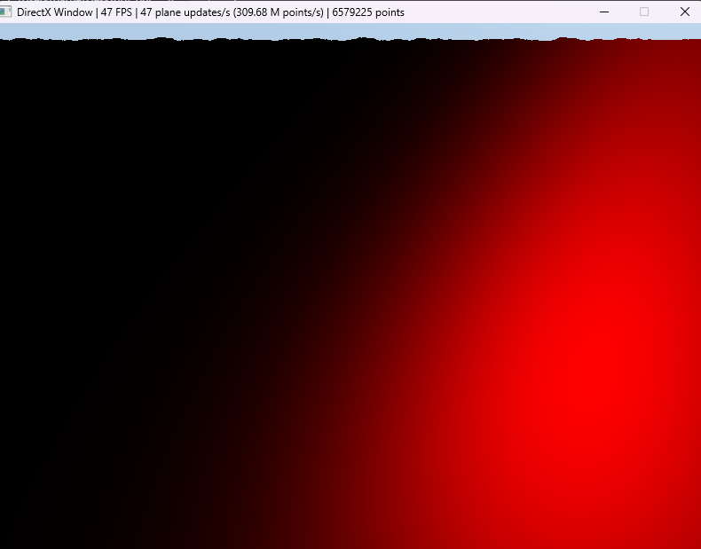
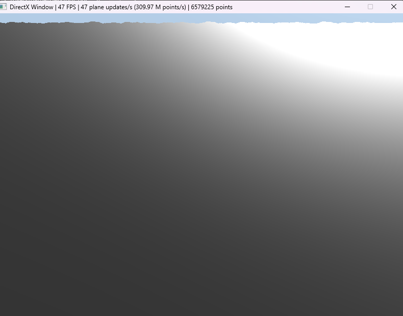
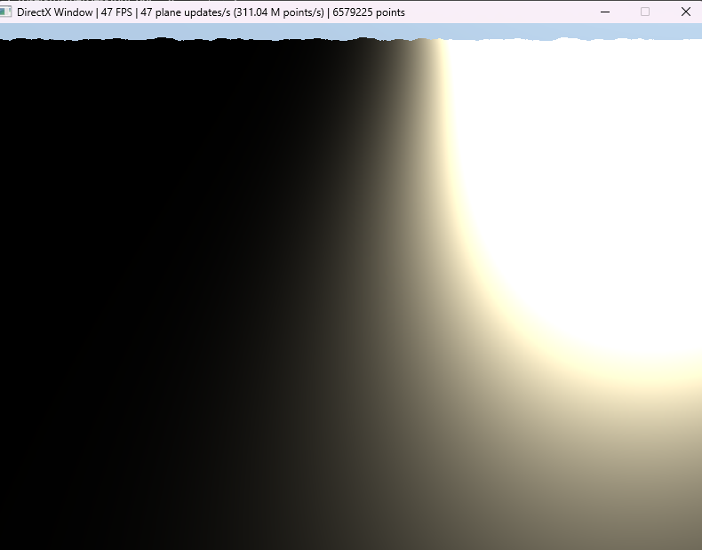
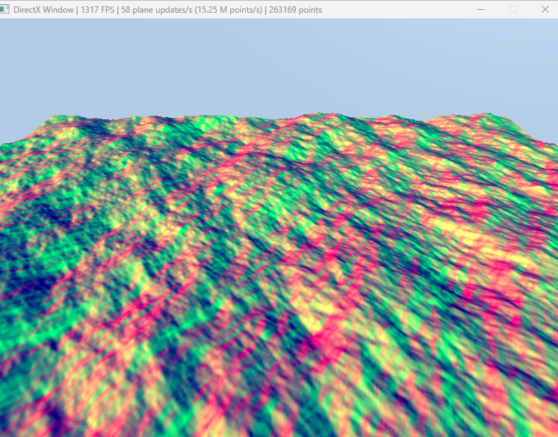
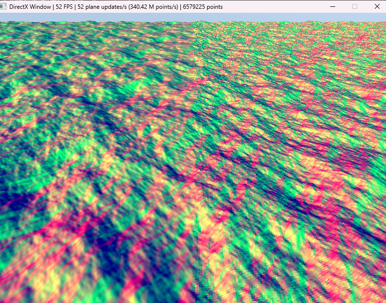
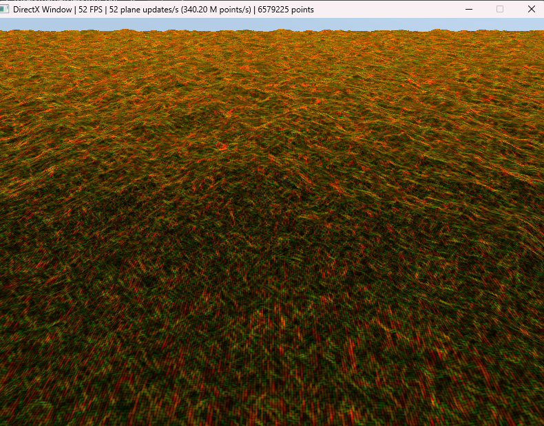
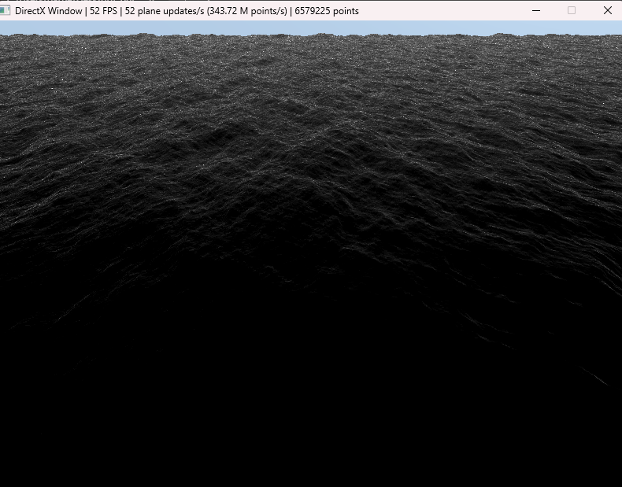
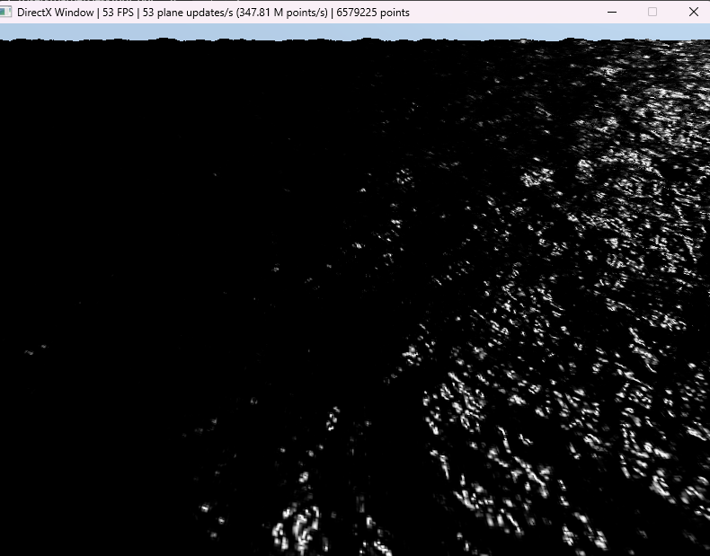

# Rendering the seas — tutoriel d'implémentation

Tutoriel basé sur la partie **« Rendering the seas »** (diapos 29 à 60) de la conférence GDC 2019 *« Wakes, Explosions and Lighting: Interactive Water Simulation in ATLAS »* (Mark Mihelich), à implémenter dans **Interactive Ocean Surface Simulation** (C++17, Direct3D 11).

> **État du document : lot 1 sur 3.** Ce lot contient les parties **0 à 5**. Le lot 2 (parties 6 à 11) et le lot 3 (parties 12, 13 et les annexes de fin : récapitulatif, paramètres de config, checklist de debug, lectures, suites) viendront après tes questions.

---

## Comment lire ce document

**Trois étiquettes** dans chaque partie :

- **(A)** : ce que fait la conférence.
- **(B)** : ce que *toi* tu dois adapter, parce que ton projet n'est pas celui d'ATLAS.
- **(C)** : amélioration optionnelle.

**Trois niveaux de confiance** pour chaque équation ou affirmation :

- ✅ **vérifié** : formule relue sur l'image de la diapo, ou test numérique, ou code compilé et exécuté.
- ⚠️ **reconstruit** : déduit de la littérature ou de mon calcul, absent de la diapo. Je le dis chaque fois.
- ❓ **non vérifié** : à contrôler par toi, avec l'endroit où regarder.

**Ce que j'ai réellement vérifié pour ce lot :**

1. Les diapos 29 à 60 ont été rendues en images, et chaque formule a été lue **visuellement**, pas à partir du texte extrait (qui est illisible).
2. Les propriétés de la partie 4 (normalisation de $P_{22}$ et de $D$, moyenne et covariance retrouvées) ont été testées numériquement avec un petit programme C++ (§4.5).
3. Le code des parties 3 et 5 a été compilé et exécuté sur une **copie** de ton projet (hors dépôt), avec ta configuration FFT (N = 512, 200 m, A = 5e-6, V = 10). Les captures `docs/figures/` viennent de là. Les valeurs chiffrées de la partie 5 ont été mesurées de la même façon, et recoupées avec un calcul CPU qui réutilise ton `fft.cpp`.
4. **Aucun fichier de ton projet n'a été modifié.** Seuls `docs/rendering-the-seas-tutorial.md` et `docs/figures/` ont été créés. Le code est dans ce document, c'est toi qui le tapes.

**Équations :** elles sont numérotées `(partie.numéro)` et suivies de la diapo d'origine quand elle existe. Exemple : « Éq. 4.2, diapo 34 ».

**Couleurs :** tout le calcul se fait en **espace linéaire**. La conversion vers l'écran est discutée en §0.6.

---

## Table des matières

| Partie | Titre | Diapos | Lot |
|---|---|---|---|
| [0](#partie-0--vue-densemble-et-feuille-de-route) | Vue d'ensemble et feuille de route | 29, 32, 55 | 1 |
| [1](#partie-1--la-mer-comme-surface-à-microfacettes) | La mer comme surface à microfacettes | 30–31 | 1 |
| [2](#partie-2--léquation-de-rendu-de-la-mer) | L'équation de rendu de la mer | 32 | 1 |
| [3](#partie-3--la-brdf-à-microfacettes) | La BRDF à microfacettes | 33 | 1 |
| [4](#partie-4--la-ndf-de-beckmann-et-les-moments-de-surface-leadr) | NDF de Beckmann et moments de surface (LEADR) | 34–36 | 1 |
| [5](#partie-5--calculer-et-sommer-les-moments-depuis-la-simulation) | Calculer et sommer les moments depuis la simulation | 37–39 | 1 |
| 6 | Réflexion spéculaire du soleil | 40–41 | 2 |
| 7 | Réflexion de l'environnement | 42–43 | 2 |
| 8 | Masquage et ombrage | 44–47 | 2 |
| 9 | Réflectance de Fresnel | 48–50 | 2 |
| 10 | Lumière diffusée (SSS truqué) | 51–54 | 2 |
| 11 | Assemblage final | 55 | 2 |
| 12 | Écume | 56–57 | 3 |
| 13 | Retouches finales (optionnelles) | 58–60 | 3 |

---

## Tableau de notation

La conférence mélange plusieurs notations, et **le même symbole $\omega_n$ désigne deux choses différentes** (diapos 34 et 40). Je fixe donc la mienne et je donne la correspondance.

| Mon symbole | Sens | Dans la conférence | Remarque |
|---|---|---|---|
| $\mathbf n$ | macronormale, ici toujours $(0,0,1)$ | $\omega_n$ (diapo 40), $\omega_g$ (diapo 34) | le repère $z$ vers le haut est celui de ton projet |
| $\mathbf m$ | micronormale (vecteur unitaire) | $\bar n$ (diapos 34–36) | |
| $\mathbf l$ | direction **vers** le soleil | $\omega_{sun}$, $\omega_i$ | = `sunDirection` (b1) |
| $\mathbf v$ | direction **vers** l'œil | $\omega_{eye}$, $\omega_o$ | = `normalize(cameraPosition − worldPosition)` |
| $\mathbf h$ | demi-vecteur $\dfrac{\mathbf l+\mathbf v}{\lVert\mathbf l+\mathbf v\rVert}$ | $\omega_h$ | |
| $\theta,\varphi$ | colatitude (angle avec $z$) et azimut | $\theta,\varphi$ | $\theta_i,\theta_o$ pour $\mathbf l,\mathbf v$ |
| $\mathbf s=(s_x,s_y)$ | **pente** : $s_x=\partial h/\partial x$ | $(x_{\bar n},y_{\bar n})$ | j'évite $x_{\bar n}$, qui ressemble à une coordonnée |
| $\boldsymbol\mu=E[\mathbf s]$ | pente moyenne dans l'empreinte du pixel | $E[x_{\bar n}],E[y_{\bar n}]$ | moment d'ordre 1 |
| $\delta_x^2,\delta_y^2,c_{xy}$ | variances et covariance des pentes | $\delta_x^2,\delta_y^2,c_{xy}$ | diapo 36 |
| $\Sigma$ | matrice de covariance des pentes | $\Sigma$ | |
| $\alpha_x,\alpha_y$ | rugosité de Beckmann | $\alpha_x,\alpha_y$ | **$\alpha^2=2\delta^2$**, la diapo ne le dit pas (§4) |
| $P_{22}(\mathbf s)$ | densité de probabilité des pentes | $P_{22}$, $p_{22}$ | ne pas confondre avec $D$ |
| $D(\mathbf m)$ | NDF : distribution des normales | $D$ | |
| $F,G,\Lambda$ | Fresnel, masquage, fonction de Smith | $F,G,\Lambda$ | |
| $L_{sun},L_{env},L_{scatter},L_{to\_eye}$ | luminances | idem | $L_{sun}$ est lu comme un *éclairement* (§2) |
| $E[\cdot]$ | moyenne sur l'empreinte du pixel | $E[\cdot]$ | |
| $\langle a,b\rangle$ | $\max(0,a\cdot b)$ | $\langle\omega_a,\omega_b\rangle$ | |
| $N,\Delta$ | taille de la grille FFT, taille d'une maille | `f.N`, `planeSize/N` | $\Delta=200/512=0{,}39\ \text{m}$ |

**Les axes de ton projet** (c'est la source de beaucoup de bugs) :

| Dans la FFT (`fft.cpp`, `fft_gpu.cpp`) | Dans le monde (`plane.cpp`, `vsMain`) |
|---|---|
| colonne `n`, `kx` | axe **x** |
| ligne `m`, **`kz`**, **`dz`** | axe **y** (et non z !) |
| `ht` (hauteur) | axe **z** (le haut) |

---

# Partie 0 — Vue d'ensemble et feuille de route

## 0.1 But et résultat à l'écran

À la fin du tutoriel, ton eau n'utilise plus « ambiant + Lambert + Blinn-Phong ». Elle est éclairée par un modèle **physique** : elle reflète le soleil et le ciel, devient miroir à l'horizon, prend une teinte verte quand le soleil est bas, et porte de l'écume sur les crêtes. Chaque partie ajoute un effet que tu peux **vérifier à l'écran** avant de passer à la suivante.

## 0.2 Le pipeline en un schéma

```
 SIMULATION (existe déjà)             MICRONORMALES (partie 5)               ÉCLAIRAGE (parties 6 à 11)
 ────────────────────────             ────────────────────────               ──────────────────────────
 h0 ─► csTimeEvo ─► iFFT              pentes sx, sy (différences finies)
        │  (ht, dx, dz)                      │
        │                                    ▼
        ├─► vsMain : déplace          moments par texel :                  Σ, μ ──► D  (Beckmann)  (partie 4)
        │   les sommets               E[s], E[s²], E[sx·sy]                 Λ   ──► G  (masquage)   (partie 8)
        │   (position, silhouette)           │ mips = moyennes 2×2         Fresnel ──► F            (partie 9)
        │                                    ▼                                 │
        └─► csMoments (nouveau) ─────► textures RGBA32F + mips ──────►  (1−F)·L_scatter            (partie 10)
                                       lues par le pixel shader          + L_sun·F·D·G/(4cosθo)    (partie 6)
                                                                         + F·L_env                  (partie 7)
                                                                         + écume (partie 12)
                                                                                │
                                                                                ▼
                                                                    conversion linéaire → écran (§0.6)
```

L'idée centrale de la conférence tient en une phrase : **le maillage ne sert qu'à la position (silhouette). Tout l'éclairage vient de statistiques sur les pentes, lues dans des textures, avec la macronormale $(0,0,1)$ comme repère.** Ton code actuel fait l'inverse : il déduit une normale du maillage lui-même (voir §1.4).

## 0.3 Ce que chaque partie ajoute à l'écran

| Partie | Ce que tu dois voir |
|---|---|
| 3 | Trois cartes lisses : la tache de $D$, la carte de $F$, une « route » de reflet du soleil sans vagues (fig. 3-1 à 3-3) |
| 5 | Des cartes de **pentes** en couleur, des cartes de **variance** qui croissent avec la distance, une carte de LOD (fig. 5-1 à 5-5) |
| 6 | La route de reflet est maintenant **structurée par les vagues** : des milliers de scintillements |
| 7 | Le ciel se reflète, flou, sans scintillement |
| 8 | L'horizon est moins brillant (le masquage retire de la lumière aux angles rasants) |
| 9 | L'eau est sombre quand on la regarde de haut, et **miroir** à l'horizon |
| 10 | La teinte verte/turquoise de l'eau, plus marquée quand le soleil est bas |
| 11 | L'image complète |
| 12 | De l'écume blanche sur les crêtes (il faut `lambda > 0`) |
| 13 | Disparition des « blocs carrés » dans les reflets proches (optionnel) |

Le **brouillard** de ta roadmap (« fog ») n'est **pas** dans les diapos 29–60 : il est hors périmètre de ce tutoriel.

## 0.4 Ordre de travail

1. Suis les parties dans l'ordre : chacune compile et se lance seule.
2. **Fais un `git commit` à chaque étape qui marche.** Ton dépôt est déjà sous git. Si une étape casse tout, tu reviens au dernier état connu.
3. Lis d'abord toute la partie (intuition → équation), puis tape le code. La conférence donne les formules, pas le code : les formules sont ✅, **le code est le mien** et il est testé sur ta config, mais c'est à toi de le comprendre.

## 0.5 Où en est ton code aujourd'hui (instantané vérifié)

| Élément | État actuel | Fichier : ligne |
|---|---|---|
| Axes | Z vers le haut, `sunDirection.z = sin(elev)` | `lighting.cpp:41`, `skybox.cpp:48` |
| Normale de l'eau | `cross(ddx(worldPosition), ddy(worldPosition))` : **une normale par triangle** | `directx.cpp:140` |
| Éclairage de l'eau | ambiant + Lambert + `pow(n·h, shininess)` | `directx.cpp:145–157` |
| Sorties de la FFT GPU | trois `StructuredBuffer<float2>` : `ht`, `dx`, `dz` | `fft_gpu.cpp:182` (`makeBuffer`), lus par `vsMain` en t0–t2 |
| **Textures, samplers, cubemap** | **aucun** dans le projet (seuls le back buffer et le depth buffer sont des textures) | recherche `Texture2D\|Sampler\|cubemap` vide |
| Ciel | dégradé zénith→horizon + disque et halo du soleil, calculé dans un autre shader | `skybox.cpp:11` (`SKY_SHADER`), `psSky` ligne 42 |
| Pixel shader | compilé en `ps_4_0` | `directx.cpp:272` |
| cbuffers du PS | b1 = soleil ; **b2 contient encore le cbuffer `Sky`** laissé par le ciel (le PS de l'eau ne le lit pas) | `lighting.cpp:58`, `skybox.cpp:138` |
| Back buffer | `R8G8B8A8_UNORM`, vue de rendu **non sRGB** | `directx.cpp:235` |
| `lambda` | `0` dans `config.json` (le code a `1.5` par défaut) | `config.json:76`, `config.hpp:29` |
| Bandes de fréquences | **une seule** bande FFT, spectre de Phillips ; pas de JONSWAP | `fft.cpp:51` |
| FFT non normalisée | pas de division par N² sur le GPU (le CPU divise par N puis multiplie par N·N dans `plane.cpp`) : les deux se valent | `fft_gpu.cpp`, `plane.cpp:98` |

Ton correctif de la ligne 72 de `fft_gpu.cpp` est bien en place (la ligne est un commentaire).

**Les trois obstacles à connaître d'avance** (chacun a sa solution minimale dans la partie 5) :

1. Le pixel shader ne reçoit **que** `worldPosition` : il n'a accès ni aux pentes ni à la FFT. → créer des **textures de moments** + un **sampler**.
2. Les sorties de la FFT sont des *buffers*, pas des textures : on ne peut pas les moyenner par mipmap. → un compute shader `csMoments` qui écrit des textures.
3. Rien dans le projet ne sait créer une texture ou un sampler. → ~60 lignes de C++, données en partie 5.

## 0.6 Espace colorimétrique : où faire la conversion linéaire → sRGB

**Principe.** Les calculs d'éclairage (additions de lumières, produits par $F$, etc.) n'ont de sens qu'en **linéaire**. L'écran attend de l'**sRGB** (à peu près $x^{1/2{,}2}$).

**Problème dans ton code.** Le back buffer est `UNORM` sans sRGB, et le ciel écrit ses couleurs directement. Toutes les couleurs de `config.json` (`sky`, `sun.color`, `plane.color`) sont aujourd'hui choisies « à l'œil », donc en réalité en espace d'affichage.

**Option recommandée (testée sur ton swap chain).** Créer la vue de rendu en `R8G8B8A8_UNORM_SRGB` : le matériel convertit alors **toute** écriture, eau et ciel. C'est un changement de quelques lignes à `directx.cpp:255` :

```cpp
D3D11_RENDER_TARGET_VIEW_DESC rtvDesc{};
rtvDesc.Format = DXGI_FORMAT_R8G8B8A8_UNORM_SRGB;
rtvDesc.ViewDimension = D3D11_RTV_DIMENSION_TEXTURE2D;
device->CreateRenderTargetView(backBuffer.Get(), &rtvDesc, &colorView);
```

J'ai vérifié que ça fonctionne (le swap chain garde son format `UNORM`) : tout devient nettement plus clair. **Conséquence importante** : le ciel, qui écrit des couleurs déjà « d'affichage », paraîtrait délavé. Il faudrait donc convertir les couleurs de config en linéaire au chargement (`pow(c, 2.2)`).

**Décision pour ce tutoriel :**

- **Parties 3 à 10 : ne change rien.** On reste sur le rendu actuel : les cartes de debug sont des *données* (des pentes, des variances), pas des couleurs, et elles ne doivent surtout **pas** passer par une conversion sRGB.
- **Partie 11 :** on bascule, avec la liste précise des couleurs à convertir.

**Pour l'instant**, garde en tête : *toute valeur affichée pendant les parties 3 à 10 est dans l'espace du back buffer, sans gamma.*

**Exposition.** Le soleil est des milliers de fois plus lumineux que le ciel ; ton rendu est limité à $[0,1]$. D'où `sunIntensity` utilisé comme un bouton d'exposition, et un tone mapping en partie 11.

---

# Partie 1 — La mer comme surface à microfacettes

*Diapos 30 à 31.*

## 1.1 But et résultat à l'écran

Comprendre **pourquoi** on ne peut pas simplement calculer une normale par pixel et lui appliquer Phong, et ce qu'est une « statistique de normales ». Pas de code à écrire ici, juste une expérience de 1 ligne (§1.6) pour *voir* le problème dans ton rendu actuel.

## 1.2 Intuition

Un pixel de l'écran couvre une portion de mer. Près de la caméra, cette portion est plus petite qu'une maille de ton maillage (0,39 m) : la surface est lisse à cette échelle et **une** normale suffit. Loin, la portion couvre des centaines de mailles, avec des vagues dans tous les sens.

Si tu éclaires ce pixel avec **une seule** normale (celle d'un triangle, ou la moyenne), tu rates l'essentiel : sur un pixel lointain, **certaines** microfacettes renvoient le soleil dans ton œil et d'autres non. Le pixel est la **moyenne** de ce qui vient de toutes ces facettes. C'est ce qui fait le scintillement de la mer au loin.

Moyenne des normales ≠ moyenne des éclairages. Exemple chiffré : deux facettes de pentes $+0{,}2$ et $-0{,}2$, un lobe de réflexion étroit $e^{-(s_h-s)^2/\alpha^2}$ avec $\alpha=0{,}1$, et un demi-vecteur de pente $s_h=0{,}2$.

- la facette $+0{,}2$ renvoie en plein dans l'œil : valeur $e^{0}=1$ ;
- la facette $-0{,}2$ est à $0{,}4$ du lobe : $e^{-16}\approx10^{-7}$ ;
- **moyenne des éclairages : $\approx 0{,}5$** ;
- éclairage de la normale moyenne (pente $0$) : $e^{-(0{,}2/0{,}1)^2}=e^{-4}\approx0{,}018$, soit **27 fois moins**.

La normale moyenne aurait « éteint » un pixel qui brille. C'est exactement ce que corrigent les moments (parties 4 et 5).

## 1.3 Les trois échelles

La conférence parle de *vagues*, *microfacettes* et *micronormales* (diapo 30). Pour ton projet, concrètement :

| Échelle | Taille | Représentée par |
|---|---|---|
| **Vagues portées par le maillage** | $\ge 2\Delta = 0{,}78$ m (longueur d'onde minimale d'une grille de pas $\Delta=0{,}39$ m : critère de Nyquist) | sommets déplacés par `vsMain` : silhouette, position |
| **Pentes de ces vagues, vues par le pixel** | de 1 texel à des centaines de texels | **textures de moments** (partie 5) |
| **Vagues plus petites qu'une maille** | $< 0{,}78$ m | **rien** dans ton projet aujourd'hui : on ajoutera une rugosité de base (§5.6) |

Le nombre d'onde maximal de ta grille est $k_{max}=\pi/\Delta\approx 8{,}04$ rad/m ✅ (calcul).

**Ce que fait la conférence (A).** $\omega_g$ est la *macronormale* ; elle vaut $(0,0,1)$ dans leur cas (diapo 40). L'éclairage se calcule donc **dans le repère du plan horizontal**, avec les pentes des vagues comme *distribution de micronormales* autour de cette verticale. Le maillage déplacé n'intervient pas dans l'éclairage.

## 1.4 Mapping sur ton code (B)

Ton `psMain` (`directx.cpp`, ligne ~140) calcule :

```hlsl
float3 normal = normalize(cross(ddx(input.worldPosition), ddy(input.worldPosition)));
```

C'est la normale du **triangle** (dérivées d'un quad 2×2 de pixels). Deux défauts visibles :

- **De près** : des facettes plates, des blocs. C'est l'aspect de la **diapo 31**, qui montre précisément cet artefact.
- **De loin** : un pixel couvre beaucoup de triangles, mais tu n'en lis qu'**un** : le résultat scintille d'une image à l'autre (aliasing temporel).

La figure 5-2 (§5.6, moitié droite) montre cette normale-par-triangle : on y voit les blocs.

## 1.5 Équation (hors diapo, ⚠️)

La luminance d'un pixel est la moyenne de la luminance sur son empreinte $A$ :

$$L_{pixel}=\frac1{|A|}\int_A L(\mathbf x)\,d\mathbf x \tag{1.1}$$

Toute la suite (distribution $D$, masquage $G$, Fresnel $F$) est la façon rigoureuse de **remplacer cette intégrale sur la surface par une intégrale sur les normales** présentes dans $A$. Ce passage n'est pas détaillé dans la conférence ; il vient de la théorie des microfacettes (Walter et al. 2007).

## 1.6 Vérifier le problème sur ton écran

Dans `psMain`, juste avant le `return` final, ajoute **temporairement** :

```hlsl
return float4(normal * 0.5 + 0.5, 1.0);
```

Lance la simulation, avance la caméra vers l'horizon. **Ce que tu dois voir** : de près des facettes plates, de loin un grésillement qui change à chaque image. Retire la ligne ensuite.

## 1.7 Exercices

1. Pourquoi la normale moyenne éteint-elle un reflet que la moyenne des éclairages conserve ? (réponse chiffrée attendue)
2. Calcule la longueur d'onde minimale représentée par ta grille N = 512 sur 200 m.
3. Dans ton code actuel, quelles données du maillage sont utilisées pour l'éclairage ? Quelles données seront utilisées à la fin du tutoriel ?

*(Réponses en annexe A.)*

---

# Partie 2 — L'équation de rendu de la mer

*Diapo 32 (et un aperçu de la diapo 55).*

## 2.1 But et résultat à l'écran

Poser l'équation qui organise tout le reste, définir **chaque symbole**, et décider ce qu'on peut ignorer au début. Aucun changement visuel ; en revanche tu prendras une **capture de référence** de ton rendu actuel (§2.6), car on la comparera plusieurs fois.

## 2.2 Intuition

Ce que ton œil reçoit d'un point de l'eau vient de trois sources :

1. **la lumière qui entre dans l'eau, y est diffusée, et ressort** : $L_{scatter}$, qui donne la couleur propre de l'eau (bleu-vert) ;
2. **le reflet du soleil** : une source très petite et très forte ;
3. **le reflet du reste du ciel** : une source étendue et faible.

Le soleil et le ciel se traitent **séparément** parce que leurs intégrales se calculent de façons très différentes : l'une est analytique (parties 4 et 6), l'autre est une somme d'échantillons (partie 7).

## 2.3 L'équation

Diapo 32 ✅ (lue sur l'image) :

$$L_{to\_eye}=L_{scatter}+\int_\Omega L_{sun}\,f_r\cos\theta\,d\omega+\int_\Omega L_{env}\,f_r\cos\theta\,d\omega \tag{2.1}$$

| Symbole | Sens | Unités / plage | Dans ton code |
|---|---|---|---|
| $L_{to\_eye}$ | luminance qui part du point vers l'œil | W·m⁻²·sr⁻¹ (ici : arbitraire, linéaire) | la couleur renvoyée par `psMain` |
| $\Omega$ | demi-sphère au-dessus de la surface | — | — |
| $\omega$ | direction d'où vient la lumière | vecteur unitaire | — |
| $\theta$ | angle entre $\omega$ et $\mathbf n$ ; $\cos\theta=\omega\cdot\mathbf n$ | $[0,\pi/2]$ | — |
| $f_r$ | **BRDF** : « quelle fraction de la lumière venant de $\omega$ part vers l'œil » | sr⁻¹ | partie 3 |
| $L_{sun}$ | luminance du soleil | | `sunColor * sunIntensity` |
| $L_{env}$ | luminance du ciel (hors soleil) | | partie 7 |
| $L_{scatter}$ | lumière diffusée dans l'eau | | partie 10 |

**Définitions.** La *luminance* (radiance) est l'énergie par unité de surface perpendiculaire et par angle solide ; c'est ce qu'un pixel mesure. La BRDF $f_r(\mathbf l,\mathbf v)$ relie une luminance entrante à une luminance sortante. Le facteur $\cos\theta$ vient de ce qu'une surface inclinée reçoit moins d'énergie par unité d'aire.

## 2.4 Le soleil est (presque) une source ponctuelle

Le soleil couvre un angle solide minuscule : rayon angulaire $\approx 4{,}65\cdot10^{-3}$ rad, soit $\Omega_{sun}=\pi r^2\approx 6{,}8\cdot10^{-5}$ sr ✅ (calcul). Sur un si petit angle, $f_r\cos\theta$ est constant, donc

$$\int_\Omega L_{sun}\,f_r\cos\theta\,d\omega\;\approx\;E_{sun}\,f_r(\mathbf l,\mathbf v)\cos\theta_i,\qquad E_{sun}=L_{sun}\,\Omega_{sun} \tag{2.2}$$

$E_{sun}$ est l'**éclairement** (W/m²) sur une surface perpendiculaire aux rayons.

**Ce que la diapo ne dit pas ⚠️.** À la diapo 40, la formule finale contient « $L_{sun}$ » sans le facteur $\Omega_{sun}$. Je lis donc, dans la suite, $L_{sun}$ comme **un éclairement $E_{sun}$**, c'est-à-dire un nombre que tu règles (`sunColor × sunIntensity`). C'est la seule lecture cohérente avec les unités. À contrôler dans la conférence (vidéo GDC Vault) si tu veux être sûr.

## 2.5 Aperçu de la formule finale (diapo 55)

Diapo 55 ✅ :

$$L_{to\_eye}=(1-F)\,L_{scatter}+\int_\Omega L_{sun}+F\int_\Omega L_{env} \tag{2.3}$$

- « $\int_\Omega L_{sun}$ » est une abréviation de l'intégrale (2.1) du soleil, **avec $F$ déjà dedans** (c'est pourquoi aucun $F$ ne s'y ajoute : la diapo le précise).
- Le Fresnel $F$ multiplie le ciel (l'eau le reflète d'autant plus qu'on la voit rasante) et **retire** la même part à la lumière diffusée : $(1-F)$. L'énergie se conserve.

**Que peux-tu ignorer au début ?**

| Terme | Premier jet | Quand l'ajouter |
|---|---|---|
| $L_{scatter}$ | 0 | partie 10 |
| $G$ (masquage) | 1 | partie 8 |
| $L_{env}$ | un ciel de couleur constante | partie 7 |
| $F$ | constante $0{,}0201$ | partie 9 |
| écume | 0 | partie 12 |

## 2.6 Mapping sur ton code (B)

Ton `psMain` fait : `color = input.color * (ambient + diffuse * sunLight) + specular * sunLight`. Voici ce qui devient quoi :

| Aujourd'hui | Devient | Où |
|---|---|---|
| `specular = pow(n·h, shininess)` | le lobe $D$ de Beckmann (physique) | parties 3, 4, 6 |
| `diffuse = saturate(n·l)` (Lambert) | **disparaît** : l'eau n'a pas de diffus. Sa couleur propre est $L_{scatter}$ | partie 10 |
| `ambient` | remplacé par la réflexion du ciel $F\int L_{env}$ | parties 7 et 9 |
| `input.color` (config `plane.color`) | devient la couleur de diffusion $C_{ss}$ | partie 10 |
| `sunColor * sunIntensity` | $L_{sun}$ (lu comme éclairement) | partie 6 |
| `cameraPosition` (b1) | donne $\mathbf v$ | partie 3 |

**Capture de référence.** Avant de continuer, lance ton rendu actuel (`selectedmethod: "fft"`, `process: "gpu"`) et fais une capture d'écran, caméra au même endroit. Les diapos 41, 43, 46 et 50 comparent « simple » et « PBR » : tu feras la même comparaison.

## 2.7 Exercices

1. Quelle est l'unité de $f_r$ si $L$ est en W·m⁻²·sr⁻¹ ?
2. Pourquoi la formule (2.3) contient-elle $(1-F)$ devant $L_{scatter}$ ?
3. Pourquoi peut-on traiter le soleil comme une source ponctuelle, et pas le ciel ?

*(Réponses en annexe A.)*

---

# Partie 3 — La BRDF à microfacettes

*Diapo 33.*

## 3.1 But et résultat à l'écran

Comprendre $f_r=\dfrac{F\,D\,G}{4\cos\theta_i\cos\theta_o}$ facteur par facteur, et la voir fonctionner **avant** d'avoir les textures : avec une rugosité *constante* et la macronormale $(0,0,1)$, tu obtiens trois cartes lisses, dont une « route de reflet du soleil » sans vagues (fig. 3-1 à 3-3). Les vagues arrivent en partie 5.

## 3.2 Intuition

Imagine la surface comme une mosaïque de **minuscules miroirs plats** (les microfacettes), chacun orienté selon sa micronormale $\mathbf m$. Pour qu'un rayon venant du soleil ($\mathbf l$) arrive dans ton œil ($\mathbf v$), la loi du miroir impose que la facette soit orientée **exactement à mi-chemin** : $\mathbf m=\mathbf h$. Donc :

- **$D(\mathbf h)$** : combien de facettes (par unité de surface) ont cette orientation ? C'est la *distribution de normales*.
- **$F$** : quelle fraction de la lumière un miroir d'eau renvoie-t-il (le reste entre dans l'eau) ? C'est Fresnel.
- **$G$** : parmi ces facettes, quelle fraction est réellement **éclairée et visible** (pas cachée derrière une autre vague) ? C'est le masquage/ombrage.
- **$1/(4\cos\theta_i\cos\theta_o)$** : un facteur géométrique de changement de variable.

## 3.3 L'équation

Diapo 33 ✅ :

$$f_r(\mathbf l,\mathbf v)=\frac{F\cdot D\cdot G}{4\cdot\cos\theta_i\cdot\cos\theta_o} \tag{3.1}$$

| Symbole | Sens | Plage | Dans ton code |
|---|---|---|---|
| $F$ | réflectance de Fresnel | $[0,1]$, $\approx0{,}02$ à incidence normale pour l'eau | partie 9 |
| $D$ | NDF (normales par unité d'aire, normalisée par aire projetée) | $\ge0$, sr⁻¹ | parties 4–5 |
| $G$ | masquage-ombrage | $[0,1]$ | partie 8 |
| $\theta_i$ | angle entre $\mathbf l$ et $\mathbf n$ ; $\cos\theta_i=l_z$ | | `sunDirection.z` |
| $\theta_o$ | angle entre $\mathbf v$ et $\mathbf n$ ; $\cos\theta_o=v_z$ | | `v.z` |

## 3.4 Justification de la forme (la diapo ne la donne pas ⚠️)

Voici pourquoi le 4 et les deux cosinus apparaissent (Walter et al. 2007, §5.2 ; calcul à refaire une fois sur papier).

On éclaire une aire macroscopique $dA$ depuis un petit angle solide $d\omega_i$ avec la luminance $L_i$ : le flux incident est $L_i\cos\theta_i\,d\omega_i\,dA$.

1. L'aire de microfacettes dont la normale est dans $d\omega_h$ est $D(\mathbf h)\,d\omega_h\,dA$ (c'est la définition de $D$).
2. Le flux qu'elles interceptent est $L_i\,d\omega_i\,(\mathbf l\cdot\mathbf h)\,D\,d\omega_h\,dA$.
3. Elles en réfléchissent la fraction $F$ (en ignorant $G$ pour l'instant).
4. La loi du miroir donne $d\omega_o=4\,(\mathbf v\cdot\mathbf h)\,d\omega_h$. Comme $\mathbf l\cdot\mathbf h=\mathbf v\cdot\mathbf h$, on obtient $d\omega_h=d\omega_o/\big(4(\mathbf l\cdot\mathbf h)\big)$.
5. La luminance sortante est (flux réfléchi) / ($\cos\theta_o\,d\omega_o\,dA$) $=L_i\,d\omega_i\,\dfrac{F\,D}{4\cos\theta_o}$.
6. Et $f_r=L_o/(L_i\cos\theta_i\,d\omega_i)=\dfrac{F\,D}{4\cos\theta_i\cos\theta_o}$. On multiplie par $G$ pour retirer les facettes cachées. $\square$

**Conséquence qui sert tout de suite.** Combinée à (2.2), cette forme *simplifie* le terme du soleil : le $\cos\theta_i$ de l'équation de rendu annule celui du dénominateur :

$$\int_\Omega L_{sun}\,f_r\cos\theta\,d\omega\;=\;\frac{L_{sun}\,F\,D\,G}{4\cos\theta_o} \tag{3.2}$$

C'est (au remplacement près de $D$ par $p_{22}$ et de $G$ par $1/(1+\Lambda_i+\Lambda_o)$) la formule de la **diapo 40** ✅, que tu implémenteras en partie 6.

## 3.5 Mapping sur ton code (B)

- $\mathbf l$ = `normalize(sunDirection)` (cbuffer `Lighting`, b1) ; $\mathbf v$ = `normalize(cameraPosition − worldPosition)` ; $\mathbf n=(0,0,1)$.
- L'ancien `pow(n·h, shininess)` est un lobe « de Blinn-Phong ». La correspondance classique avec Beckmann est $\alpha^2\approx 2/(s+2)$ (⚠️ de mémoire, à vérifier dans Walter 2007) : pour `shininess = 64`, $\alpha\approx0{,}17$. Cela te donne un ordre de grandeur pour comparer.

## 3.6 Implémentation (B)

**Étape 3.1 : les fonctions.** Dans `SHADER_SOURCE` (`directx.cpp`), juste **avant** `float4 psMain`, colle :

```hlsl
    static const float PI = 3.14159265358979;
    static const float WATER_R = 0.0201;      // ((η − 1) / (η + 1))² avec η = 1,33 (diapo 49)
    static const float ROUGH_TEST = 0.3;      // rugosité de Beckmann constante, pour les tests de cette partie

    #define DEBUG_VIEW 1   // 0 = rendu d'origine ; 1 = D ; 2 = F ; 3 = reflet du soleil (rugosité constante)

    // Beckmann isotrope, h unitaire, macronormale (0,0,1) : D = exp(−tan²θ / a²) / (π a² cos⁴θ)
    // (cette forme est justifiée en partie 4)
    float beckmannD(float3 h, float a) {
        float cos2 = h.z * h.z;
        float tan2 = (1.0 - cos2) / cos2;
        return exp(-tan2 / (a * a)) / (PI * a * a * cos2 * cos2);
    }

    // Schlick simple : F = R + (1 − R)(1 − cosθ)^5 (la version « eau » de la conférence est en partie 9)
    float schlickSimple(float cosTheta) {
        return WATER_R + (1.0 - WATER_R) * pow(1.0 - saturate(cosTheta), 5.0);
    }
```

**Étape 3.2 : les trois vues de debug.** Dans `psMain`, juste **après** le bloc qui retourne la normale vers le haut (`if (normal.z < 0.0) {...}`), colle :

```hlsl
        // Les trois directions de la BRDF
        float3 l = normalize(sunDirection);
        float3 v = normalize(cameraPosition - input.worldPosition);
        float3 h = normalize(l + v);

        if (DEBUG_VIEW == 1) {                       // D seul : vaut 1 au centre du lobe
            float D = beckmannD(h, ROUGH_TEST);
            return float4(D * PI * ROUGH_TEST * ROUGH_TEST, 0.0, 0.0, 1.0);
        }
        if (DEBUG_VIEW == 2) {                       // F seul, sur l'angle entre v et h (×10 pour le voir)
            float F = schlickSimple(dot(v, h));
            return float4(F * 10.0, F * 10.0, F * 10.0, 1.0);
        }
        if (DEBUG_VIEW == 3) {                       // reflet du soleil : F·D / (4 cosθo), G = 1
            float D = beckmannD(h, ROUGH_TEST);
            float F = schlickSimple(dot(v, h));
            float3 glint = sunColor * sunIntensity * F * D / (4.0 * max(v.z, 1e-3));
            return float4(saturate(glint * 20.0), 1.0);
        }
```

Change `DEBUG_VIEW` à 1, 2 puis 3, recompile (`make`), relance. (Les variables `l`, `v`, `h` ne portent pas les mêmes noms que celles du reste de ton `psMain` (`toSun`, `toCamera`, `halfway`) : il n'y a pas de conflit.)

## 3.7 Vérifier que ça marche

Avec `selectedmethod: "fft"` en GPU et la caméra de départ (fig. 3-1 à 3-3 : 25 chunks, soleil à l'azimut 30°, donc à droite) :

| Vue | Ce que tu dois voir |
|---|---|
| **1 : $D$** | une tache **rouge**, maximale (rouge pur, valeur 1) vers le bas à droite, qui s'éteint progressivement vers le noir à gauche. Toute la surface est lisse : **aucune vague** n'apparaît, normal, la normale est $(0,0,1)$ partout |
| **2 : $F\times10$** | gris foncé ($\approx0{,}2$, donc $F\approx0{,}02$) en bas, qui monte jusqu'au blanc vers l'horizon, côté droit (angles rasants : $F\to1$) |
| **3 : reflet** | une **route de reflet** lisse, qui s'étale du blanc (droite) au noir (gauche) |


*Fig. 3-1 : $D$ seul (rugosité 0,3, normale verticale).*


*Fig. 3-2 : $F\times10$.*


*Fig. 3-3 : reflet du soleil à rugosité constante, sans vagues.*

La **position** de la tache suit le soleil : change `sun.azimuth` dans `config.json` et la route se déplace. Change `ROUGH_TEST` : plus il est petit, plus la tache est étroite et intense.

**Bugs typiques :**

- **`h` non normalisé** : la tache devient gigantesque ou disparaît.
- **$\cos\theta$ nul ou négatif** (`h.z ≤ 0`, ou `v.z ≤ 0` si la caméra passe sous une crête) : $D$ explose. J'ai mis `max(v.z, 1e-3)` ; garde cette précaution.
- **Fresnel calculé avec `n·l`** : ici l'angle pertinent est celui entre $\mathbf v$ et $\mathbf h$ (c'est $F(\omega_h,\omega_{sun})$ de la diapo 40), pas celui avec la macronormale.
- **Tout est noir en vue 3** : le facteur $F\approx0{,}02$ rend le reflet faible avec `sunIntensity = 1`. Le `×20` du code compense ; sinon augmente `sunIntensity`.
- **Confusion gamma** : ces valeurs sont affichées *brutes*, sans conversion sRGB (voir §0.6).

## 3.8 Exercices

1. Dans la dérivation (§3.4), d'où vient le facteur 4 ?
2. Pour un miroir parfait de rugosité très petite, que devient $D(\mathbf h)$ quand $\mathbf h=\mathbf n$ ?
3. Pourquoi, à incidence quasi normale, le reflet du soleil est-il si faible avec $F\approx0{,}02$ ?

---

# Partie 4 — La NDF de Beckmann et les moments de surface (LEADR)

*Diapos 34 à 36.*

## 4.1 But et résultat à l'écran

Dériver la distribution $D$ à partir d'une **gaussienne sur les pentes**, l'écrire avec **moyennes et variances**, et comprendre pourquoi cette écriture permet de **filtrer** correctement une carte de normales à distance. Cette partie se vérifie d'abord par un **petit programme C++ numérique** (§4.5). La vérification à l'écran vient en §5.7, quand les textures existeront.

## 4.2 Intuition

Pour la mer, la forme des vagues est « aléatoire ». On ne cherche pas la normale exacte en un point, mais **la probabilité** qu'une facette de normale donnée se trouve dans le pixel. Si les pentes des vagues sont réparties en cloche (gaussienne) :

- le **centre** de la cloche est la pente moyenne $\boldsymbol\mu$ (la pente moyenne des vagues dans le pixel, souvent 0 sur toute la mer, mais pas dans un pixel particulier) ;
- la **largeur** est la rugosité : une mer calme a une cloche étroite, une mer agitée une cloche large.

Une gaussienne est décrite *complètement* par sa moyenne et sa covariance. Or la moyenne des pentes et la moyenne des **carrés** des pentes sont des opérations **linéaires** (des moyennes) : on peut les calculer par **mipmap**. Voilà le tour de passe-passe de LEADR : on stocke des moyennes, le GPU les moyenne gratuitement à distance, et on reconstruit la gaussienne par pixel.

## 4.3 Les équations

Diapo 34 ✅ (Beckmann) :

$$D(\omega_n)=\frac{P_{22}(\bar n)}{(\omega_n\cdot\omega_g)^4} \tag{4.1}$$

$$P_{22}(\bar n)=\frac{1}{\pi\,\alpha_x\alpha_y}\exp\!\Big(-\frac{x_{\bar n}^2}{\alpha_x^2}-\frac{y_{\bar n}^2}{\alpha_y^2}\Big) \tag{4.2}$$

Diapo 36 ✅ (LEADR : la même chose avec moments) :

$$P_{22}(\bar n)=\frac{1}{2\pi\sqrt{|\Sigma|}}\exp\!\Big(-\tfrac12(\bar n-E[\bar n])^{t}\,\Sigma^{-1}(\bar n-E[\bar n])\Big),\qquad \Sigma=\begin{pmatrix}\delta_x^2&c_{xy}\\ c_{xy}&\delta_y^2\end{pmatrix} \tag{4.3}$$

$$\delta_x^2=E[x_{\bar n}^2]-E^2[x_{\bar n}],\quad \delta_y^2=E[y_{\bar n}^2]-E^2[y_{\bar n}],\quad c_{xy}=E[x_{\bar n}y_{\bar n}]-E[x_{\bar n}]E[y_{\bar n}] \tag{4.4}$$

Avec ma notation ($\mathbf s$ pour la pente, $\boldsymbol\mu=E[\mathbf s]$, $\mathbf m$ pour la micronormale), je les écrirai :

$$P_{22}(\mathbf s)=\frac{1}{2\pi\sqrt{|\Sigma|}}\exp\!\Big(-\tfrac12(\mathbf s-\boldsymbol\mu)^{T}\Sigma^{-1}(\mathbf s-\boldsymbol\mu)\Big),\qquad \Sigma^{-1}=\frac1{|\Sigma|}\begin{pmatrix}\delta_y^2&-c_{xy}\\-c_{xy}&\delta_x^2\end{pmatrix} \tag{4.3'}$$

Et deux relations qui **ne sont pas** sur les diapos (⚠️, démontrées en §4.4) :

$$\alpha_x^2=2\,\delta_x^2,\qquad \alpha_y^2=2\,\delta_y^2 \tag{4.5}$$

$$\mathbf s(\mathbf m)=\Big(-\frac{m_x}{m_z},\,-\frac{m_y}{m_z}\Big),\qquad D(\mathbf m)=\frac{P_{22}\big(\mathbf s(\mathbf m)\big)}{m_z^4},\qquad \int_{\Omega}D(\mathbf m)\cos\theta_m\,d\omega_m=1 \tag{4.6}$$

| Symbole | Sens | Unités / plage | D'où ça vient dans ton code |
|---|---|---|---|
| $\mathbf s=(s_x,s_y)$ | pente $\partial h/\partial x$, $\partial h/\partial y$ | sans unité ($\tan$ de l'angle) | texture de moments (partie 5) |
| $\boldsymbol\mu$ | moyenne des pentes dans l'empreinte | $\sim\pm0{,}2$ | `momentsA.xy` |
| $\delta_x^2,\delta_y^2,c_{xy}$ | variances / covariance | $\ge0$ | `momentsB.xy − μ²`, `momentsB.z − μx·μy` |
| $\alpha_x,\alpha_y$ | rugosité (Beckmann) | $\sim0{,}1$–$0{,}4$ | $\sqrt{2\delta^2}$ |
| $P_{22}$ | densité de probabilité des pentes | sans unité de normale ; $\int P_{22}\,d\mathbf s=1$ | à coder, §4.6 |
| $D$ | NDF | sr⁻¹ | $P_{22}/h_z^4$ |

## 4.4 Dérivations et justifications

**(a) Pourquoi $D=P_{22}/\cos^4\theta$.** Une normale $\mathbf m=(\sin\theta\cos\varphi,\sin\theta\sin\varphi,\cos\theta)$ correspond à la pente $\mathbf s=-\tan\theta\,(\cos\varphi,\sin\varphi)$. L'élément d'aire du plan des pentes est

$$d\mathbf s=|\mathbf s|\,d|\mathbf s|\,d\varphi=\tan\theta\,\sec^2\theta\,d\theta\,d\varphi=\frac{\sin\theta\,d\theta\,d\varphi}{\cos^3\theta}=\frac{d\omega}{\cos^3\theta}.$$

Comme $\int P_{22}\,d\mathbf s=1$, on a $\int \dfrac{P_{22}}{\cos^3\theta}\,d\omega=1$, soit $\int\dfrac{P_{22}}{\cos^4\theta}\,\cos\theta\,d\omega=1$. La convention de la théorie des microfacettes est que $D$ est normalisée par l'**aire projetée** ($\int D\cos\theta\,d\omega=1$) ; donc $D=P_{22}/\cos^4\theta$. ✅ (vérifié numériquement en §4.5 : l'intégrale vaut $1{,}00000$).

**(b) Pourquoi $\alpha^2=2\delta^2$.** Prends (4.3) avec $\Sigma=\mathrm{diag}(\delta_x^2,\delta_y^2)$ et $c_{xy}=0$ : $\dfrac1{2\pi\delta_x\delta_y}\exp\!\big(-\dfrac{x^2}{2\delta_x^2}-\dfrac{y^2}{2\delta_y^2}\big)$. Compare à (4.2) : $\alpha_x^2=2\delta_x^2$, et le préfacteur $\dfrac1{\pi\alpha_x\alpha_y}=\dfrac1{2\pi\delta_x\delta_y}$ est identique ✅. Contrôle numérique : pour $\alpha=0{,}1$, les deux valent $31{,}8310$.

**(c) Pourquoi des moments, et pourquoi pas la variance directement.** Choisis un point au hasard dans l'empreinte du pixel : sa pente $\mathbf S$ est un vecteur aléatoire. Les moments $E[\mathbf S]$, $E[S_x^2]$, $E[S_xS_y]$ sont des **moyennes sur les texels** : opérateurs linéaires, donc commutables avec le mipmapping (qui est une moyenne). La **variance**, elle, n'est pas linéaire. Exemple chiffré ✅ : deux texels de pentes $+0{,}2$ et $-0{,}2$.

| | texel 1 | texel 2 | moyenne (mip) | calcul correct |
|---|---|---|---|---|
| $s$ | $0{,}2$ | $-0{,}2$ | $E[s]=0$ | |
| $s^2$ | $0{,}04$ | $0{,}04$ | $E[s^2]=0{,}04$ | $\delta^2=0{,}04-0=\mathbf{0{,}04}$ |
| variance du texel | $0$ | $0$ | **moyenne des variances $=0$** | faux : $0\ne0{,}04$ |

On stocke $E[s]$ et $E[s^2]$ ; la variance se reconstruit **après** le filtrage. (Dans cet exemple, mipmapper la variance donnerait une mer parfaitement lisse, sans reflets.)

**(d) L'hypothèse gaussienne : ce que la diapo saute ⚠️.** Les vagues linéaires de ton modèle (somme de nombreuses sinusoïdes indépendantes, spectre de Phillips) donnent, sur toute la mer, des pentes à peu près gaussiennes (c'est aussi ce qu'ont mesuré Cox et Munk en 1954 ❓ à vérifier). Mais la distribution **dans un petit pixel** n'est pas gaussienne (une seule vague donne une loi de type arcsinus). LEADR remplace cette distribution réelle par la gaussienne de **mêmes moyenne et covariance**, parce que c'est la seule qui se filtre linéairement. C'est une approximation, pas une identité.

**(e) Le « $(\omega_n\cdot\omega_g)^4=1$ » de la diapo 34 ❓.** La diapo écrit « on pose $(\omega_n\cdot\omega_g)^4=1$ : $\omega_n$ (mesonormale) égale $\omega_g$ (macronormale) ». Je ne suis pas certain de lire le sens exact (le texte de la diapo parle de la mésonormale ; l'article LEADR de Dupuy et al. 2013, à consulter, le dit mieux). Ce que je **peux** affirmer :

- la formule (4.6) est celle qui normalise $D$ ✅ ; sans le facteur $1/\cos^4$, l'intégrale $\int D\cos\theta\,d\omega$ vaut $0{,}848$ au lieu de $1$ (test §4.5, $\alpha=(0{,}2;0{,}4)$) ;
- le facteur $1/\cos^4\theta_h$ vaut ✅ :

| $\theta_h$ | 5° | 10° | 20° | 30° | 45° |
|---|---|---|---|---|---|
| $1/\cos^4\theta_h$ | 1,015 | 1,063 | 1,282 | 1,778 | 4,000 |

- dans la zone de reflet du soleil, $\mathbf h$ est proche de la verticale. Exemple (calcul à la main) : soleil à 35°, caméra à 20° au-dessus de l'horizon, face au soleil : $\theta_h\approx7{,}5^\circ$, facteur $\approx1{,}035$. La différence est donc **petite** dans le cas qui compte.

**Je te fais donc coder la version avec $1/\cos^4$** (la version correcte), et tu pourras la désactiver pour comparer avec la diapo.

**(f) Le rôle de $E[\mathbf s]$.** Dans (4.3), la cloche est centrée en $\boldsymbol\mu$, pas en 0 : les facettes du pixel sont globalement inclinées. Le lobe de reflet se déplace donc avec la pente moyenne : c'est ce qui rend les vagues **visibles** dans l'éclairage, alors que la macronormale reste $(0,0,1)$.

## 4.5 Vérifier que ça marche : un test numérique (hors projet)

Crée un fichier **en dehors de ton projet** (par exemple `C:\Users\barbe\Desktop\scratch\check_beckmann.cpp`) :

```cpp
// Vérifie : (1) ∫P22 ds = 1, et moyenne / covariance retrouvées
//           (2) ∫ D(m) cosθ dω = 1 sur l'hémisphère, avec et sans le facteur 1/cos^4
#include <cmath>
#include <cstdio>
#include <initializer_list>
const double PI = 3.14159265358979323846;

struct Gauss { double mx, my, vx, vy, cxy; };

double P22(double sx, double sy, const Gauss& g) {
    double det = g.vx * g.vy - g.cxy * g.cxy;
    double dx = sx - g.mx, dy = sy - g.my;
    double q = (g.vy * dx * dx - 2.0 * g.cxy * dx * dy + g.vx * dy * dy) / det;
    return std::exp(-0.5 * q) / (2.0 * PI * std::sqrt(det));
}

int main() {
    Gauss g{0.05, -0.02, 0.02, 0.03, 0.01};
    const int M = 3000; const double S = 2.0, ds = 2.0 * S / M;
    double I = 0, Ex = 0, Ey = 0, Exx = 0, Eyy = 0, Exy = 0;
    for (int i = 0; i < M; i++) for (int j = 0; j < M; j++) {
        double sx = -S + (i + 0.5) * ds, sy = -S + (j + 0.5) * ds;
        double p = P22(sx, sy, g) * ds * ds;
        I += p; Ex += p * sx; Ey += p * sy; Exx += p * sx * sx; Eyy += p * sy * sy; Exy += p * sx * sy;
    }
    std::printf("P22: integrale=%.6f  E[sx]=%.5f E[sy]=%.5f  var x=%.5f var y=%.5f cov=%.5f\n",
                I, Ex, Ey, Exx - Ex * Ex, Eyy - Ey * Ey, Exy - Ex * Ey);

    Gauss b{0, 0, 0.5 * 0.2 * 0.2, 0.5 * 0.4 * 0.4, 0};   // Beckmann ax=0.2, ay=0.4, donc delta² = alpha²/2
    double N1 = 0, N2 = 0; const int T = 20000, F = 720;
    for (int it = 0; it < T; it++) {
        double th = (it + 0.5) * (PI / 2.0) / T, dth = (PI / 2.0) / T;
        for (int ip = 0; ip < F; ip++) {
            double ph = (ip + 0.5) * 2.0 * PI / F, dph = 2.0 * PI / F;
            double mx = std::sin(th) * std::cos(ph), my = std::sin(th) * std::sin(ph), mz = std::cos(th);
            double sx = -mx / mz, sy = -my / mz;
            double dw = std::sin(th) * dth * dph;
            N1 += P22(sx, sy, b) / (mz * mz * mz * mz) * mz * dw;   // D = P22 / cos^4
            N2 += P22(sx, sy, b) * mz * dw;                        // sans le facteur 1/cos^4
        }
    }
    std::printf("avec 1/cos^4 : int D cos dw = %.5f (attendu 1)\n", N1);
    std::printf("sans 1/cos^4 : int D cos dw = %.5f\n", N2);
    return 0;
}
```

Compile et lance : `g++ -O2 -std=c++17 check_beckmann.cpp -o check_beckmann.exe && ./check_beckmann.exe`. **Sortie obtenue (✅ testée) :**

```
P22: integrale=1.000000  E[sx]=0.05000 E[sy]=-0.02000  var x=0.02000 var y=0.03000 cov=0.01000
avec 1/cos^4 : int D cos dw = 1.00000 (attendu 1)
sans 1/cos^4 : int D cos dw = 0.84812
```

Si tu changes `Gauss g{...}`, les quatre moments retrouvés doivent rester égaux aux paramètres : c'est une vérification complète de la formule (4.3′) et de l'inverse de $\Sigma$.

## 4.6 Mapping sur ton code et implémentation (B)

Il n'y a rien à lire dans les textures avant la partie 5, mais tu peux déjà écrire les deux fonctions HLSL. Colle-les dans `SHADER_SOURCE`, **après** `schlickSimple` (partie 3), avant `psMain`. Elles ne sont pas appelées avant §5.7, donc le programme se comporte comme avant.

```hlsl
    // d^T Σ^-1 d, avec Σ = [[vx, c], [c, vy]]   (éq. 4.3′)
    float mahalanobis2(float2 d, float2 var, float cxy) {
        float det = max(var.x * var.y - cxy * cxy, 1e-8);
        return (var.y * d.x * d.x - 2.0 * cxy * d.x * d.y + var.x * d.y * d.y) / det;
    }

    // Densité gaussienne des pentes (diapo 36). s = pente où on évalue, mu = pente moyenne, var = (δx², δy²).
    float P22(float2 s, float2 mu, float2 var, float cxy) {
        float det = max(var.x * var.y - cxy * cxy, 1e-8);
        return exp(-0.5 * mahalanobis2(s - mu, var, cxy)) / (2.0 * PI * sqrt(det));
    }
```

Pourquoi `max(det, 1e-8)` : mathématiquement $|\Sigma|\ge0$ (inégalité de Cauchy-Schwarz), mais avec des valeurs filtrées en flottants, ou quand la variance vaut presque 0 (près de la caméra, §5.6), $|\Sigma|$ peut devenir nul ou légèrement négatif.

**La pente d'un vecteur de l'espace.** Pour évaluer $D$ en $\mathbf h$, tu auras besoin de sa pente : `float2 sh = -h.xy / h.z;` (éq. 4.6, avec le signe **moins**).

## 4.7 Bugs typiques

- **Oublier le signe moins dans `-h.xy / h.z`** : le lobe se place au miroir de sa position réelle.
- **Confondre $\alpha$ et $\delta$** : à $\alpha=\sqrt{2}\,\delta$, ignorer le facteur 2 donne un lobe $\sqrt2$ trop étroit.
- **Confondre $D$ et $P_{22}$** : $D=P_{22}/h_z^4$.
- **Normalisation oubliée** : sans le $1/(2\pi\sqrt{|\Sigma|})$, la densité n'intègre plus à 1 et la luminosité dépend de la rugosité.
- **Variance négative** à cause de l'annulation en flottant (`E[s²] − μ²`) : surtout en `RGBA16F`, d'où `RGBA32F` en §5.

## 4.8 Exercices

1. Démontre $\alpha^2=2\delta^2$ à partir des diapos 34 et 36.
2. Calcule $D(\mathbf h=\mathbf n)$ pour un Beckmann isotrope de rugosité $\alpha=0{,}2$.
3. Pourquoi ne peut-on pas faire un mipmap de la variance, mais seulement de $E[s]$ et $E[s^2]$ ?

---

# Partie 5 — Calculer et sommer les moments depuis la simulation

*Diapos 37 à 39.*

## 5.1 But et résultat à l'écran

Produire, à chaque mise à jour de la FFT, deux **textures de moments** avec leurs mipmaps, les brancher sur le pixel shader, et les **visualiser** : cartes de pentes en couleur, carte de variance qui augmente avec la distance, carte de LOD (fig. 5-1 à 5-5). C'est la plus grosse partie du lot 1 : environ 100 lignes de C++ et 25 lignes de HLSL, en deux paliers qui compilent chacun seul.

## 5.2 Intuition

La FFT te donne la hauteur $h(x,y)$ sur une grille. La **pente** est la raideur de cette hauteur ; les micronormales en sont déduites ($\mathbf m\propto(-s_x,-s_y,1)$). Pour qu'un pixel lointain connaisse la statistique de pentes de **toute la zone qu'il couvre**, on stocke dans une texture, pour chaque texel, la pente et son carré. La texture est ensuite **moyennée par mipmap** : le niveau $k$ contient la moyenne sur des blocs de $2^k\times2^k$ texels. Le pixel lit le bon niveau, le matériel choisit lequel d'après la taille du pixel sur la texture.

## 5.3 Les équations

**Les cinq moments** (diapo 37 ✅). Avec ma notation, calculés sur l'empreinte du pixel :

$$E[s_x],\quad E[s_y],\quad E[s_x^2],\quad E[s_y^2],\quad E[s_xs_y] \tag{5.1}$$

(la diapo les appelle « first order moments or slopes », « second order moments or squares of slopes » et « covariance » ; son terme « covariance » désigne en fait le moment croisé $E[s_xs_y]$ : la covariance $c_{xy}$ s'obtient ensuite par (4.4)).

**Au niveau le plus fin** (un seul texel, une seule valeur) ⚠️ :

$$E[s_x]=s_x,\quad E[s_x^2]=s_x^2,\quad E[s_xs_y]=s_xs_y\;\;\Rightarrow\;\;\delta_x^2=0,\ c_{xy}=0 \tag{5.2}$$

**Pente depuis la hauteur** (⚠️ choix de ma part : la diapo 37 ne dit pas comment les pentes sont obtenues). Par différences centrées sur ta grille de pas $\Delta=\text{planeSize}/N$, périodique :

$$s_x(n,m)\approx\frac{h(n{+}1,m)-h(n{-}1,m)}{2\Delta},\qquad s_y(n,m)\approx\frac{h(n,m{+}1)-h(n,m{-}1)}{2\Delta} \tag{5.3}$$

**Mipmap** : le niveau $k$ est la moyenne par blocs, un opérateur **linéaire** ✅ (diapo 36 : « mipmapping and combination are the linear operators we will gladly use ») :

$$E_k[f]=\frac1{4^k}\sum_{(i,j)\in\text{bloc }2^k\times2^k}f(i,j) \tag{5.4}$$

**Somme de plusieurs bandes de fréquences** (diapo 39 ✅, pour plus tard puisque tu n'as qu'une bande) :

$$\begin{aligned}
E[s_x]&=E_1[s_x]+E_2[s_x]\\
E[s_x^2]&=E_1[s_x^2]+E_2[s_x^2]+2\,E_1[s_x]\,E_2[s_x]\\
E[s_xs_y]&=E_1[s_xs_y]+E_2[s_xs_y]+E_1[s_x]E_2[s_y]+E_1[s_y]E_2[s_x]
\end{aligned} \tag{5.5}$$

(et les formules symétriques pour $y$.)

**Rugosité de base** (⚠️, mon adaptation, §5.4) : on ajoute une variance pour les vagues plus petites qu'une maille :

$$\delta_x^2\leftarrow\delta_x^2+\delta^2_{base},\qquad \delta_y^2\leftarrow\delta_y^2+\delta^2_{base} \tag{5.6}$$

| Symbole | Sens | Où dans ton code |
|---|---|---|
| $n,m$ | colonne, ligne d'un texel (axes **x**, **y** du monde) | `id.x`, `id.y` dans `csMoments` |
| $h(n,m)$ | hauteur $=(-1)^{n+m}\cdot$`ht[m*N+n].x` | `fieldH` |
| $\Delta$ | pas de la grille | `planeSize / N` = 0,39 m |
| $\delta^2_{base}$ | variance des vagues sous-maille | constante `BASE_VAR` (à mettre en config en partie 11) |

## 5.4 Le layout de la conférence et son adaptation (A → B)

**(A) Diapo 38 ✅.** Trois tableaux de textures, chacun de 4 tranches (une par **bande de fréquences**), en RGBA16F :

| Tableau | R | G | B | A |
|---|---|---|---|---|
| 1 : sortie de l'iFFT | déplacement X | déplacement Y | déplacement Z | inutilisé |
| 2 : après COMPUTE | $E[s_x]$ | $E[s_y]$ | intensité d'écume | déplacement $J$ (jacobien) |
| 3 : « + » | $E[s_x^2]$ | $E[s_y^2]$ | $E[s_xs_y]$ | inutilisé |

**(B) Pour toi (une seule bande, donc une seule tranche) :**

| Ressource | Format | R | G | B | A |
|---|---|---|---|---|---|
| `momentsA` | `R32G32B32A32_FLOAT`, mips | $E[s_x]$ | $E[s_y]$ | 0 (écume, partie 12) | 0 (jacobien, partie 12) |
| `momentsB` | idem | $E[s_x^2]$ | $E[s_y^2]$ | $E[s_xs_y]$ | 0 |

Pourquoi `R32` plutôt que `R16` (la conférence utilise `R16F`) : le calcul $E[s^2]-E^2[s]$ est une soustraction de deux nombres proches ; en demi-précision (erreur relative $\approx5\cdot10^{-4}$), pour une pente moyenne de $0{,}9$ ($\mu^2=0{,}81$) l'erreur dépasse $4\cdot10^{-4}$, donc peut être plus grande que la variance elle-même. Tu pourras repasser en `R16F` plus tard. Coût mémoire : $512^2\times16$ octets $=4$ Mo par texture, plus un tiers pour les mips.

**Si tu ajoutes des bandes plus tard**, il suffira de passer en `Texture2DArray` avec une tranche par bande, et de combiner avec (5.5). Rien de ce que tu codes maintenant ne sera à jeter.

## 5.5 Dérivations et ce que la diapo saute

**Pourquoi (5.5) est juste.** La pente totale est $\mathbf s=\mathbf a+\mathbf b$ (somme de deux bandes). Alors $E[s_x^2]=E[a_x^2]+E[b_x^2]+2E[a_xb_x]$, et si $a_x$ et $b_x$ sont **indépendantes** dans l'empreinte, $E[a_xb_x]=E[a_x]E[b_x]$. ✅ Ça redonne exactement la diapo 39. **L'hypothèse d'indépendance n'est pas justifiée dans la conférence** ⚠️ : elle est raisonnable parce que des bandes différentes sont faites de modes de Fourier différents, mais elle n'est pas exacte pour une empreinte donnée. Ta rugosité de base est le cas particulier d'une 2ᵉ bande de moyenne nulle ($E_2[s]=0$) et de variance $\delta^2_{base}$ : (5.5) donne bien (5.6).

**Précision des différences centrées ⚠️.** Pour une onde de nombre d'onde $k$, la différence centrée (5.3) multiplie l'amplitude de la pente par $\dfrac{\sin(k\Delta)}{k\Delta}$ : 0,64 à $k\Delta=\pi/2$ et 0 au bord de la grille. Les plus petites vagues sont donc sous-estimées. Variante (C) : calculer les pentes **dans l'espace de Fourier**, $\hat s_x(\mathbf k)=i\,k_x\hat h(\mathbf k)$, ce qui est exact mais coûte deux iFFT de plus (astuce classique : deux champs réels peuvent partager une iFFT complexe).

**Le choppy ($\lambda>0$) ⚠️ (C).** Avec un déplacement horizontal $\mathbf p'=\mathbf p+\lambda\mathbf D(\mathbf p)$, la pente en coordonnées déplacées vaut, par la règle de la chaîne,

$$\nabla_{\mathbf p'}H=\Big(I+\lambda\,\partial\mathbf D/\partial\mathbf p\Big)^{-T}\nabla_{\mathbf p}h. \tag{5.7}$$

La diapo ne parle pas de cette correction. **Dans ce tutoriel, on l'ignore** : elle est négligeable pour $\lambda$ petit. Le déterminant de $I+\lambda\,\partial\mathbf D/\partial\mathbf p$ est le **jacobien** de la partie 12.

**Un artefact qui arrive tout de suite : la variance n'est pas nulle près de la caméra.** D'après (5.2), la variance devrait valoir 0 au niveau le plus fin. Mais l'interpolation bilinéaire (le pixel est plus petit que le texel) interpole *séparément* $s$ et $s^2$ : entre deux texels de pentes $s_0,s_1$, à la fraction $t$,

$$E[s^2]-E^2[s]=(1-t)s_0^2+t\,s_1^2-\big((1-t)s_0+t\,s_1\big)^2=t(1-t)\,(s_1-s_0)^2 \tag{5.8}$$

(⚠️ calcul à moi, en 1D). Cette « variance fantôme » est maximale à mi-chemin, $\tfrac14(s_1-s_0)^2$. C'est exactement ce que la **diapo 58** appelle *« bilinear magnification is not a linear operator »*, et que la partie 13 corrigera. Tu la verras en vue 5 sous la forme d'un **quadrillage** près de la caméra (fig. 5-3).

## 5.6 Mapping sur ton code : ce qui doit changer (B)

**Ce qui bloque aujourd'hui** (§0.5) : pas de texture, pas de sampler, des buffers là où il faut des textures. **Le plus petit changement :**

| Fichier | Ce qui change |
|---|---|
| `fft_gpu.cpp` | (1) un nouveau compute shader `csMoments` à la fin de `CS_SOURCE` ; (2) une fonction `makeMomentTexture` avant `FFTGpu::init` ; (3) dans `init` : compiler le shader, créer deux textures et un sampler ; (4) dans `compute` : débrancher les SRV du pixel shader en entrée, lancer `csMoments` à la fin, puis `GenerateMips` ; (5) une nouvelle méthode `bindForPixelShader` |
| `fft_gpu.hpp` | membres `momentsA_`, `momentsB_`, `momentsShader_`, `sampler_`, et la déclaration de `bindForPixelShader` |
| `directx.cpp` | `ps_4_0` → `ps_5_0` ; ajouter le cbuffer `Ocean` (b4), les textures t0–t1 et le sampler s0 dans `SHADER_SOURCE` ; créer le buffer `Ocean` ; appeler `bindForPixelShader` à côté de `bindForVertexShader` |
| `vsMain`, `plane.cpp`, `config.json` | **rien** (pas pour cette partie) |

**Ressources par étage après cette partie** (un étage = ses propres numéros de slot) :

| Étage | cbuffers | SRV (t) | UAV (u) | samplers (s) |
|---|---|---|---|---|
| Compute (FFT) | b0 `Params` | t0 `h0`, **t1 `ht` (nouveau)** | u0–u2 `bufA..C`, **u3, u4 moments (nouveaux)** | — |
| Vertex | b0 caméra, b2 `GpuWave`, b3 Gerstner | t0–t2 `ht, dx, dz` | — | — |
| Pixel | b1 soleil, **b4 `Ocean` (nouveau)** | **t0, t1 moments (nouveaux)** | — | **s0 (nouveau)** |

(On a vérifié que déclarer `t0` à la fois pour les `StructuredBuffer` du vertex shader et pour la `Texture2D` du pixel shader, dans la même chaîne HLSL, compile sans erreur : chaque point d'entrée n'utilise que ses ressources.)

**Les coordonnées de texture.** Les sommets de ton chunk sont en $x=c_x-\tfrac{\text{size}}2+\text{col}\cdot\Delta$ avec $c_x$ multiple de la taille du chunk. Donc $x/\text{size}+\tfrac12=i+\text{col}/N$. Le sommet de colonne `col` correspond au texel `col`, dont le **centre** est en $(\text{col}+\tfrac12)/N$ :

$$\mathbf{uv}=\frac{\mathbf x_{monde}}{\text{planeSize}}+\frac12+\frac1{2N} \tag{5.9}$$

(⚠️ calcul à moi). Le sampler en mode `WRAP` s'occupe de la partie entière : n'applique **pas** `frac()` toi-même, ça casse les dérivées de `uv` à la couture et donc le choix du mip.

**Et Gerstner ?** Tes textures n'existent que pour la **FFT GPU**. Pour Gerstner, deux voies.

1. **Analytique par pixel** (recommandée, ⚠️ dérivation à moi) : chaque vague $i$ a la phase $\varphi_i=k_i\,\mathbf D_i\cdot\mathbf p-\omega_it$, et ton shader déplace $\mathbf p'=\mathbf p+\sum\tfrac{s_i}{k_i}\mathbf D_i\cos\varphi_i$, $z=\sum A_i\sin\varphi_i$. En dérivant par rapport à $\mathbf p$ :

$$M=I-\sum_i s_i\,\mathbf D_i\mathbf D_i^T\sin\varphi_i,\qquad \mathbf g=\sum_iA_ik_i\cos\varphi_i\,\mathbf D_i,\qquad \mathbf s=M^{-1}\mathbf g,\qquad J=\det M \tag{5.10}$$

$\mathbf s$ est la pente de la surface déplacée, et $J$ le jacobien (pour l'écume). C'est aussi $\mathbf n\propto(-s_x,-s_y,1)$, obtenu par le produit vectoriel des deux tangentes. Il faut garder $J>0$ (c'est le sens de ta règle « somme des $s$ < 1 »).
   La **variance** (le filtrage sur l'empreinte du pixel) demanderait d'atténuer chaque sinusoïde selon la largeur de l'empreinte le long de $\mathbf D_i$ : c'est une extension non couverte par la conférence ; je la traiterai si tu le souhaites.
2. **Cuire Gerstner dans les mêmes textures** : possible, mais **pas sans couture** avec ta config : $k\cdot\text{size}=0{,}15\times200=30\ne2\pi\,n$, donc les vagues ne se raccordent pas d'un chunk à l'autre.

**Et la FFT CPU ?** Rien : `hasMoments = 0`, l'ancien éclairage reste utilisé.

## 5.7 Implémentation

### Palier A : les textures de moments (compile et se lance sans effet visible)

**A.1 : `fft_gpu.hpp`.** Dans la classe `FFTGpu`, **publique**, sous `bindForVertexShader` :

```cpp
            // Branche les moments sur t0, t1 et le sampler sur s0 du pixel shader.
            void bindForPixelShader(ID3D11DeviceContext* context);
```

**Privé**, avant `void setParams(...)` :

```cpp
            struct Texture {
                Microsoft::WRL::ComPtr<ID3D11Texture2D> texture;
                Microsoft::WRL::ComPtr<ID3D11ShaderResourceView> srv;
                Microsoft::WRL::ComPtr<ID3D11UnorderedAccessView> uav;
            };
            Texture momentsA_, momentsB_;                 // (E[sx], E[sy], 0, 0) et (E[sx²], E[sy²], E[sx·sy], 0)
            Microsoft::WRL::ComPtr<ID3D11ComputeShader> momentsShader_;
            Microsoft::WRL::ComPtr<ID3D11SamplerState> sampler_;
```

**A.2 : le kernel `csMoments`.** Dans `CS_SOURCE` (`fft_gpu.cpp`), juste **avant** le `)";` qui ferme la chaîne (après la fin de `csFFT`) :

```hlsl
    // ---- Étape 3 : moments des pentes (diapos 37-38) ----
    StructuredBuffer<float2> fieldH : register(t1);   // la hauteur après FFT (ht)
    RWTexture2D<float4> momentsA : register(u3);      // (E[sx], E[sy], 0, 0)
    RWTexture2D<float4> momentsB : register(u4);      // (E[sx²], E[sy²], E[sx·sy], 0)

    float heightAt(int n, int m) {
        n = (n + N) & (N - 1);                         // la grille se répète (N est une puissance de 2)
        m = (m + N) & (N - 1);
        float sign = ((n + m) & 1) ? -1.0 : 1.0;       // le damier (-1)^(n+m), comme dans le vertex shader
        return sign * fieldH[m * N + n].x;
    }

    [numthreads(8, 8, 1)]
    void csMoments(uint3 id : SV_DispatchThreadID) {
        int n = id.x;                                  // colonne -> axe x du monde
        int m = id.y;                                  // ligne   -> axe y du monde
        float cell = planeSize / N;                    // taille d'une maille en mètres
        float sx = (heightAt(n + 1, m) - heightAt(n - 1, m)) / (2.0 * cell);   // éq. 5.3
        float sy = (heightAt(n, m + 1) - heightAt(n, m - 1)) / (2.0 * cell);
        momentsA[id.xy] = float4(sx, sy, 0.0, 0.0);
        momentsB[id.xy] = float4(sx * sx, sy * sy, sx * sy, 0.0);              // éq. 5.2
    }
```

Les points à bien comprendre : (1) le signe $(-1)^{n+m}$ **doit** être appliqué à *chaque* voisin (sinon les pentes sont du bruit) ; (2) `& (N - 1)` est un modulo valable car $N$ est une puissance de 2, comme dans ton `csFFT` (§3.1 de ton `questions.md`) ; (3) `planeSize` et `N` viennent déjà du cbuffer `Params` et de la macro `N`.

**A.3 : `makeMomentTexture`.** Dans `fft_gpu.cpp`, avant `bool FFTGpu::init(...)` :

```cpp
// Crée une texture N x N en RGBA32F avec tous ses mips : écrite par un compute shader (UAV, mip 0),
// lue par le pixel shader (SRV, tous les mips).
static bool makeMomentTexture(ID3D11Device* device, int N, ComPtr<ID3D11Texture2D>& texture,
                              ComPtr<ID3D11ShaderResourceView>& srv,
                              ComPtr<ID3D11UnorderedAccessView>& uav) {
    D3D11_TEXTURE2D_DESC desc{};
    desc.Width = N;
    desc.Height = N;
    desc.MipLevels = 0;                                    // 0 = toute la chaîne de mips, jusqu'à 1x1
    desc.ArraySize = 1;
    desc.Format = DXGI_FORMAT_R32G32B32A32_FLOAT;
    desc.SampleDesc.Count = 1;
    desc.Usage = D3D11_USAGE_DEFAULT;
    desc.BindFlags = D3D11_BIND_SHADER_RESOURCE | D3D11_BIND_RENDER_TARGET | D3D11_BIND_UNORDERED_ACCESS;
    desc.MiscFlags = D3D11_RESOURCE_MISC_GENERATE_MIPS;    // GenerateMips a besoin de RENDER_TARGET + ce flag
    if (FAILED(device->CreateTexture2D(&desc, nullptr, &texture))) return false;

    D3D11_SHADER_RESOURCE_VIEW_DESC srvDesc{};
    srvDesc.Format = desc.Format;
    srvDesc.ViewDimension = D3D11_SRV_DIMENSION_TEXTURE2D;
    srvDesc.Texture2D.MostDetailedMip = 0;
    srvDesc.Texture2D.MipLevels = static_cast<UINT>(-1);   // -1 = tous les mips
    if (FAILED(device->CreateShaderResourceView(texture.Get(), &srvDesc, &srv))) return false;

    D3D11_UNORDERED_ACCESS_VIEW_DESC uavDesc{};
    uavDesc.Format = desc.Format;
    uavDesc.ViewDimension = D3D11_UAV_DIMENSION_TEXTURE2D;
    uavDesc.Texture2D.MipSlice = 0;                        // le compute shader n'écrit que le mip 0
    return SUCCEEDED(device->CreateUnorderedAccessView(texture.Get(), &uavDesc, &uav));
}
```

**A.4 : `init`.** Remplace les deux dernières lignes de `FFTGpu::init` (la compilation des shaders et le `return`) par :

```cpp
    fftShader_ = compileShader(device, "csFFT", N_);
    momentsShader_ = compileShader(device, "csMoments", N_);

    if (!makeMomentTexture(device, N_, momentsA_.texture, momentsA_.srv, momentsA_.uav)) return false;
    if (!makeMomentTexture(device, N_, momentsB_.texture, momentsB_.srv, momentsB_.uav)) return false;

    D3D11_SAMPLER_DESC samplerDesc{};
    samplerDesc.Filter = D3D11_FILTER_MIN_MAG_MIP_LINEAR;   // trilinéaire
    samplerDesc.AddressU = D3D11_TEXTURE_ADDRESS_WRAP;      // la mer se répète
    samplerDesc.AddressV = D3D11_TEXTURE_ADDRESS_WRAP;
    samplerDesc.AddressW = D3D11_TEXTURE_ADDRESS_WRAP;
    samplerDesc.MaxLOD = D3D11_FLOAT32_MAX;                 // ATTENTION : 0 par défaut = pas de mips !
    samplerDesc.ComparisonFunc = D3D11_COMPARISON_NEVER;
    if (FAILED(device->CreateSamplerState(&samplerDesc, &sampler_))) return false;

    return timeEvoShader_ && fftShader_ && momentsShader_;
```

**A.5 : `compute`.** Tout au début de `FFTGpu::compute(...)`, **avant** les `VSSetShaderResources` existants :

```cpp
    ID3D11ShaderResourceView* noPs[2] = {nullptr, nullptr};
    context->PSSetShaderResources(0, 2, noPs);
    // Le pixel shader lisait les moments à la frame précédente : on les débranche avant de les écrire (UAV).
```

Et à la **toute fin** de `compute`, après la ligne `context->CSSetShaderResources(0, 1, noCsSrv);` et son commentaire :

```cpp
    // 4) moments des pentes : un thread par point, puis les mips (moyennes 2x2 successives)
    context->CSSetShader(momentsShader_.Get(), nullptr, 0);
    context->CSSetShaderResources(1, 1, ht_.srv.GetAddressOf());                       // t1 = ht
    ID3D11UnorderedAccessView* momentUavs[2] = {momentsA_.uav.Get(), momentsB_.uav.Get()};
    context->CSSetUnorderedAccessViews(3, 2, momentUavs, nullptr);                     // u3, u4
    context->Dispatch(N_ / 8, N_ / 8, 1);

    ID3D11UnorderedAccessView* noMomentUavs[2] = {nullptr, nullptr};
    context->CSSetUnorderedAccessViews(3, 2, noMomentUavs, nullptr);
    ID3D11ShaderResourceView* noField[1] = {nullptr};
    context->CSSetShaderResources(1, 1, noField);

    context->GenerateMips(momentsA_.srv.Get());
    context->GenerateMips(momentsB_.srv.Get());
```

**A.6 : la méthode `bindForPixelShader`**, à la fin de `fft_gpu.cpp` :

```cpp
void FFTGpu::bindForPixelShader(ID3D11DeviceContext* context) {
    ID3D11ShaderResourceView* views[2] = {momentsA_.srv.Get(), momentsB_.srv.Get()};
    context->PSSetShaderResources(0, 2, views);                // t0 = moments A, t1 = moments B
    context->PSSetSamplers(0, 1, sampler_.GetAddressOf());     // s0
}
```

**Compile (`make`) et lance** : rien ne change à l'écran ; si la fenêtre s'ouvre et que la console n'affiche aucune erreur de shader, le palier A est bon.

### Palier B : brancher les textures sur le pixel shader (visible)

**B.1 : `directx.cpp`, ligne 272** : remplace `ps_4_0` par `ps_5_0` pour `psMain` (ce qui permet `CalculateLevelOfDetail`) :

```cpp
    ComPtr<ID3DBlob> psCode = compileShader("psMain", "ps_5_0");
```

(`psOutline` peut rester en `ps_4_0`.)

**B.2 : déclarations HLSL.** Dans `SHADER_SOURCE`, après le `cbuffer Gerstner` et avant `struct VertexOut` :

```hlsl
    cbuffer Ocean : register(b4) {
        float planeSizeW;     // taille d'un chunk en mètres (= config.planesize)
        float invGridN;       // 1 / N
        uint hasMoments;      // 1 si les textures de moments existent (FFT GPU), 0 sinon
        float oceanPad;       // remplissage jusqu'à 16 octets
    };

    Texture2D<float4> momentsA : register(t0);   // (E[sx], E[sy], 0, 0)
    Texture2D<float4> momentsB : register(t1);   // (E[sx²], E[sy²], E[sx·sy], 0)
    SamplerState linearWrap : register(s0);
```

Dans les constantes de la partie 3 (à côté de `ROUGH_TEST`), ajoute :

```hlsl
    static const float BASE_VAR = 0.001;      // δ²_base : variance des vagues plus petites qu'une maille (à régler)
```

**B.3 : le cbuffer côté C++.** Dans `runDirectX`, juste après la ligne `// --------------------` qui suit la création de `waveBuffer` (ligne ~339) :

```cpp
    // --- Paramètres du pixel shader de l'eau (cbuffer Ocean, b4) ---
    struct OceanParams {
        float planeSize, invGridN;
        UINT hasMoments;
        float pad;
    };
    OceanParams oceanParams{config.planeSize, 1.0f / static_cast<float>(config.f.N), useGpuFFT ? 1u : 0u, 0.0f};
    D3D11_BUFFER_DESC oceanDesc{};
    oceanDesc.ByteWidth = sizeof(OceanParams);   // 16 octets
    oceanDesc.Usage = D3D11_USAGE_IMMUTABLE;
    oceanDesc.BindFlags = D3D11_BIND_CONSTANT_BUFFER;
    D3D11_SUBRESOURCE_DATA oceanData{&oceanParams, 0, 0};
    ComPtr<ID3D11Buffer> oceanBuffer;
    device->CreateBuffer(&oceanDesc, &oceanData, &oceanBuffer);
    context->PSSetConstantBuffers(4, 1, oceanBuffer.GetAddressOf());   // b4 n'est utilisé par personne d'autre : une seule fois suffit
```

**B.4 : brancher à chaque frame.** Dans la boucle de rendu, juste après `fftGpu.bindForVertexShader(context.Get());` (ligne ~467) :

```cpp
            fftGpu.bindForPixelShader(context.Get());
```

(À chaque frame, parce que `compute` débranche les SRV du pixel shader.)

**B.5 : les vues de debug.** Dans `psMain`, **après** le bloc des trois vues de la partie 3 :

```hlsl
        if (hasMoments != 0 && DEBUG_VIEW >= 4) {
            float2 uv = input.worldPosition.xy / planeSizeW + 0.5 + 0.5 * invGridN;     // éq. 5.9
            float4 A = momentsA.Sample(linearWrap, uv);
            float4 B = momentsB.Sample(linearWrap, uv);
            float2 mu = A.xy;                           // E[sx], E[sy]
            float2 var = B.xy - mu * mu;                // δx², δy²
            float cxy = B.z - mu.x * mu.y;              // c_xy

            if (DEBUG_VIEW == 4) return float4(0.5 + 2.0 * mu, 0.5, 1.0);               // pentes moyennes
            if (DEBUG_VIEW == 5) return float4(4.0 * sqrt(max(var, 0.0)), 0.0, 1.0);    // écart type des pentes
            if (DEBUG_VIEW == 6) {                      // écran partagé : gauche = texture, droite = géométrie
                float2 slopeGeo = -normal.xy / normal.z;    // une normale (-sx, -sy, 1) a pour pente -n.xy/n.z
                float2 s = (input.position.x < 400.0) ? mu : slopeGeo;   // 400 = moitié de ta fenêtre de 800 px
                return float4(0.5 + 2.0 * s, 0.5, 1.0);
            }
            if (DEBUG_VIEW == 7) {                      // niveau de mip choisi par le matériel
                float lod = momentsA.CalculateLevelOfDetail(linearWrap, uv);
                return float4(lod / 9.0, lod / 9.0, lod / 9.0, 1.0);    // 9 = log2(512)
            }
            if (DEBUG_VIEW == 8) {                      // où le demi-vecteur tombe dans la distribution des pentes
                float2 sh = -h.xy / h.z;                // pente du demi-vecteur (éq. 4.6)
                float e = exp(-0.5 * mahalanobis2(sh - mu, var + BASE_VAR, cxy));
                return float4(e, e, e, 1.0);
            }
            if (DEBUG_VIEW == 9) {                      // le dernier mip (1×1) : les moments de TOUTE la mer
                float4 topA = momentsA.SampleLevel(linearWrap, float2(0.5, 0.5), 9);
                float4 topB = momentsB.SampleLevel(linearWrap, float2(0.5, 0.5), 9);
                return float4(topB.x * 10.0, topB.y * 10.0, abs(topA.x) * 1000.0, 1.0);
            }
        }
```

Pour que ces vues fonctionnent il faut : `"selectedmethod": "fft"` et `"process": "gpu"` ; la vue 6 suppose une fenêtre de 800 px de large ; pour voir les mips lointains (vues 5 et 7), mets `"chunksnumber": 25` (j'ai 50 images/s avec 6,5 M de sommets).

## 5.8 Vérifier que ça marche

Les figures ci-dessous ont été produites avec exactement ce code (config : FFT GPU, 25 chunks pour les figures 5-2 à 5-4, 1 chunk pour la 5-1).

**Vue 4 : pentes moyennes** (fig. 5-1). La couleur est $(0{,}5+2\mu_x,\ 0{,}5+2\mu_y,\ 0{,}5)$ : gris-violet = surface plane ; plus **rouge** = pente $\mu_x>0$ (la surface monte vers $+x$) ; plus **vert** = $\mu_y>0$. Le vent soufflant selon $+x$, les crêtes sont perpendiculaires à $x$ : la variation rouge/cyan domine.


*Fig. 5-1 : $E[\mathbf s]$, vue 4. Les structures bougent avec le temps ; la couleur moyenne de l'ensemble est gris-violet.*

**Vue 6 : écran partagé** (fig. 5-2). C'est **le test des signes et des axes**. À gauche, la pente lue dans la texture ; à droite, la pente déduite de la géométrie (`ddx/ddy`). Les **couleurs doivent concorder** (les mêmes zones rouges, vertes). La moitié droite est en blocs : c'est la normale-par-triangle de la partie 1.


*Fig. 5-2 : à gauche la texture (lisse), à droite la géométrie (en blocs). Mêmes teintes.*

Symptômes d'erreur : **couleurs complémentaires** (rouge ↔ cyan) = signe inversé ; **rouge ↔ vert** = axes échangés ; **bruit à haute fréquence** = damier $(-1)^{n+m}$ oublié sur un voisin.

**Vue 5 : écart type** (fig. 5-3). Couleur $=4\sigma$. Elle doit **croître avec la distance** : de plus en plus de vagues dans l'empreinte du pixel. Les valeurs attendues viennent de mon calcul CPU sur ta config (sa grille de départ : `seed = 42`, $t=0$) :

| Niveau de mip | 1 (2×2) | 2 | 3 | 4 | 5 | 6 | 7 | 8–9 (global) |
|---|---|---|---|---|---|---|---|---|
| $\sigma_x$ moyen | 0,064 | 0,105 | 0,140 | 0,169 | 0,189 | 0,203 | 0,208 | 0,209 |

Soit une couleur rouge (4σ) allant de ~0,25 à ~0,83 : orange-vert au loin, sombre près de la caméra. La mer entière a $E[s_x^2]=0{,}0435$ et $E[s_y^2]=0{,}0161$ (écarts types globaux $0{,}209$ et $0{,}127$), une hauteur RMS de 0,87 m et une pente maximale d'environ 0,91 (42°) : **ta mer est raide**. À titre d'ordre de grandeur, $E[s_x^2]+E[s_y^2]=0{,}060$ est voisin du résultat de Cox et Munk pour 10 m/s de vent, $0{,}003+0{,}00512\,U\approx0{,}054$ (❓ formule de mémoire, à vérifier ; la coïncidence est partielle car ta grille coupe les vagues sous 0,78 m).


*Fig. 5-3 : $4\sigma$, vue 5, 25 chunks. Le quadrillage près de la caméra est l'artefact (5.8).*

**Vue 7 : LOD** (fig. 5-4). $\text{LOD}/9$ : noir près de la caméra (niveau 0), grisé puis granuleux vers l'horizon. Avec **un seul** chunk, la scène ne s'étend que sur 200 m et le LOD ne dépasse pas ~2.


*Fig. 5-4 : niveau de mip choisi par le matériel (25 chunks).*

**Vue 9 : le dernier mip.** Elle prouve que la chaîne de mips contient bien des **moyennes exactes**. Couleur attendue : **rouge $\approx0{,}44$**, **vert $\approx0{,}15$ à $0{,}16$**, **bleu $0$**, c'est-à-dire en 8 bits $\approx(110,\,39,\,0)$ (✅ mesuré sur la copie : $(112,39,0)$ et $(107,39,0)$ selon l'instant, soit $E[s_x^2]\approx0{,}042$ à $0{,}044$ et $E[s_y^2]\approx0{,}015$, en accord avec le CPU à $\pm5\,\%$, car la mer évolue au cours du temps). Le **bleu à 0** vérifie que $E[s_x]\approx0$ sur la période : la somme des différences centrées d'un champ périodique est exactement nulle.

**Vue 8 : le masque du lobe** (§5.9) — voir ci-dessous.

**Bugs typiques de cette partie :**

| Symptôme | Cause probable |
|---|---|
| tout est noir ou rien ne change | `hasMoments = 0` : config pas en `fft` + `gpu` |
| la vue 5 est uniforme, pas de dépendance à la distance | `samplerDesc.MaxLOD` oublié : par défaut `0`, donc **un seul mip** |
| les moments restent vides ou figés ; avec la couche de debug D3D11, un avertissement « resource still bound » | les SRV du pixel shader n'ont pas été débranchés avant l'écriture UAV (A.5) : D3D11 ne peut pas lier la même ressource en lecture et en écriture, et en supprime une des deux liaisons |
| pentes en bruit | damier $(-1)^{n+m}$ oublié |
| `psMain` ne compile pas | `ps_4_0` laissé (`CalculateLevelOfDetail`) |
| couleurs complémentaires en vue 6 | signe de la pente (§5.8, vue 6) |
| texture décalée d'un demi-texel | `+ 0.5 * invGridN` oublié (éq. 5.9) |
| la texture n'a pas de mips | `GENERATE_MIPS` sans `BIND_RENDER_TARGET`, ou `MipLevels` ≠ 0 à la création |

## 5.9 Premier usage : le masque du lobe (vue 8)

C'est la première fois que $\boldsymbol\mu$ et $\Sigma$ servent à quelque chose. La vue 8 affiche

$$e=\exp\!\Big(-\tfrac12(\mathbf s_h-\boldsymbol\mu)^T\Sigma^{-1}(\mathbf s_h-\boldsymbol\mu)\Big)\in[0,1]$$

(la partie exponentielle de $P_{22}$, sans normalisation) : **blanc là où le demi-vecteur tombe au centre de la distribution de pentes du pixel**, noir ailleurs. C'est le **masque de scintillement**. On a ajouté $\delta^2_{base}=0{,}001$ aux variances (éq. 5.6) : sans cela, près de la caméra $\Sigma\to0$ (§5.5) et le lobe devient infiniment étroit.


*Fig. 5-5 : vue 8. Des milliers de scintillements structurés par les vagues, concentrés du côté du soleil (à droite).*

**Contrôle de signe** (✅ mesuré). Les éclats du masque doivent se trouver **aux mêmes pixels** que ceux d'un Blinn-Phong calculé avec la normale géométrique, car « $\mathbf s_h\approx\boldsymbol\mu$ » signifie « la normale de la vague est proche de $\mathbf h$ ». Pour le voir dans **une seule image** (les vagues bougent, on ne peut pas comparer deux captures), ajoute dans le bloc de la vue 8 une vue de test, **à retirer ensuite** :

```hlsl
            if (DEBUG_VIEW == 10) {                     // rouge = masque du lobe, vert = Blinn-Phong géométrique (shininess 512)
                float2 sh = -h.xy / h.z;
                float e = exp(-0.5 * mahalanobis2(sh - mu, var + BASE_VAR, cxy));
                float spec = pow(saturate(dot(normal, h)), 512.0);
                return float4(e, spec, 0.0, 1.0);
            }
```

**Là où les deux s'allument ensemble, le pixel est jaune.** Avec le bon signe, tu vois beaucoup de points jaunes près de la caméra. Mesure que j'ai faite (coefficient de corrélation de Pearson entre le canal rouge et le canal vert, sur le tiers inférieur de l'image, ~65 000 pixels) : **0,47 avec `-h.xy / h.z`**, et **0,02 avec `+h.xy / h.z`** (rouge et vert indépendants). Ce n'est pas 1, parce que le Blinn-Phong géométrique vit sur des triangles plats et que le masque vit sur une texture lisse ; mais l'écart entre 0,47 et 0,02 suffit à détecter le mauvais signe.

## 5.10 Exercices

1. Montre que la différence centrée (5.3) multiplie l'amplitude de la pente d'une sinusoïde de nombre d'onde $k$ par $\sin(k\Delta)/(k\Delta)$.
2. Entre deux texels de pentes $0{,}1$ et $0{,}3$, quelle est la variance « fantôme » maximale due à l'interpolation bilinéaire (éq. 5.8) ? Quel écart type cela donne-t-il ?
3. Pour ta config Gerstner (`k = 0.15, A = 1.5, s = 0.3` pour la première vague), quelle est l'amplitude de la pente d'**une** seule vague, quand $M\approx I$ (éq. 5.10) ?

---

# Annexe A — Réponses aux exercices (lot 1)

**Partie 1**

1. Facettes de pentes $+0{,}2$ et $-0{,}2$, lobe $e^{-(\Delta s)^2/\alpha^2}$, $\alpha=0{,}1$, demi-vecteur de pente $0{,}2$. La moyenne des éclairages vaut $\tfrac12(1+e^{-16})\approx0{,}5$ ; l'éclairage de la normale moyenne (pente 0) vaut $e^{-4}\approx0{,}018$ : 27 fois moins. La fonction « éclairage » est **non linéaire** ; moyenne et fonction ne commutent pas.
2. $\lambda_{min}=2\Delta=2\times200/512=0{,}78$ m.
3. Aujourd'hui : les positions des sommets (via `ddx/ddy` de `worldPosition`), donc la normale par triangle. À la fin : **uniquement** les statistiques de pentes lues dans les textures de moments, avec la macronormale $(0,0,1)$ ; le maillage ne sert qu'à la position.

**Partie 2**

1. $f_r$ est en sr⁻¹ : $L_o=\int L_i\,f_r\cos\theta\,d\omega$, et $d\omega$ est en sr.
2. Parce que $F$ est la part de lumière réfléchie par la surface ; le reste, $1-F$, entre dans l'eau et alimente la diffusion. L'énergie se conserve.
3. Le soleil couvre $\Omega_{sun}\approx6{,}8\cdot10^{-5}$ sr : $f_r\cos\theta$ y est constant, donc l'intégrale se réduit à un produit. Le ciel couvre toute la demi-sphère, avec des variations : il faut l'échantillonner (partie 7).

**Partie 3**

1. De la loi du miroir : si $\omega_o=2(\omega_i\cdot\mathbf h)\mathbf h-\omega_i$, alors $d\omega_o=4(\omega_i\cdot\mathbf h)\,d\omega_h$. C'est le jacobien du passage « facettes d'orientation $\mathbf h$ » → « directions de sortie ».
2. $D$ devient très grande : $D(\mathbf n)=1/(\pi\alpha^2)\to\infty$. Dans la limite $\alpha\to0$, c'est une distribution de Dirac centrée en $\mathbf n$ (miroir parfait).
3. Parce que l'eau ne reflète que $\approx2\,\%$ de la lumière quand on la regarde de face ($F\approx0{,}0201$). Le reste entre dans l'eau (d'où l'importance de $L_{scatter}$).

**Partie 4**

1. (4.2) avec $\alpha_x,\alpha_y$ et (4.3) avec $\Sigma=\mathrm{diag}(\delta_x^2,\delta_y^2)$ : les exposants $-x^2/\alpha_x^2$ et $-x^2/(2\delta_x^2)$ coïncident si $\alpha_x^2=2\delta_x^2$, et les préfacteurs $1/(\pi\alpha_x\alpha_y)$ et $1/(2\pi\delta_x\delta_y)$ aussi.
2. $D(\mathbf n)=\dfrac1{\pi\alpha^2}=\dfrac1{\pi\cdot0{,}04}\approx7{,}96$.
3. Parce que la variance n'est pas linéaire : la moyenne des variances de deux texels $\ne$ la variance de leur mélange. Avec les pentes $\pm0{,}2$ : la moyenne des variances vaut 0, la variance du mélange 0,04. Les deux moments $E[s]$ et $E[s^2]$ sont linéaires, donc moyennables ; la variance s'en déduit après coup.

**Partie 5**

1. Pour $h=a\,e^{ikx}$, la pente exacte est $ik\,a\,e^{ikx}$. La différence centrée donne $\dfrac{a(e^{ik\Delta}-e^{-ik\Delta})}{2\Delta}e^{ikx}=\dfrac{i\sin(k\Delta)}{\Delta}a\,e^{ikx}$. Le rapport est $\dfrac{\sin(k\Delta)/\Delta}{k}=\dfrac{\sin(k\Delta)}{k\Delta}$ ; à $k\Delta=\pi/2$ il vaut $2/\pi\approx0{,}64$.
2. $t(1-t)(s_1-s_0)^2$ est maximal à $t=\tfrac12$ : $\tfrac14(0{,}2)^2=0{,}01$, soit $\sigma=0{,}1$. C'est comparable aux pentes elles-mêmes : l'artefact est **visible**.
3. L'amplitude de la pente est $A\,k=1{,}5\times0{,}15=0{,}225$ (éq. 5.10 avec $M\approx I$ : $\mathbf s\approx\mathbf g$). Pour trois vagues, la somme peut atteindre $\sum A_ik_i=0{,}225+0{,}34+0{,}13=0{,}695$.

---

# Annexe B — Ce que je n'ai pas pu vérifier (lot 1) et ce que tu dois tester

**Non vérifié (❓) :**

1. **Diapo 34, le « $(\omega_n\cdot\omega_g)^4=1$ »** : je ne suis pas sûr de la lecture exacte ; vérifie dans Dupuy et al. 2013 (LEADR). Ma version (avec $1/\cos^4$) est celle qui normalise $D$ (test numérique ✅).
2. **Attribution des formules** : Walter 2007 pour $f_r$ et la dérivation du 4 ; Cox et Munk 1954 pour la gaussianité des pentes ; mon $\alpha^2\approx2/(s+2)$ pour la correspondance Blinn-Phong ↔ Beckmann. Toutes de mémoire.
3. **$L_{sun}$ lu comme un éclairement** (§2.4) : cohérent avec les unités, mais pas écrit sur la diapo 40.
4. **GenerateMips** : D3D11 laisse le filtre au pilote (en pratique une moyenne 2×2). Mon test du dernier mip (✅ cohérent avec le CPU à ±3 %) suggère que c'est bien une moyenne, mais ce n'est pas garanti par l'API. Si tu changes de carte graphique, refais la vue 9.
5. **Valeurs chiffrées de §5.8** : calculées sur ta graine (`seed = 42`) avec ton `fft.cpp` en double précision. Sur ton GPU en `float`, tu dois retrouver les mêmes valeurs à quelques pour cent près.
6. **Le seuil de corrélation de §5.9** (0,47 avec le bon signe, 0,02 avec le mauvais) a été mesuré sur **une** capture, avec une rugosité de base de 0,001 et un Blinn-Phong de shininess 512. Le contraste entre les deux signes est net, mais la valeur exacte dépend de ces choix.

**À tester sur ta machine :**

- Les vues 1 à 3 (partie 3), puis 4 à 9 (partie 5), avec les figures sous les yeux. En particulier **la vue 6 (signes et axes)** et **la vue 9 (moments globaux)**.
- Compile en `-Wall -Wextra` (comme ton Makefile) : j'ai compilé sur une copie sans aucun avertissement.
- Les avertissements HLSL `X3556 : integer modulus may be much slower` viennent de ton code existant (`csTimeEvo`, `vsMain`), pas du mien.

**Points de décision pour le lot 2 :**

- Le bouton d'exposition (`sunIntensity`) et le tone mapping (partie 11) : à regarder ensemble.
- La conversion sRGB (§0.6) : recommandée en partie 11, avec la liste des couleurs à convertir.

*Fin du lot 1. Les parties 6 à 11 viennent après tes retours.*

