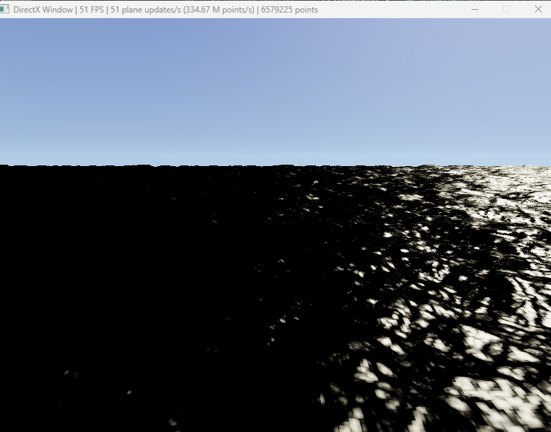
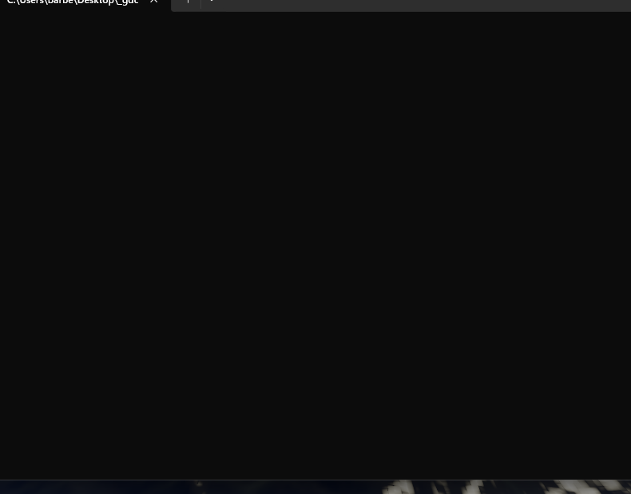
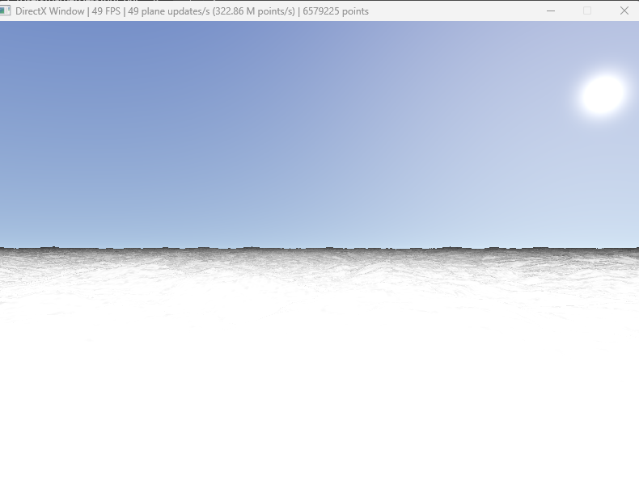
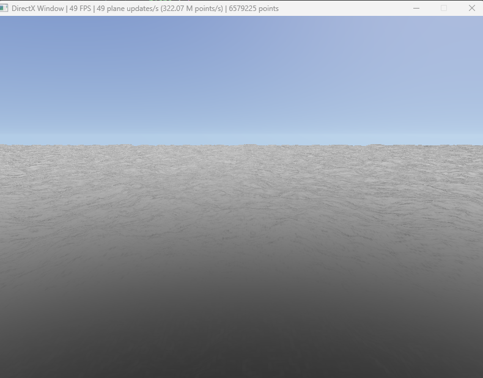
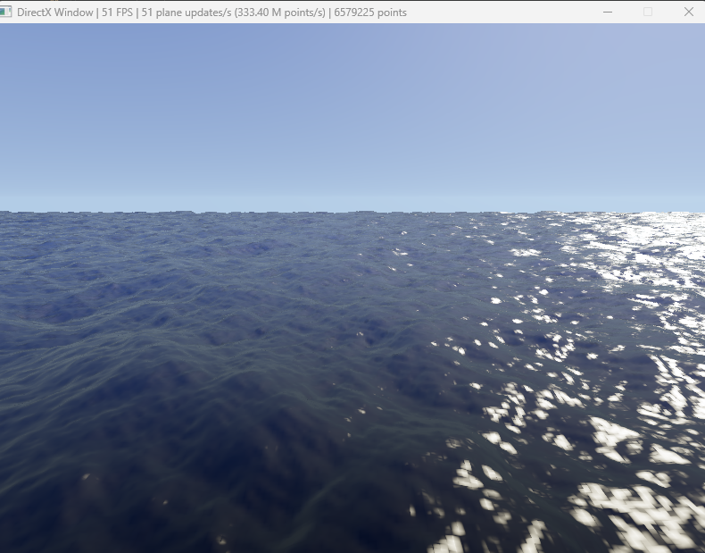
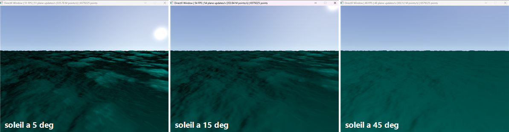
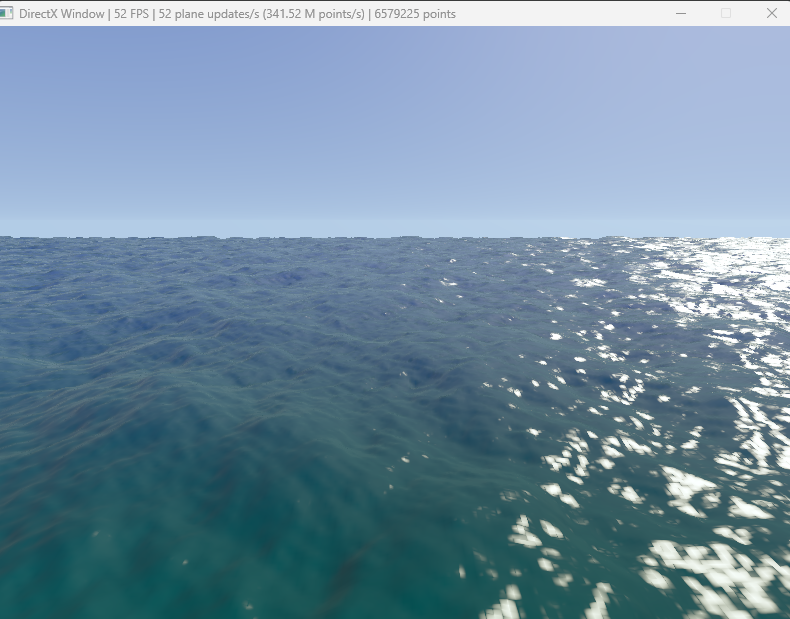
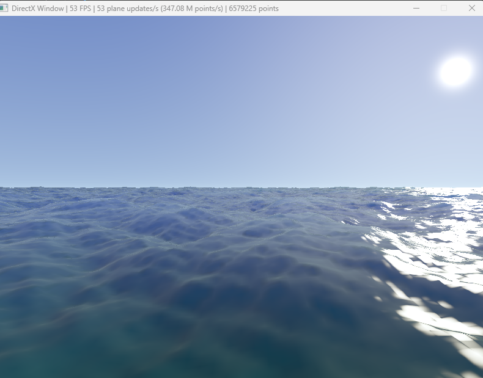

# Rendering the seas — lot 2 : l'éclairage (parties 6 à 11)

Suite de [`rendering-the-seas-tutorial.md`](rendering-the-seas-tutorial.md) (lot 1, parties 0 à 5). Ce lot construit, terme par terme, la formule finale de la **diapo 55** :

$$L_{to\_eye}=(1-F)\,L_{scatter}+\int_\Omega L_{sun}+F\int_\Omega L_{env}$$

> **État : lot 2 sur 3.** Le lot 3 (parties 12 et 13, puis récapitulatif, liste complète des paramètres de config, checklist de debug, lectures, suites) vient après tes retours.

## Prérequis et conventions

- **Le lot 1 doit marcher** : textures de moments, vues de debug 1 à 9, `selectedmethod: "fft"` avec `process: "gpu"`. Tout ce lot en dépend.
- Mêmes étiquettes **(A)** conférence / **(B)** adaptation / **(C)** option, mêmes niveaux ✅ vérifié / ⚠️ reconstruit / ❓ non vérifié, même notation (voir le tableau de notation du lot 1).
- **Avant la partie 11**, tu restes dans le rendu **non sRGB** du lot 1 (§0.6 du lot 1) : tes images seront un peu sombres. **Les figures de ce lot ont été produites avec le code final de la partie 11** (sRGB), en n'affichant seulement les termes dont on parle : elles sont donc **plus claires** que ce que tu verras avant la partie 11.
- Les parties 6 à 10 ajoutent chacune des fonctions HLSL dans `SHADER_SOURCE` (`directx.cpp`). **HLSL exige qu'une fonction soit définie avant d'être appelée** : je te dis à chaque fois *où* coller.

**Ce que j'ai réellement vérifié pour ce lot :**

1. Les formules des diapos 40 à 55 : relues visuellement sur les images.
2. Trois contrôles numériques en C++ (hors projet) : approximation de $\Lambda$ contre sa forme exacte ; ajustement de Fresnel contre une moyenne numérique de l'équation de Fresnel exacte sur les normales visibles ; quadrature 3×3 du ciel contre une référence Monte-Carlo.
3. Le code des parties 6 à 11 a été compilé en `-Wall -Wextra` **sans avertissement** et exécuté sur une copie de ton projet (FFT GPU, 25 chunks, caméra basse). Les figures viennent de là.
4. **Aucun fichier de ton projet n'a été modifié** : le code est dans ce document, c'est toi qui le tapes.

## Table des matières

| Partie | Titre | Diapos |
|---|---|---|
| [6](#partie-6--réflexion-spéculaire-du-soleil) | Réflexion spéculaire du soleil | 40–41 |
| [7](#partie-7--réflexion-de-lenvironnement-le-ciel) | Réflexion de l'environnement (le ciel) | 42–43 |
| [8](#partie-8--masquage-et-ombrage) | Masquage et ombrage | 44–47 |
| [9](#partie-9--réflectance-de-fresnel) | Réflectance de Fresnel | 48–50 |
| [10](#partie-10--lumière-diffusée-sss-truqué) | Lumière diffusée (SSS truqué) | 51–54 |
| [11](#partie-11--assemblage-final) | Assemblage final | 55 |
| [Annexes](#annexe-a--réponses-aux-exercices-lot-2) | Réponses, ce qui n'est pas vérifié | |

---

# Partie 6 — Réflexion spéculaire du soleil

*Diapos 40 à 41.*

## 6.1 But et résultat à l'écran

Remplacer l'ancien `pow(n·h, shininess)` par le **terme du soleil** physique, qui s'intègre **analytiquement** : à l'écran, une route de scintillements **structurée par les vagues** (fig. 6-1), qui se déplace quand tu changes `sun.azimuth` ou `sun.elevation`.

## 6.2 Intuition

Le soleil est minuscule. Dans l'intégrale de l'équation de rendu, seul **un point** de la demi-sphère compte : la direction $\mathbf l$ du soleil. L'intégrale se réduit donc à *évaluer la BRDF une fois*, avec $\mathbf h=\widehat{\mathbf l+\mathbf v}$. Ce que fait ensuite la statistique de pentes, c'est dire **quelle part des facettes du pixel** pointe vers $\mathbf h$ : c'est $D(\mathbf h)$, lu dans la gaussienne de la partie 4. Pas besoin d'échantillonner : c'est pour ça que le soleil est « analytique ».

## 6.3 L'équation

Diapo 40 ✅ (lue sur l'image) :

$$\int_\Omega L_{sun}\,f_r\cos\theta\,d\omega=\frac{L_{sun}\cdot F(\omega_h,\omega_{sun})\cdot p_{22}(\omega_h)}{4\cdot(\omega_n\cdot\omega_{eye})\cdot\big(1+\Lambda(\omega_{sun})+\Lambda(\omega_{eye})\big)} \tag{6.1}$$

avec $\omega_n=(0,0,1)$ (macronormale, « dans notre cas »). Avec ma notation, et en gardant le facteur $1/\cos^4$ du §4.4(e) :

$$\boxed{\;L_{sun}\text{-terme}=\frac{E_{sun}\;F(\mathbf v\!\cdot\!\mathbf h)\;D(\mathbf h)\;G}{4\,v_z}\;},\qquad D(\mathbf h)=\frac{P_{22}(\mathbf s_h)}{h_z^4},\quad G=\frac1{1+\Lambda(\mathbf l)+\Lambda(\mathbf v)} \tag{6.2}$$

| Symbole | Sens | Plage | Dans ton code |
|---|---|---|---|
| $E_{sun}$ | éclairement du soleil (la diapo l'écrit $L_{sun}$ ; §2.4 du lot 1) | arbitraire, > 0 | `sunColor * SUN_E` |
| $F(\mathbf v\cdot\mathbf h)$ | Fresnel **par micronormale** (angle entre $\mathbf v$ et $\mathbf h$) | $[0{,}02;1]$ | `schlickSimple(dot(v, h))` |
| $D(\mathbf h)$ | NDF au demi-vecteur, avec $\boldsymbol\mu$, $\Sigma$ du pixel | sr⁻¹ | `P22(...)` / `h.z⁴` |
| $\mathbf s_h$ | pente du demi-vecteur $=-(h_x,h_y)/h_z$ | | `-h.xy / h.z` |
| $G$ | masquage-ombrage | $[0,1]$ | partie 8 (ici $G=1$) |
| $v_z$ | $\cos\theta_o$ | $]0,1]$ | `v.z` |

## 6.4 Justification

(6.1) est (3.2) du lot 1, qui découle de (2.2) et (3.1). La seule étape à vérifier est que le soleil est **plus petit que la structure du lobe**, sinon « une seule évaluation » ne suffit pas. Le soleil a un rayon angulaire de $4{,}65\cdot10^{-3}$ rad : en pente, cela vaut environ $0{,}0024$ (le demi-vecteur ne bouge que de la moitié de l'angle du soleil). La rugosité de base que tu as ajoutée ($\delta^2_{base}=0{,}001$) a un écart type de $0{,}0316$ : le lobe est ≥ 13 fois plus large que le soleil ✅ (calcul), donc l'approximation est excellente. Elle ne le serait plus pour un miroir parfait (variance → 0) : tu verrais alors le disque du soleil lui-même.

**Ce que la diapo ne dit pas ⚠️.** La conférence écrit $p_{22}(\omega_h)$, et sa diapo 34 pose « $(\omega_n\cdot\omega_g)^4=1$ » : voir §4.4(e). **Mon code garde le facteur $1/h_z^4$** et te laisse le retirer avec `USE_COS4 = false` pour comparer à la diapo à la lettre. Dans la zone du reflet, $\theta_h\lesssim10^\circ$ : la différence est inférieure à 6 % (§4.4(e)).

## 6.5 Mapping sur ton code (B)

- Les moments se lisent avec une petite fonction `readMoments`, qui reprend les 5 lignes de ta vue de debug (§5.7 B.5 du lot 1) sans les modifier.
- `sunSpecular` calcule $F\,D\,G/(4v_z)$ **sans** $E_{sun}$ ; on multiplie dehors.
- **Exposition.** Le soleil vaut des milliers de fois le ciel, mais ton back buffer est borné à 1. On ne peut pas simplement multiplier : `saturate` écraserait tout en blanc. On fait donc une **compression douce de la partie « soleil » seulement** : $x\mapsto x/(1+x)$ (Reinhard). C'est ma décision (⚠️), la conférence ne dit rien du tone mapping ; elle est justifiée en §11.4.
- `v.z <= 0` (œil sous la surface locale) ou `l.z <= 0` (soleil sous l'horizon) : la formule n'a plus de sens, on renvoie 0.

## 6.6 Implémentation

**Étape 6.1 : les fonctions.** Dans `SHADER_SOURCE`, **après** `P22` (partie 4) et **avant** `float4 psMain`, colle :

```hlsl
    // Lit les moments au pixel et en déduit pente moyenne, variances et covariance (éq. 4.4)
    void readMoments(float3 worldPosition, out float2 mu, out float2 var, out float cxy) {
        float2 uv = worldPosition.xy / planeSizeW + 0.5 + 0.5 * invGridN;     // éq. 5.9
        float4 A = momentsA.Sample(linearWrap, uv);
        float4 B = momentsB.Sample(linearWrap, uv);
        mu = A.xy;
        var = B.xy - mu * mu;
        cxy = B.z - mu.x * mu.y;
    }

    static const float SUN_E = 3.0;          // éclairement du soleil (HDR, arbitraire) : ira dans la config en partie 11
    static const bool USE_COS4 = true;       // false = la diapo 34 à la lettre (sans le facteur 1/cos^4)

    // Le terme du soleil sans L_sun : F · D · G / (4 cosθo)   (éq. 3.2, diapo 40)
    float sunSpecular(float3 l, float3 v, float2 mu, float2 var, float cxy) {
        if (l.z <= 0.0 || v.z <= 0.0) return 0.0;             // soleil sous l'horizon, ou œil sous la surface
        float3 h = normalize(l + v);
        float2 sh = -h.xy / h.z;                              // pente du demi-vecteur
        float D = P22(sh, mu, var + BASE_VAR, cxy);           // éq. 4.3′, variances + rugosité de base
        if (USE_COS4) D /= (h.z * h.z * h.z * h.z);           // éq. 4.6
        float F = schlickSimple(dot(v, h));                   // F(ωh, ωsun) : angle entre v et h
        float G = 1.0;                                        // masquage : partie 8
        return F * D * G / (4.0 * v.z);
    }
```

**Étape 6.2 : le rendu.** Dans `psMain`, juste **avant** la ligne `float3 toSun = normalize(sunDirection);` (donc après le bloc de debug `DEBUG_VIEW >= 4`), colle ce bloc. Il remplace l'ancien éclairage **quand les moments existent** et que `DEBUG_VIEW` vaut 0 :

```hlsl
        if (hasMoments != 0 && DEBUG_VIEW == 0) {
            float2 mu, var;
            float cxy;
            readMoments(input.worldPosition, mu, var, cxy);
            float3 Lsun = sunColor * SUN_E * sunSpecular(l, v, mu, var, cxy);
            Lsun = Lsun / (1.0 + Lsun);                 // compression douce de la partie HDR
            return float4(Lsun, 1.0);
        }
```

Mets `#define DEBUG_VIEW 0`, compile (`make`), lance.

## 6.7 Vérifier que ça marche

- **Ce que tu dois voir** : une mer **noire** (aucun ciel réfléchi, aucune couleur propre : ça viendra), avec des **scintillements** blancs concentrés du côté du soleil (à droite avec `azimuth: 30`), plus denses et plus larges vers l'horizon.


*Fig. 6-1 : terme du soleil seul, caméra à 17 m, soleil à 35°. (Rendu sRGB de la partie 11.)*

- **Le soleil bouge** : change `sun.azimuth` (le reflet glisse horizontalement) et `sun.elevation` (la route monte vers l'horizon quand le soleil descend).
- **`USE_COS4 = false`** : l'image change à peine (< 6 % dans le reflet).
- **Compare à ta capture de référence** (§2.6 du lot 1, diapo 41 « SIMPLE vs PBR ») : l'ancien Blinn-Phong produit un reflet régulier, circulaire ; le nouveau suit les vagues.

**Bugs typiques :**

| Symptôme | Cause probable |
|---|---|
| tout blanc | `SUN_E` trop grand, ou compression oubliée |
| tout noir | `hasMoments = 0` (config pas en `fft` + `gpu`), ou `DEBUG_VIEW != 0` |
| reflet du **mauvais côté** | signe de `-h.xy / h.z` (voir §5.9 du lot 1) |
| carrés visibles dans les scintillements | variance « fantôme » de l'interpolation bilinéaire (§5.5 du lot 1) : normal, la partie 13 le corrige |
| disque du soleil sur l'eau | `BASE_VAR` trop petit |
| l'ancien rendu est toujours là | tu es en `gerstner` ou en FFT CPU : `hasMoments = 0` |

## 6.8 Exercices

1. Pour un pixel de pente moyenne $\boldsymbol\mu=0$ et de variances $\delta_x^2=\delta_y^2=0{,}04$, évalue $P_{22}$ à $\mathbf s_h=(0{,}1;0)$.
2. Pourquoi $F$ de l'éq. (6.2) utilise-t-il l'angle entre $\mathbf v$ et $\mathbf h$, et pas celui entre $\mathbf v$ et $\mathbf n$ ?
3. Que se passe-t-il si tu enlèves la rugosité de base ($\delta^2_{base}=0$) près de la caméra ? Pourquoi ?

*(Réponses en annexe A.)*

---

# Partie 7 — Réflexion de l'environnement (le ciel)

*Diapos 42 à 43.*

## 7.1 But et résultat à l'écran

Ajouter le **reflet du ciel**. Résultat : l'eau n'est plus noire mais prend les nuances du ciel, **floues** (pas de scintillement : le ciel varie lentement) ; elles deviennent presque un miroir près de l'horizon (fig. 7-1, 7-2).

## 7.2 Intuition

Le ciel n'est pas ponctuel : il faut **intégrer sur toute la demi-sphère**, et c'est impossible analytiquement parce que $L_{env}$ est une fonction quelconque (ici : un dégradé + un halo). La conférence l'écrit explicitement (diapo 42 ✅) : *« integrate numerically as sum of samples »*, avec trois simplifications pour la vitesse :

1. **un petit nombre d'échantillons : 3×3** ;
2. **pas de Fresnel par échantillon** : on applique $F$ une seule fois, sur la somme ;
3. **pas de masquage-ombrage**.

Idée : un pixel contient des micronormales réparties selon la gaussienne $(\boldsymbol\mu,\Sigma)$. Pour chacune, la direction réfléchie voit une partie du ciel ; on **moyenne ces couleurs de ciel**. Plus la mer est rugueuse (variance grande), plus on moyenne de directions différentes : l'image est **plus floue**. C'est l'idée d'**empreinte** : la rugosité décide de la netteté du reflet.

## 7.3 L'équation

Diapo 42 ✅ : l'intégrale $\int_\Omega L_{env}\,f_r\cos\theta\,d\omega$ « se calcule comme une somme d'échantillons ». La diapo ne donne pas les nœuds : **le choix de mes 9 échantillons est le mien** (⚠️), voici lequel et pourquoi.

On remplace l'intégrale par la **moyenne du ciel réfléchi** sous la loi des micronormales :

$$\bar L_{env}=E_{\mathbf s\sim\mathcal N(\boldsymbol\mu,\Sigma)}\Big[\,L_{env}\big(\mathbf r(\mathbf s)\big)\Big],\qquad \mathbf m(\mathbf s)=\frac{(-s_x,-s_y,1)}{\sqrt{1+s_x^2+s_y^2}},\quad \mathbf r=2(\mathbf m\!\cdot\!\mathbf v)\,\mathbf m-\mathbf v \tag{7.1}$$

et on approche cette espérance par la **quadrature de Gauss-Hermite à 3 points par axe** (donc 3×3 = 9 échantillons) :

$$\bar L_{env}\approx\sum_{i,j\in\{1,2,3\}}w_iw_j\;L_{env}\Big(\mathbf r\big(\boldsymbol\mu+\mathsf L\,(z_i,z_j)^T\big)\Big),\quad z\in\{-\sqrt3,\,0,\,\sqrt3\},\quad w\in\{\tfrac16,\tfrac23,\tfrac16\} \tag{7.2}$$

où $\mathsf L$ est la **factorisation de Cholesky** de $\Sigma$ : $\mathsf L\mathsf L^T=\Sigma$,

$$\mathsf L=\begin{pmatrix}a&0\\b&c\end{pmatrix},\quad a=\delta_x,\quad b=\frac{c_{xy}}{\delta_x},\quad c=\sqrt{\delta_y^2-b^2} \tag{7.3}$$

| Symbole | Sens | Dans ton code |
|---|---|---|
| $\mathbf r$ | direction réfléchie de $\mathbf v$ par la micronormale $\mathbf m$ | `reflect(-v, m)` |
| $L_{env}(\mathbf r)$ | luminance du ciel dans la direction $\mathbf r$ | `skyRadiance(r, l)` |
| $z_i,w_i$ | nœuds et poids de Gauss-Hermite à 3 points | `nodes[]`, `weights[]` |
| $a,b,c$ | facteur de Cholesky de $\Sigma$ (+ rugosité de base) | `a, b, c` |

## 7.4 Justification

**Pourquoi Gauss-Hermite à 3 points.** Pour une variable $z\sim\mathcal N(0,1)$, la règle à nœuds $\{-\sqrt3,0,\sqrt3\}$ et poids $\{\tfrac16,\tfrac23,\tfrac16\}$ reproduit exactement les moments 0, 2 et 4 : $E[z^0]=1$, $E[z^2]=2\cdot\tfrac16\cdot3=1$, $E[z^4]=2\cdot\tfrac16\cdot9=3$ ✅ (calculés), et elle est exacte pour tout polynôme de degré ≤ 5 (le moment 6 donne 9 au lieu de 15 : c'est la limite). **Le produit tensoriel 3×3 donne bien « 3×3 échantillons »** comme la diapo.

**Pourquoi Cholesky.** Si $\mathbf z\sim\mathcal N(0,I)$ alors $\boldsymbol\mu+\mathsf L\mathbf z\sim\mathcal N(\boldsymbol\mu,\Sigma)$ ; on décorrèle les deux axes, ce qui permet d'appliquer la règle 1D sur chaque axe. Vérification : $\mathsf L\mathsf L^T=\begin{pmatrix}a^2&ab\\ab&b^2+c^2\end{pmatrix}=\begin{pmatrix}\delta_x^2&c_{xy}\\c_{xy}&\delta_y^2\end{pmatrix}$ ✅.

**Quelle précision ? ✅ (mesuré, ⚠️ sur un ciel simplifié).** J'ai comparé (7.2) à une référence Monte-Carlo de 4 millions d'échantillons, sur un ciel à un canal $0{,}8\to0{,}3$ qui reprend ta formule $\mathrm{lerp}(\text{horizon},\text{zénith},\sqrt{\cos})$ :

| Cas (angle de vue, variances) | erreur 3×3 | erreur d'un seul échantillon central |
|---|---|---|
| 70°, $(0{,}0435\,;\,0{,}0161)$ (ta mer entière) | 0,019 | 0,043 |
| 80°, $(0{,}02\,;\,0{,}01)$, $\boldsymbol\mu=(0{,}1;-0{,}05)$ | 0,042 | 0,097 |
| 85°, $(0{,}002\,;\,0{,}002)$ | 0,0066 | 0,015 |

Le 3×3 divise l'erreur par ≈ 2,3. L'erreur résiduelle (jusqu'à 5 % de la luminance du ciel) vient surtout du **coude de l'horizon** (le ciel est écrêté par `max(r.z, 0)`, donc non lisse). Variante (C) : 5×5 points (nœuds de Gauss-Hermite à 5 points, que je n'ai pas testés ❓).

**Pourquoi pas de Fresnel ni de masquage dans la somme (A).** Sur la diapo 55, $F$ multiplie **toute** l'intégrale du ciel : on l'évalue une fois pour la direction de vue (partie 9), pas pour chaque échantillon. Quant au masquage, la diapo l'écarte « for sake of performance » : il atténuerait les directions rasantes dans l'intégrale, ce qu'on néglige.

**Le disque du soleil est exclu de $L_{env}$.** L'intégrale du soleil est déjà faite analytiquement (partie 6) : l'inclure ici le compterait deux fois. Ton `psSky` ajoute à la fois un disque (`pow(…, 2000)`) et un halo (`pow(…, 8) × 0.3`). Je **garde le halo** (c'est du ciel diffus), **je retire le disque**. ⚠️ Les constantes `8` et `0.3` sont **copiées** de `skybox.cpp:54` : si tu changes l'une, change l'autre (en partie 11 tu pourras les factoriser).

## 7.5 Mapping sur ton code (B)

- Le ciel du fond est dessiné par `skybox.cpp` (`psSky`, ligne 42). Il n'existe **aucun cubemap** : $L_{env}$ est donc la fonction `skyRadiance` ci-dessous, la même formule que `psSky` **moins le disque**.
- Les couleurs du ciel (`config.sky`) ne sont pas encore accessibles au shader de l'eau : on les **copie** en constantes HLSL (valeurs par défaut de ton `config.json`). La partie 11 les passera en cbuffer. ⚠️ Si tu as changé `sky` dans ton `config.json`, change aussi ces deux lignes.
- Direction **sous l'horizon** : une micronormale très inclinée peut réfléchir vers le bas. On lit alors la couleur de l'horizon (`max(r.z, 0.001)`).

## 7.6 Implémentation

**Étape 7.1 : les fonctions.** Colle ce bloc **juste avant `sunSpecular`** (il utilise `P22`/`BASE_VAR`, mais pas encore `sunSpecular`) :

```hlsl
    // ===== Partie 7 : ciel =====
    static const float3 SKY_ZENITH  = float3(0.1, 0.3, 0.7);    // copie de config.json "sky" (la partie 11 les passe en cbuffer)
    static const float3 SKY_HORIZON = float3(0.7, 0.8, 0.9);

    // Luminance du ciel dans la direction dir, SANS le disque du soleil (déjà traité par le terme analytique)
    float3 skyRadiance(float3 dir, float3 l) {
        float3 sky = lerp(SKY_HORIZON, SKY_ZENITH, sqrt(saturate(dir.z)));
        float glow = pow(saturate(dot(dir, l)), 8.0) * 0.3;                     // le même halo que psSky
        return sky + sunColor * sunIntensity * glow;
    }

    // Moyenne du ciel réfléchi sur la distribution des micronormales : quadrature de Gauss-Hermite 3x3
    float3 envReflection(float3 v, float3 l, float2 mu, float2 var, float cxy) {
        float2 vv = var + BASE_VAR;
        float a = sqrt(vv.x);                                // Cholesky de Σ : L = [[a, 0], [b, c]]
        float b = cxy / a;
        float c = sqrt(max(vv.y - b * b, 1e-8));
        const float nodes[3] = {-1.7320508, 0.0, 1.7320508};   // ±√3 et 0
        const float weights[3] = {1.0 / 6.0, 2.0 / 3.0, 1.0 / 6.0};
        float3 sum = float3(0.0, 0.0, 0.0);
        for (int i = 0; i < 3; i++) {
            for (int j = 0; j < 3; j++) {
                float2 s = mu + float2(a * nodes[i], b * nodes[i] + c * nodes[j]);   // pente échantillon
                float3 m = normalize(float3(-s, 1.0));                                // micronormale
                float3 r = reflect(-v, m);                                            // direction réfléchie
                r = normalize(float3(r.xy, max(r.z, 0.001)));                         // sous l'horizon : on lit l'horizon
                sum += weights[i] * weights[j] * skyRadiance(r, l);
            }
        }
        return sum;
    }
```

(`reflect(i, n)` de HLSL vaut $\mathbf i-2\,\mathbf n(\mathbf n\cdot\mathbf i)$ ; avec $\mathbf i=-\mathbf v$ on retrouve $2(\mathbf m\cdot\mathbf v)\mathbf m-\mathbf v$ ✅.)

**Étape 7.2 : la vue de debug du ciel seul.** Dans `psMain`, **avant** le bloc de rendu `DEBUG_VIEW == 0` et après le bloc `DEBUG_VIEW >= 4`, colle :

```hlsl
        if (hasMoments != 0 && DEBUG_VIEW >= 10) {
            float2 mu, var;
            float cxy;
            readMoments(input.worldPosition, mu, var, cxy);
            float2 vt = var + BASE_VAR;                  // variance totale
            if (DEBUG_VIEW == 10) return float4(envReflection(v, l, mu, var, cxy), 1.0);   // L_env seul
        }
```

(Les parties 8, 9 et 10 ajouteront chacune une ligne dans ce bloc.)

**Étape 7.3 : le rendu.** **Remplace** le bloc `if (hasMoments != 0 && DEBUG_VIEW == 0) { ... }` de la partie 6 par :

```hlsl
        if (hasMoments != 0 && DEBUG_VIEW == 0) {
            float2 mu, var;
            float cxy;
            readMoments(input.worldPosition, mu, var, cxy);
            float3 Lsun = sunColor * SUN_E * sunSpecular(l, v, mu, var, cxy);
            Lsun = Lsun / (1.0 + Lsun);
            float3 Lenv = envReflection(v, l, mu, var, cxy);
            float F = schlickSimple(v.z);               // provisoire : Fresnel d'une surface plane (partie 9)
            return float4(saturate(Lsun + F * Lenv), 1.0);
        }
```

## 7.7 Vérifier que ça marche

- **Vue 10 ($L_{env}$ seul, sans $F$)** : une mer **bleue claire**, à peu près uniforme, avec de **fines ondulations floues** qui suivent les vagues (fig. 7-1). **Pas de scintillement.** Plus on regarde loin, plus la teinte se rapproche de l'horizon.
- **Vue 0** : $L_{sun}+F\,L_{env}$ avec $F=F_{simple}(v_z)$ : une mer **sombre** (le ciel n'est réfléchi qu'à ≈ 2 à 6 % de face), qui **s'éclaircit vers l'horizon**, avec le scintillement par-dessus (fig. 7-2).
- **Test de sens** : augmente `BASE_VAR` à 0,05 : le reflet du ciel devient **plus uniforme** (plus de moyennage) ; mets-le à 0,0001 : plus de détail.


*Fig. 7-1 : $L_{env}$ seul (vue 10).*


*Fig. 7-2 : $L_{sun}+F\,L_{env}$ avec le Fresnel simple $F_{simple}(v_z)$ de cette partie. Le fond est sombre : à 2 à 6 % de réflexion, le ciel est à peine visible, sauf près de l'horizon.*

**Bugs typiques :**

| Symptôme | Cause probable |
|---|---|
| reflet du ciel **à l'envers** (zénith en bas) | `reflect(v, m)` au lieu de `reflect(-v, m)` |
| pixels noirs / `NaN` | `cxy / a` avec `a = 0` (variance nulle) : `BASE_VAR` doit être > 0 ; ou `max(vv.y − b², 1e-8)` oublié |
| disque du soleil dans la mer | tu as repris `psSky` tel quel (avec `pow(…, 2000)`) |
| couleurs qui ne correspondent pas au ciel du fond | tes `SKY_ZENITH` / `SKY_HORIZON` ne sont pas ceux de `config.json` |
| bandes visibles dans le reflet | limite du 3×3 sur mer très rugueuse : option 5×5 (C) |

## 7.8 Exercices

1. Vérifie que la règle de Gauss-Hermite 3 points est exacte pour $E[z^4]$.
2. Une mer deux fois plus rugueuse (variances ×2) : le reflet du ciel devient-il plus ou moins net ? Pourquoi ?
3. Pourquoi ne met-on pas le disque du soleil dans $L_{env}$ ?

*(Réponses en annexe A.)*

---

# Partie 8 — Masquage et ombrage

*Diapos 44 à 47.*

## 8.1 But et résultat à l'écran

Corriger un défaut de la formule (6.2) : **aux angles rasants, elle donne beaucoup trop de lumière**. Résultat : près de l'horizon, le reflet du soleil s'atténue (fig. 8-1) ; ailleurs, rien ne change. C'est un effet **subtil sur cette mer** : j'ai mesuré −11 % de luminance moyenne dans la bande de l'horizon (voir §8.7).

## 8.2 Intuition

Les vagues se cachent les unes les autres. Vu de très bas (angle rasant), une facette bien orientée vers le soleil peut être **cachée derrière la crête d'une vague plus proche** ($\to$ *masquage*, côté œil), ou **dans l'ombre** d'une crête côté soleil ($\to$ *ombrage*, côté lumière). La diapo 44 ✅ le résume : *« waves obstruct each other! »*.

Il y a une raison mathématique pressante : la formule (6.2) contient $1/(4v_z)$. Quand l'œil se rapproche de l'horizontale, $v_z\to0$ et le terme **diverge**. $G$ est le facteur qui le **calme**, parce qu'il tend vers 0 plus vite.

## 8.3 Les équations

Diapo 45 ✅ (« Walter's approximation for Smith's masking and shadowing functions ») :

$$G=\frac{1}{1+\Lambda(\omega_i)+\Lambda(\omega_o)} \tag{8.1}$$

$$\Lambda(\omega)\approx\begin{cases}\dfrac{1-1{,}259\,a+0{,}396\,a^2}{3{,}535\,a+2{,}181\,a^2}, & a<1{,}6\\[2mm] 0,&\text{sinon}\end{cases},\qquad a=\frac{1}{\alpha\tan\theta} \tag{8.2}$$

$$\alpha=\sqrt{\alpha_x^2\cos^2\varphi+\alpha_y^2\sin^2\varphi}\quad\text{(« projected anisotropic roughness »)} \tag{8.3}$$

Avec les moments (⚠️ ma généralisation : la diapo ignore la covariance $c_{xy}$) :

$$\delta_\omega^2=\delta_x^2\cos^2\varphi+\delta_y^2\sin^2\varphi+2\,c_{xy}\cos\varphi\sin\varphi,\qquad \alpha=\sqrt{2\,\delta_\omega^2} \tag{8.4}$$

où $\varphi$ est l'**azimut de la direction** $\omega$ (angle de ses composantes $x,y$). En pratique : $a=\dfrac{\omega_z}{\alpha\sqrt{1-\omega_z^2}}$.

| Symbole | Sens | Plage | Dans ton code |
|---|---|---|---|
| $\omega_i,\omega_o$ | directions du soleil $\mathbf l$ et de l'œil $\mathbf v$ | | `l`, `v` |
| $\theta,\varphi$ | colatitude et azimut de la direction | | `w.z`, `w.xy` |
| $\delta^2_\omega$ | variance des pentes **le long** de l'azimut de $\omega$ | $\ge0$ | `projectedVariance(...)` |
| $\alpha$ | rugosité de Beckmann projetée ; $\alpha^2=2\delta^2$ | $\sim0{,}05$–$0{,}5$ | `sqrt(2 * ...)` |
| $a$ | $1/(\alpha\tan\theta)$ : grand = direction proche de la verticale | | `a` |
| $\Lambda$ | fonction de Smith | $\ge0$ ; $\to0$ pour $a$ grand | `lambdaSmith` |

## 8.4 Justification

**Ce que représente $\Lambda$.** $\Lambda(\omega)$ mesure la **proportion de surface cachée vue depuis $\omega$**. Dans le modèle de Smith, on suppose que la hauteur d'un point et la pente en ce point sont indépendantes. Pour une distribution de Beckmann, $\Lambda$ a une forme fermée (⚠️ de mémoire, Heitz 2014 ❓) :

$$\Lambda(a)=\tfrac12\Big(\frac{e^{-a^2}}{a\sqrt\pi}-\operatorname{erfc}a\Big) \tag{8.5}$$

Je l'ai utilisée comme **référence** pour tester l'approximation de la diapo ; l'indépendance entre mon test et l'approximation est garantie : l'approximation (8.2) se réécrit $\dfrac1{1+\Lambda}=\dfrac{3{,}535a+2{,}181a^2}{1+2{,}276a+2{,}577a^2}$, qui est (de mémoire ❓) l'approximation rationnelle de $G_1$ de Walter et al. 2007, d'où le « Walter's approximation » de la diapo. Le calcul algébrique est ✅ (le numérateur $3{,}535a+2{,}181a^2$ plus $1-1{,}259a+0{,}396a^2$ donne bien $1+2{,}276a+2{,}577a^2$). Surtout, ✅ **mon calcul exact (8.5) et la formule de la diapo s'accordent numériquement** (tableau ci-dessous), ce qui valide à la fois ma mémoire de (8.5) et la diapo.

**Précision de l'approximation (8.2) ✅ (mesurée).** Erreur absolue maximale sur $a\in[0{,}05;1{,}6[$ : **0,0096**.

| $\alpha=0{,}3$, angle | $a$ | $\Lambda$ exact | $\Lambda$ diapo | $G_1$ exact | $G_1$ diapo |
|---|---|---|---|---|---|
| 60° | 1,925 | 0,0004 | 0 | 1,000 | 1,000 |
| 75° | 0,893 | 0,0390 | 0,0391 | 0,962 | 0,962 |
| 80° | 0,588 | 0,1368 | 0,1402 | 0,880 | 0,877 |
| 85° | 0,292 | 0,5484 | 0,5479 | 0,646 | 0,646 |
| 88° | 0,116 | 1,9562 | 1,9473 | 0,338 | 0,339 |
| 89,5° | 0,029 | 9,2057 | 9,2065 | 0,098 | 0,098 |

Pour $a\ge1{,}5$ la formule rationnelle devient légèrement **négative** (−6·10⁻⁵ à $a=1{,}6$) : d'où le `max(0.0, …)` dans le code.

**$G=1/(1+\Lambda_i+\Lambda_o)$ et pas $G_1(\omega_i)\,G_1(\omega_o)$ ⚠️.** La diapo écrit la forme « somme », qui correspond à une corrélation entre masquage et ombrage (les deux sont causés par les mêmes crêtes) : c'est plus réaliste que le produit des deux. L'attribution précise (Smith à hauteurs corrélées, Heitz 2014) est de mémoire ❓.

**Un risque de double comptage ⚠️.** Les grandes vagues portées par le maillage se cachent déjà géométriquement (le z-buffer). Le $\Lambda$ calculé avec la variance **du pixel** (moments + rugosité de base) concerne les ondulations plus petites que le pixel. Ça ne devrait pas dupliquer l'effet : mais la conférence n'en parle pas, donc je le signale.

## 8.5 Mapping sur ton code (B)

- On évalue $\Lambda$ pour $\mathbf l$ (ombrage) **et** pour $\mathbf v$ (masquage), avec la **variance totale** du pixel : `var + BASE_VAR`.
- $G$ s'applique **dans `sunSpecular`** (c'est le `G = 1.0` de la partie 6). Il s'appliquera aussi à $L_{scatter}$ sous la forme $1/(1+\Lambda(\omega_i))$ (partie 10).
- Le $G$ **n'est pas** dans la somme du ciel (diapo 42).

## 8.6 Implémentation

**Étape 8.1 : constante de comparaison.** À côté de `USE_COS4` :

```hlsl
    static const bool USE_MASKING = true;    // false : G = 1 (pour comparer avant/après)
```

**Étape 8.2 : les fonctions.** Colle **juste avant `sunSpecular`** :

```hlsl
    // ===== Partie 8 : masquage =====
    // Variance des pentes le long de l'azimut de w : δw² = δx² cos²φ + δy² sin²φ + 2 c cosφ sinφ
    float projectedVariance(float3 w, float2 var, float cxy) {
        float2 xy = w.xy;
        float len2 = dot(xy, xy);
        if (len2 < 1e-8) return 0.5 * (var.x + var.y);
        float2 d = xy * rsqrt(len2);
        return var.x * d.x * d.x + var.y * d.y * d.y + 2.0 * cxy * d.x * d.y;
    }

    // Λ(ω) de Smith pour Beckmann, approximation de la diapo 45 ; var contient déjà la rugosité de base
    float lambdaSmith(float3 w, float2 var, float cxy) {
        float alpha = sqrt(2.0 * max(projectedVariance(w, var, cxy), 1e-8));   // α² = 2δ² (éq. 4.5)
        float sinT = sqrt(max(1.0 - w.z * w.z, 1e-8));
        float a = max(w.z, 1e-4) / (alpha * sinT);                              // a = 1/(α tanθ)
        if (a >= 1.6) return 0.0;
        return max(0.0, (1.0 - 1.259 * a + 0.396 * a * a) / (3.535 * a + 2.181 * a * a));
    }
```

**Étape 8.3 : activer $G$.** Dans `sunSpecular`, **remplace** la ligne `float G = 1.0; // masquage : partie 8` par :

```hlsl
        float2 vt = var + BASE_VAR;
        float G = USE_MASKING ? 1.0 / (1.0 + lambdaSmith(l, vt, cxy) + lambdaSmith(v, vt, cxy)) : 1.0;   // diapo 45
```

**Étape 8.4 : la vue de $G$.** Dans le bloc de debug `DEBUG_VIEW >= 10` (étape 7.2), **avant** l'accolade fermante, ajoute :

```hlsl
            if (DEBUG_VIEW == 11) {                      // G seul
                float G = 1.0 / (1.0 + lambdaSmith(l, vt, cxy) + lambdaSmith(v, vt, cxy));
                return float4(G, G, G, 1.0);
            }
```

## 8.7 Vérifier que ça marche

**Pour voir l'horizon**, baisse la caméra dans `config.json` : `"tiltdegrees": -88`, `"cameradistance": -100` (caméra à $z\approx3{,}5$ m) et mets `"elevation": 15` pour le soleil.

- **Vue 11 ($G$)** : **blanc ($G\approx1$) presque partout**, avec une **mince bande grise** le long de l'horizon. Valeurs mesurées sur la capture (fig. 8-1, caméra à 3,5 m, soleil à 15°) : $G=0{,}29$ sur la ligne d'horizon, $0{,}56$ à 8 pixels en dessous, $0{,}86$ à 23 pixels, $0{,}97$ à 38 pixels, $1$ au-delà.


*Fig. 8-1 : $G$ seul (vue 11), caméra basse. Une bande grise le long de l'horizon, blanc ailleurs.*

- **Avant/après** (diapo 46 : OFF contre ON) : mets `USE_MASKING = false` puis `true` et regarde la bande de l'horizon. **Honnêtement, sur cette mer, l'effet est modeste** : avec `water.sunirradiance` réduit à 0,3 pour éviter la saturation, j'ai mesuré une luminance moyenne **−11 %** dans la bande de 33 pixels sous l'horizon (0,167 → 0,149), et aucune différence mesurable plus bas. Avec une forte irradiance, la compression $x/(1+x)$ écrase la différence dans les zones saturées. Les diapos 46 et 47 montrent un effet bien plus marqué (mer plus calme et plus large, soleil bas) : essaie `"elevation": 5`.
- **Valeurs théoriques** à retrouver : pour $\alpha=0{,}3$, soleil à 55° et œil à 88°, $G=0{,}339$ ; œil à 60°, $G=1{,}000$ ✅ (calculé).

**Bugs typiques :**

| Symptôme | Cause probable |
|---|---|
| $G>1$ ou négatif | `max(0.0, …)` oublié dans $\Lambda$, ou $a<0$ si `w.z < 0` |
| bande grise partout | $\alpha$ confondu avec $\delta$ (facteur $\sqrt2$) |
| rien ne change | `USE_MASKING` mis à `false`, ou la caméra n'est pas assez basse |
| `NaN` à l'horizon | division par `alpha * sinT` avec `alpha = 0` : garde `max(..., 1e-8)` |
| $G$ asymétrique gauche/droite | `projectedVariance` : signe de la covariance, ou azimut calculé avec `atan2` au lieu de la direction normalisée |

## 8.8 Exercices

1. Calcule $a$ et $\Lambda$ (formule de la diapo) pour $\alpha=0{,}3$ et un œil à 80°.
2. Pourquoi $G\to0$ quand $\theta\to90^\circ$ ? Que devient alors le terme $F D G/(4\cos\theta_o)$ ?
3. Que changerait le terme $c_{xy}$ dans (8.4) pour des vagues qui avancent en diagonale ?

*(Réponses en annexe A.)*

---

# Partie 9 — Réflectance de Fresnel

*Diapos 48 à 50.*

## 9.1 But et résultat à l'écran

Remplacer le Fresnel provisoire de la partie 7 par celui de la conférence. Résultat : l'eau est **sombre** vue de dessus, de plus en plus **miroir** vers l'horizon, plus tôt que dans la partie 7 (fig. 9-1, 9-2). C'est le $F$ du ciel et de la lumière diffusée.

## 9.2 Intuition

À incidence normale, l'eau ne réfléchit que **2 %** de la lumière : on voit *à travers*. À incidence rasante, elle devient un **miroir** : c'est pourquoi l'horizon de la mer reflète le ciel. Pour une mer **plane**, la formule exacte donne (✅ calcul, $\eta=1{,}33$) :

| angle $\theta$ | 0° | 30° | 60° | 70° | 80° | 85° | 89° |
|---|---|---|---|---|---|---|---|
| $F$ exact | 0,0201 | 0,0211 | 0,0591 | 0,1327 | 0,3469 | 0,5827 | 0,8960 |

Mais une mer **rugueuse** n'est pas plane : quand tu la regardes presque horizontalement, tu vois des facettes d'orientations variées, **certaines inclinées vers toi**, donc vues sous un angle plus proche de la normale, donc moins réfléchissantes. **La rugosité diminue le $F$ moyen aux angles rasants.** C'est ce que la diapo 48 appelle la **distribution des micronormales visibles** : celle que *l'œil* voit, qui n'est pas la distribution complète (les facettes tournées dos à l'œil, ou cachées, disparaissent). On l'a même dessinée : la distribution rouge de la diapo 48 est penchée vers l'œil.

## 9.3 Les équations

Diapo 49 ✅ (lue sur l'image : l'exposant $5\exp(-2{,}69\,\alpha_v)$ et le dénominateur $1+22{,}7\,\alpha_v^{1{,}5}$) :

$$F\approx R+(1-R)\,\frac{(1-\cos\theta_v)^{\,5\exp(-2{,}69\,\alpha_v)}}{1+22{,}7\,\alpha_v^{1{,}5}},\qquad R=\frac{(\eta-1)^2}{(\eta+1)^2} \tag{9.1}$$

$$\alpha_v=\sqrt{\alpha_x^2\cos^2\varphi_v+\alpha_y^2\sin^2\varphi_v} \tag{9.2}$$

où $\eta$ est l'indice de réfraction air → eau, et $\varphi_v,\theta_v$ les angles du vecteur de vue.

Pour comparer, la référence **exacte** (non polarisée, ✅ ce sont les équations de Fresnel) :

$$F_{exact}(\cos\theta_i)=\tfrac12\big(r_\perp^2+r_\parallel^2\big),\quad r_\perp=\frac{\cos\theta_i-\eta\cos\theta_t}{\cos\theta_i+\eta\cos\theta_t},\quad r_\parallel=\frac{\eta\cos\theta_i-\cos\theta_t}{\eta\cos\theta_i+\cos\theta_t},\quad \sin\theta_t=\frac{\sin\theta_i}{\eta} \tag{9.3}$$

et la moyenne sur les **normales visibles** (mon test, ⚠️ la définition de « visible » via Smith est la mienne) :

$$F_{eff}(\mathbf v)=\int_\Omega F_{exact}(\mathbf v\!\cdot\!\mathbf m)\;\underbrace{\frac{G_1(\mathbf v)\,\langle\mathbf v\!\cdot\!\mathbf m\rangle\,D(\mathbf m)}{v_z}}_{D_{vis}(\mathbf m)}\,d\omega_m \tag{9.4}$$

| Symbole | Sens | Valeur / plage | Dans ton code |
|---|---|---|---|
| $\eta$ | indice de réfraction air → eau | 1,33 | `config.water.refractiveIndex` (partie 11) |
| $R$ | $F$ à incidence normale | $0{,}0201$ pour $\eta=1{,}33$ ✅ | `WATER_R` |
| $\theta_v$ | angle de vue avec la verticale ; $\cos\theta_v=v_z$ | | `v.z` |
| $\alpha_v$ | rugosité projetée dans l'azimut de vue | | `rough` |
| $D_{vis}$ | distribution des normales **visibles** | | (non codée : l'intégrale est approchée par la formule 9.1) |

## 9.4 Justification, et ce qu'il y a de douteux dans la diapo

**Ce que j'ai vérifié numériquement ✅.** J'ai calculé $F_{eff}$ (9.4) par intégration numérique pour une rugosité de Beckmann isotrope, et je l'ai comparé à la formule (9.1) de deux façons : avec $\alpha_v=\alpha$ (**ce que dit la diapo**), et avec $\alpha_v=\sigma=\alpha/\sqrt2$ (l'**écart type de pente**).

| $\alpha$ | $\theta_v$ | $F_{eff}$ (exact) | formule, $\alpha_v=\alpha$ | formule, $\alpha_v=\alpha/\sqrt2$ |
|---|---|---|---|---|
| 0,05 | 85° | 0,546 | 0,545 | 0,583 |
| 0,10 | 85° | 0,463 | 0,423 | 0,491 |
| 0,10 | 75° | 0,207 | 0,202 | 0,219 |
| 0,20 | 85° | 0,324 | 0,268 | 0,345 |
| 0,30 | 85° | 0,238 | 0,189 | 0,255 |
| 0,30 | 89° | 0,276 | 0,219 | 0,310 |
| 0,40 | 85° | 0,185 | 0,144 | 0,199 |

**Conclusions :**

1. Les deux variantes sont **proches de l'exact** (la formule est un ajustement) : erreurs de l'ordre de 10 à 20 %.
2. Pour une mer **peu rugueuse** ($\alpha\le0{,}1$), $\alpha_v=\alpha$ est meilleure ; pour une mer **rugueuse** ($\alpha\ge0{,}2$), $\alpha_v=\alpha/\sqrt2$ est nettement meilleure (erreurs ≤ 12 % contre ≈ 20 %).
3. **Ta mer** a $\alpha_x\approx0{,}30$ et $\alpha_y\approx0{,}18$ globalement : tu es dans le deuxième cas. Mon code utilise donc **$\sigma$ = écart type de pente = $\sqrt{\delta_v^2}$** par défaut ; `FRESNEL_USE_ALPHA = true` te donne la diapo à la lettre.

**❓ Attribution.** Cet ajustement ressemble à celui de Bruneton, Neyret et Holzschuch (Eurographics 2010, rendu d'océan), qui l'exprime, si je me souviens bien, avec l'**écart type de pente** (RMS) : cela expliquerait pourquoi σ colle mieux. C'est de mémoire : à vérifier dans le papier. Rien dans la diapo ne précise si « $\alpha_v$ » est la rugosité de Beckmann (comme à la diapo 34) ou l'écart type de pente.

**Les deux Fresnel (la diapo 55 le dit, de façon laconique).**

- $F(\mathbf v\!\cdot\!\mathbf h)$ de la partie 6 : un Fresnel **par micronormale** (la facette qui réfléchit le soleil vers l'œil). Schlick simple suffit.
- $F$ de la partie 9 : un Fresnel **de la surface vue par l'œil**, prenant en compte la distribution des normales visibles. Il sert à pondérer $L_{env}$ et à retrancher $(1-F)$ de $L_{scatter}$ : l'énergie réfléchie n'est pas diffusée.

## 9.5 Mapping sur ton code (B)

- $\mathbf v$ et la variance totale sont déjà disponibles. La fonction `fresnelView` réutilise `projectedVariance` (partie 8).
- `WATER_R` est la constante de la partie 3 ($0{,}0201$) ; la partie 11 la calculera depuis $\eta$.
- `FRESNEL_USE_ALPHA` est un interrupteur pour comparer les deux lectures.

## 9.6 Implémentation

**Étape 9.1 : la fonction.** Colle **juste avant `sunSpecular`** (après `lambdaSmith`) :

```hlsl
    // ===== Partie 9 : Fresnel vu de l'œil =====
    static const bool FRESNEL_USE_ALPHA = false;   // false : σ = RMS de pente (ce que mes tests préfèrent) ; true : α, comme la diapo 49

    float fresnelView(float3 v, float2 var, float cxy) {
        float d2 = max(projectedVariance(v, var, cxy), 0.0);
        float rough = FRESNEL_USE_ALPHA ? sqrt(2.0 * d2) : sqrt(d2);
        float c = saturate(v.z);
        return WATER_R + (1.0 - WATER_R) * pow(1.0 - c, 5.0 * exp(-2.69 * rough)) / (1.0 + 22.7 * pow(rough, 1.5));
    }
```

**Étape 9.2 : la vue de $F$.** Dans le bloc `DEBUG_VIEW >= 10`, avant l'accolade fermante :

```hlsl
            if (DEBUG_VIEW == 12) {                      // F vu de l'œil
                float F = fresnelView(v, vt, cxy);
                return float4(F, F, F, 1.0);
            }
```

**Étape 9.3 : le rendu.** **Remplace** le bloc `DEBUG_VIEW == 0` de la partie 7 par :

```hlsl
        if (hasMoments != 0 && DEBUG_VIEW == 0) {
            float2 mu, var;
            float cxy;
            readMoments(input.worldPosition, mu, var, cxy);
            float2 vt = var + BASE_VAR;
            float3 Lsun = sunColor * SUN_E * sunSpecular(l, v, mu, var, cxy);
            Lsun = Lsun / (1.0 + Lsun);
            float3 Lenv = envReflection(v, l, mu, var, cxy);
            float F = fresnelView(v, vt, cxy);
            return float4(saturate(Lsun + F * Lenv), 1.0);
        }
```

## 9.7 Vérifier que ça marche

- **Vue 12 ($F$)** : sombre en bas de l'écran, de plus en plus clair vers l'horizon. **Valeurs mesurées** sur la fig. 9-1 (caméra à 17 m, tes valeurs par défaut) : $F=0{,}04$ en bas de l'écran, $0{,}08$ à mi-hauteur de la mer, $0{,}19$, $0{,}35$, **$0{,}49$ juste sous l'horizon**. Ça ne monte pas à 1 parce que ta mer est rugueuse (§9.4).


*Fig. 9-1 : $F$ (vue 12). Caméra à 17 m. Les gris sont encodés en sRGB dans l'image ; les valeurs ci-dessus sont les valeurs linéaires.*

- **Vue 0** : $L_{sun}+F\,L_{env}$ : le ciel est réfléchi **de plus en plus** vers l'horizon (fig. 9-2).


*Fig. 9-2 : $L_{sun}+F\,L_{env}$ avec le Fresnel de la partie 9. L'eau se fond dans le ciel vers l'horizon. (La couleur propre de l'eau arrive en partie 10.)*

- **Test de cohérence** : à $v_z=1$ (regarde droit en bas), $F$ doit valoir exactement $R=0{,}0201$ ✅ (le terme $(1-\cos\theta_v)^p$ s'annule).
- **Test de sensibilité** : mets `BASE_VAR` à 0,05 : l'horizon sera **moins** miroir (plus de rugosité $\Rightarrow$ $F$ plus faible).

**Bugs typiques :**

| Symptôme | Cause probable |
|---|---|
| $F>1$ | `pow` avec une base négative ou exposant négatif : `1 - c` doit rester dans $[0,1]$ ; `saturate(v.z)` |
| l'eau reflète le ciel même de dessus | $F$ confondu avec 1, ou `WATER_R` mal calculé (carré oublié) |
| horizon trop sombre | `FRESNEL_USE_ALPHA = true` sur une mer rugueuse (§9.4) |
| marche d'escalier à l'horizon | `pow(rough, 1.5)` avec `rough = 0` : ajoute `BASE_VAR` |
| $F$ faux à gauche et à droite | `projectedVariance` : azimut mal calculé |

## 9.8 Exercices

1. Calcule $R$ pour $\eta=1{,}33$. Que vaut $F$ à 89° pour une mer plane (utilise le tableau) ?
2. Dans (9.1), que se passe-t-il quand $\alpha_v\to0$ ? Et quand $\alpha_v\to\infty$ ?
3. Pourquoi la rugosité diminue-t-elle le Fresnel moyen aux angles rasants ?

*(Réponses en annexe A.)*

---

# Partie 10 — Lumière diffusée (SSS truqué)

*Diapos 51 à 54.*

## 10.1 But et résultat à l'écran

Donner à l'eau **sa couleur propre** : ce que tu vois *à travers* la surface, un vert-bleu qui dépend de la hauteur du soleil. Résultat : avec le soleil bas, les **crêtes éclairées à contre-jour** s'illuminent d'un vert translucide ; avec le soleil haut, la teinte est plus uniforme (fig. 10-1).

## 10.2 Intuition

La lumière qui n'est pas réfléchie ($1-F$) **entre dans l'eau**, rebondit sur les particules, et ressort ailleurs : *subsurface scattering*. La calculer exactement demande de simuler le transport de lumière dans le volume d'eau : **« too expensive for real time »** (diapo 51 ✅). La conférence **triche** (diapo 52 : *« fake scattering by looking at the probabilities »*) : elle remplace la physique par quelques termes simples, réglés par l'artiste, qui reproduisent les trois comportements visibles.

## 10.3 L'équation

Diapo 52 ✅ (lue sur l'image) :

$$L_{scatter}=\Big(k_1H\,\langle\omega_i\!\cdot\!-\omega_o\rangle^4\,\big(0{,}5-0{,}5\,(\omega_i\!\cdot\!\omega_n)\big)^3+k_2\,\langle\omega_o\!\cdot\!\omega_n\rangle^2\Big)\,C_{ss}\,L_{sun}\cdot\frac{1}{1+\Lambda(\omega_i)} \tag{10.1}$$

$$L_{scatter}\mathrel{+}=k_3\,\langle\omega_i\!\cdot\!\omega_n\rangle\,C_{ss}\,L_{sun}\;+\;k_4\,P_f\,C_f\,L_{sun} \tag{10.2}$$

| Symbole | Sens | Dans ton code |
|---|---|---|
| $\omega_i$ | direction vers le soleil $=\mathbf l$ | `l` |
| $\omega_o$ | direction vers l'œil $=\mathbf v$ (donc $-\omega_o$ pointe **loin** de l'œil) | `v` (on écrit `-v`) |
| $\omega_n$ | normale de la surface (voir §10.4) | `nMean` |
| $H$ | $\max(0,\text{hauteur de la vague})$ | `max(0, z - niveau de la mer)` |
| $k_1\ldots k_4$ | multiplicateurs réglés par l'artiste | `SCATTER_K` |
| $C_{ss}$ | couleur de l'eau diffusante | `SCATTER_C` |
| $C_f$, $P_f$ | couleur et **densité** des bulles d'air (écume), 0 jusqu'à la partie 12 | `foam` |
| $\Lambda(\omega_i)$ | fonction de Smith pour le soleil (partie 8) | `lambdaSmith(l, ...)` |
| $\langle a,b\rangle$ | $\max(0,a\cdot b)$ | `saturate(dot(a, b))` |

## 10.4 Ce que chaque terme représente, et ce que la diapo laisse ouvert

**Interprétation de chaque terme (⚠️ mienne : la conférence ne les décrit pas).**

- **$k_1H\langle\omega_i\cdot-\omega_o\rangle^4(0{,}5-0{,}5\,\omega_i\cdot\omega_n)^3$ : la lumière qui traverse la crête.**
  - $\langle\omega_i\cdot-\omega_o\rangle^4$ n'est grand que si le soleil est **derrière la vague, du point de vue de l'œil** : on regarde vers le soleil.
  - $H$ : plus la crête est haute, plus il y a d'eau éclairée par derrière.
  - $(0{,}5-0{,}5\,\omega_i\cdot\omega_n)^3$ vaut 1 si la surface est **tournée dos au soleil**, 0 si elle lui fait face : c'est la face à l'ombre de la crête qui s'illumine par transparence.
- **$k_2\langle\omega_o\cdot\omega_n\rangle^2$ : une lueur de fond** qui dépend seulement de l'œil : les surfaces qui font face à l'œil sont un peu plus claires.
- **$k_3\langle\omega_i\cdot\omega_n\rangle$ : un terme diffus** : une surface qui fait face au soleil reçoit plus de lumière dans l'eau.
- **$k_4P_fC_f$ : l'écume**, blanche (partie 12).
- **$1/(1+\Lambda(\omega_i))$** : le soleil est caché par d'autres vagues (ombrage, partie 8), donc moins de lumière entre.

**Ce que la diapo laisse ouvert :**

1. **Quelle normale $\omega_n$ ?** Si on prenait la macronormale $(0,0,1)$ comme à la diapo 40, $(0{,}5-0{,}5\,\omega_i\cdot\omega_n)^3$ serait **constant** sur toute la mer : plus aucun effet de crête. Je prends donc la **normale moyenne du pixel** $\omega_n=\mathrm{normalize}(-\mu_x,-\mu_y,1)$ (⚠️ mon choix).
2. **Faute de frappe** : le terme en $k_3$ s'écrit $\langle\omega_i\cdot w_n\rangle$ avec un **$w$ minuscule** sur la diapo. Je lis $\omega_n$ ✅ (l'unique lecture cohérente).
3. **Unités de $H$** : non précisées. J'utilise des **mètres** (hauteur du point au-dessus du niveau moyen, `config.plane.basezpos`), et $k_1$ absorbe le reste. Pour ta mer, $H$ monte jusqu'à environ 2,8 m.
4. **Les $k_i$ et $C_{ss}$ sont des paramètres d'artiste** : aucune valeur sur la diapo. **Les valeurs que je te donne sont les miennes** (⚠️), réglées sur ta mer : $k_1=2$, $k_2=0{,}2$, $k_3=0{,}2$, $k_4=1$ ; $C_{ss}$ vert-bleu foncé.
5. **La diapo 54** compare « soleil à 5°, 15°, 45° » avec des teintes qui varient (vert vif à 5°, bleu sombre à 45°) et une luminosité qui **décroît** avec la hauteur du soleil. **Je ne reproduis pas ce sens** : mon terme diffus $k_3\langle\omega_i\cdot\omega_n\rangle$ **croît** avec la hauteur du soleil. ❓ Les $k_i$ de la conférence doivent avoir $k_3\ll k_1,k_2$ ; baisse $k_3$ pour t'en approcher. De plus, la couleur de l'eau reste ici **constante** ($C_{ss}$) : les variations de teinte de la diapo 54 viennent d'ailleurs (ciel, composition) ❓.

## 10.5 Mapping sur ton code (B)

- $\omega_n$ : `nMean = normalize(float3(-mu, 1.0))`. $H$ : `max(0.0, worldPosition.z)` (le niveau de la mer est à $z=0$ tant que `plane.basezpos` vaut 0 ; la partie 11 le passera en paramètre).
- $\Lambda(\omega_i)$ : `lambdaSmith(l, vt, cxy)`, partie 8.
- Foam $P_f$ : un argument `foam` valant 0 pour l'instant.
- Le tout se **retranche** à hauteur de $(1-F)$ au rendu final : l'énergie réfléchie n'est pas diffusée.

## 10.6 Implémentation

**Étape 10.1 : la fonction.** Colle **juste avant `sunSpecular`** (après `fresnelView`) :

```hlsl
    // ===== Partie 10 : lumière diffusée =====
    static const float3 SCATTER_C = float3(0.0, 0.17, 0.21);    // C_ss : couleur de l'eau diffusante
    static const float4 SCATTER_K = float4(2.0, 0.2, 0.2, 1.0); // k1, k2, k3, k4 (à régler)

    float3 scatteredLight(float3 l, float3 v, float3 nMean, float H, float lambdaL, float foam) {
        float t1 = SCATTER_K.x * H * pow(saturate(dot(l, -v)), 4.0) * pow(0.5 - 0.5 * dot(l, nMean), 3.0);
        float t2 = SCATTER_K.y * pow(saturate(dot(v, nMean)), 2.0);
        float3 E = sunColor * SUN_E;
        float3 Ls = (t1 + t2) * SCATTER_C * E / (1.0 + lambdaL);
        Ls += SCATTER_K.z * saturate(dot(l, nMean)) * SCATTER_C * E;
        Ls += SCATTER_K.w * foam * float3(1.0, 1.0, 1.0) * E;
        return Ls;
    }
```

**Étape 10.2 : la vue de debug.** Dans le bloc `DEBUG_VIEW >= 10`, avant l'accolade fermante :

```hlsl
            if (DEBUG_VIEW == 13) {                      // L_scatter seul
                float3 nMean = normalize(float3(-mu, 1.0));
                float3 Ls = scatteredLight(l, v, nMean, max(0.0, input.worldPosition.z), lambdaSmith(l, vt, cxy), 0.0);
                return float4(saturate(Ls), 1.0);
            }
```

**Étape 10.3 : le rendu.** **Remplace** le bloc `DEBUG_VIEW == 0` de la partie 9 par :

```hlsl
        if (hasMoments != 0 && DEBUG_VIEW == 0) {
            float2 mu, var;
            float cxy;
            readMoments(input.worldPosition, mu, var, cxy);
            float2 vt = var + BASE_VAR;
            float3 nMean = normalize(float3(-mu, 1.0));
            float H = max(0.0, input.worldPosition.z);
            float F = fresnelView(v, vt, cxy);
            float3 Lsun = sunColor * SUN_E * sunSpecular(l, v, mu, var, cxy);
            Lsun = Lsun / (1.0 + Lsun);
            float3 Lenv = envReflection(v, l, mu, var, cxy);
            float3 Lscat = scatteredLight(l, v, nMean, H, lambdaSmith(l, vt, cxy), 0.0);   // écume : partie 12
            return float4(saturate((1.0 - F) * Lscat + Lsun + F * Lenv), 1.0);
        }
```

## 10.7 Vérifier que ça marche

- **Vue 13 ($L_{scatter}$ seul)** : mets le soleil à **5°, 15° puis 45°** dans `config.json` (`sun.elevation`) et regarde **vers le soleil** (azimut 30°, caméra qui regarde vers $+y$) :
  - **5°** : des **crêtes qui s'illuminent** d'un vert vif, sur un fond sombre : c'est le terme 1 ;
  - **15°** : même motif, plus faible ;
  - **45°** : le motif de crêtes **disparaît** ; reste une teinte **uniforme** (termes 2 et 3).


*Fig. 10-1 : $L_{scatter}$ seul (vue 13), soleil à 5°, 15° et 45°. (Rendu sRGB de la partie 11.)*

- **Le soleil est derrière toi** (tourne la caméra de 180° avec les flèches) : le terme 1 s'éteint ($\langle\omega_i\cdot-\omega_o\rangle=0$), l'effet de crête disparaît ✅ (c'est ce que dit l'équation).
- **Linéarité** : multiplie $k_1$ par 2 : seul le motif de crêtes à contre-jour double ; $k_3$ par 2 : seule la teinte uniforme (soleil haut) double. Pour **régler** : mets deux des trois $k$ à 0 et ajuste le troisième seul.
- **Vue 0** : $(1-F)L_{scatter}+L_{sun}+F\,L_{env}$ : la mer a maintenant sa teinte propre.

**Bugs typiques :**

| Symptôme | Cause probable |
|---|---|
| tout noir | `SUN_E` ou les $k_i$ trop petits ; `dot(l, -v)` : oublier le signe moins ⇒ le terme 1 s'éteint quand tu regardes vers le soleil |
| teinte uniforme, pas de crêtes | $\omega_n$ = `(0,0,1)` au lieu de `nMean`, ou $H=0$ |
| crêtes illuminées **du mauvais côté** | `pow(0.5 - 0.5*dot(l, n), 3)` : signe inversé |
| `NaN` | `pow` d'un nombre négatif : `saturate` oublié sur `dot(l, -v)` |
| eau trop claire / laiteuse | $k_3$ trop grand ; $E=$ `sunColor * SUN_E` trop fort |

## 10.8 Exercices

1. Quel terme domine à $5^\circ$ quand tu regardes **vers** le soleil ? Et quand tu lui tournes le dos ?
2. Pourquoi $0{,}5-0{,}5\,\omega_i\cdot\omega_n$ est-il toujours entre 0 et 1 ? Pour quelles orientations vaut-il 0, 0,5 et 1 ?
3. Que se passe-t-il si tu doubles $k_1$ ? Et si tu mets $k_1=k_2=0$ ?

*(Réponses en annexe A.)*

---

# Partie 11 — Assemblage final

*Diapo 55.*

## 11.1 But et résultat à l'écran

Réunir les trois termes en **une seule fonction**, déplacer tous les paramètres dans `config.json`, passer en **linéaire + sRGB**. Résultat : l'image complète (fig. 11-1, 11-2), réglable depuis la config.

## 11.2 Intuition

L'énergie qui arrive sur l'eau se partage : une part $F$ est **réfléchie** (le ciel : $F\,L_{env}$ ; le soleil, déjà pondéré par son propre $F$), le reste $(1-F)$ **entre** dans l'eau et ressort en $L_{scatter}$. Le tout s'additionne.

## 11.3 L'équation

Diapo 55 ✅ :

$$\boxed{L_{to\_eye}=(1-F)\,L_{scatter}+\underbrace{\int_\Omega L_{sun}}_{\text{éq. 6.2}}+F\int_\Omega L_{env}} \tag{11.1}$$

Sur la diapo, la note *« F is already taken in account in analytical $\int L_{sun}$ »* ✅ : le $F$ du soleil est le $F(\mathbf v\!\cdot\!\mathbf h)$ de la partie 6 ; **ne multiplie pas le terme du soleil par $F$ une seconde fois.**

**Compression de la partie HDR (⚠️ ma décision, absente de la conférence) :**

$$L_{sun}\;\leftarrow\;\frac{L_{sun}}{1+L_{sun}} \tag{11.2}$$

**Conversion linéaire → sRGB** (standard ✅), faite par le matériel quand la vue de rendu est `…_UNORM_SRGB` :

$$c_{sRGB}=\begin{cases}12{,}92\,c,&c\le0{,}0031308\\1{,}055\,c^{1/2{,}4}-0{,}055,&\text{sinon}\end{cases} \tag{11.3}$$

## 11.4 Justification des choix (⚠️)

**Pourquoi compresser seulement le soleil.** Le soleil est ≫ 1 (HDR) ; le ciel et la couleur de l'eau sont dans $[0,1]$ et **doivent rester inchangés** : à l'horizon, $F$ est grand et l'eau reflète exactement le ciel du fond (non compressé, dessiné par `psSky`). Si je compressais tout, je créerais une **couture** entre l'eau et le ciel. La vraie solution est un pipeline **HDR complet** (ciel et eau en `R16F`, un pass de tone mapping) : option (C), plus intrusive, que je ne fais pas.

**Pourquoi le sRGB maintenant.** Les additions et les produits de $F$, $G$, $E_{sun}$ ne sont corrects qu'en linéaire. Le faire avec une vue `…_SRGB` convertit *toute* écriture, eau **et ciel**, sans toucher à `skybox.cpp`. En contrepartie, **les couleurs de `config.json`**, jusqu'ici choisies « à l'œil » (donc en sRGB), doivent être converties en linéaire **au chargement**, sinon le ciel apparaîtrait délavé (§0.6 du lot 1). C'est ce que fait `readColor` modifié ci-dessous : **toute couleur lue dans la config est supposée sRGB et convertie.**

## 11.5 Mapping : les paramètres et leur place

| Paramètre | Section de `config.json` | Défaut | Rôle | Partie |
|---|---|---|---|---|
| `sunirradiance` | **`water`** (nouveau) | 3,0 | $E_{sun}$ : éclairement du soleil sur l'eau (HDR, arbitraire) | 6, 10 |
| `basevariance` | `water` | 0,001 | $\delta^2_{base}$ : variance des vagues plus petites qu'une maille | 5, 6 |
| `refractiveindex` | `water` | 1,33 | $\eta$ → $R$ | 9 |
| `scattercolor` | `water` | (0 ; 0,45 ; 0,5) **sRGB** | $C_{ss}$ | 10 |
| `foamcolor` | `water` | (1 ; 1 ; 1) sRGB | $C_f$ (utilisé en partie 12) | 10, 12 |
| `k1`, `k2`, `k3`, `k4` | `water` | 2 ; 0,2 ; 0,2 ; 1 | multiplicateurs de la diapo 52 | 10 |
| `azimuth`, `elevation`, `color` | `sun` (existant) | 30 ; 35 ; (1 ; 0,95 ; 0,8) | direction et couleur du soleil | 6 |
| `intensity` | `sun` (existant) | 1,0 | **ne sert plus qu'au ciel** (disque, halo, halo reflété). L'éclairage de l'eau utilise `water.sunirradiance` | 7 |
| `ambient`, `shininess` | `sun` (existant) | | **ne servent plus qu'à l'ancien rendu** (Gerstner, FFT CPU) | |
| `zenith`, `horizon` | `sky` (existant) | | couleurs du ciel (maintenant converties en linéaire) | 7 |
| `basezpos` | `plane` (existant) | 0 | niveau de la mer, pour $H$ | 10 |
| `planesize`, `cellsnumber` | `plane` | 200 ; 512 | taille et résolution de la FFT | 5 |
| `A`, `V`, `w`, `lambda` | `methods[fft]` | | spectre, vent, choppy (`lambda > 0` : partie 12) | 12 |
| `USE_COS4`, `USE_MASKING`, `FRESNEL_USE_ALPHA`, `DEBUG_VIEW` | *constantes HLSL* | | interrupteurs de comparaison | 4, 6, 8, 9 |
| constantes de la conférence : `1,259…`, `22,7`, `2,69`, `5`, `0,3`/`8` (halo) | *dans le code* | | ne les change pas sans raison | 8, 9, 7 |

## 11.6 Implémentation

### Palier A : la config (compile sans effet visible)

**A.1 : `config.hpp`.** **Avant** `struct Config {`, ajoute :

```cpp
    struct WaterConfig {
        float sunIrradiance = 3.0f;                    // E_sun : éclairement du soleil sur l'eau (HDR, arbitraire)
        float baseVariance = 0.001f;                   // δ²_base : variance de pente des vagues plus petites qu'une maille
        float refractiveIndex = 1.33f;                 // η : air -> eau
        RGBcolor scatterColor = {0.0f, 0.45f, 0.50f};  // C_ss : couleur de l'eau diffusante (sRGB dans le fichier)
        RGBcolor foamColor = {1.0f, 1.0f, 1.0f};       // C_f : couleur de l'écume (sRGB dans le fichier)
        float k1 = 2.0f, k2 = 0.2f, k3 = 0.2f, k4 = 1.0f;   // multiplicateurs artistes de la diapo 52
    };

```

Et dans `struct Config`, après `SkyConfig sky;` :

```cpp
        WaterConfig water;
```

**A.2 : `config.cpp`.** **Remplace** la fonction `readColor` (début du fichier) par :

```cpp
// sRGB -> linéaire (les couleurs du fichier sont choisies « à l'œil », donc en sRGB)
float srgbToLinear(float c) {
    return c <= 0.04045f ? c / 12.92f : std::pow((c + 0.055f) / 1.055f, 2.4f);
}

// Reads {"r": 0.1, "g": 0.5, "b": 0.8} from parent[key]. Missing values stay as they are.
// La couleur (celle du fichier, ou la valeur par défaut, toutes deux en sRGB) est convertie en linéaire.
void readColor(const json& parent, const char* key, RGBcolor& color) {
    const json value = parent.value(key, json::object());
    color.r = srgbToLinear(value.value("r", color.r));
    color.g = srgbToLinear(value.value("g", color.g));
    color.b = srgbToLinear(value.value("b", color.b));
}
```

Et **avant** la ligne `config.calculusfrequency = root.value(...)` :

```cpp
    const json water = root.value("water", json::object());
    config.water.sunIrradiance = water.value("sunirradiance", config.water.sunIrradiance);
    config.water.baseVariance = water.value("basevariance", config.water.baseVariance);
    config.water.refractiveIndex = water.value("refractiveindex", config.water.refractiveIndex);
    readColor(water, "scattercolor", config.water.scatterColor);
    readColor(water, "foamcolor", config.water.foamColor);
    config.water.k1 = water.value("k1", config.water.k1);
    config.water.k2 = water.value("k2", config.water.k2);
    config.water.k3 = water.value("k3", config.water.k3);
    config.water.k4 = water.value("k4", config.water.k4);

```

⚠️ `readColor` s'applique aussi à `sun.color` et à `sky.zenith/horizon` : **tes couleurs de soleil et de ciel sont donc converties en linéaire**, voulu (§11.4).

**A.3 : `config.json`.** Avant la ligne `"calculusfrequency": 60,` :

```json
    "water": {
        "sunirradiance": 3.0,
        "basevariance": 0.001,
        "refractiveindex": 1.33,
        "scattercolor": { "r": 0.0, "g": 0.45, "b": 0.5 },
        "foamcolor": { "r": 1.0, "g": 1.0, "b": 1.0 },
        "k1": 2.0,
        "k2": 0.2,
        "k3": 0.2,
        "k4": 1.0
    },
```

Compile : rien ne change à l'écran.

### Palier B : le shader et le cbuffer

**B.1 : le cbuffer `Ocean` (HLSL).** **Remplace** les deux dernières lignes du `cbuffer Ocean` (`hasMoments` et `oceanPad`) et son accolade fermante par :

```hlsl
        uint hasMoments;      // 1 si les textures de moments existent (FFT GPU), 0 sinon
        float waterLevel;     // hauteur du niveau moyen de la mer (config.basezpos)
        float3 zenithColor;   // couleur du zénith (linéaire)
        float baseVar;        // δ²_base
        float3 horizonColor;  // couleur de l'horizon (linéaire)
        float waterR;         // R = ((η − 1) / (η + 1))²
        float3 scatterColor;  // C_ss
        float sunIrradiance;  // E_sun
        float3 foamColor;     // C_f
        float oceanPad;       // remplissage
        float4 scatterK;      // k1, k2, k3, k4
    };

    // Les anciens noms (constantes de test des parties 3 à 10) pointent maintenant vers le cbuffer
    #define BASE_VAR baseVar
    #define WATER_R waterR
    #define SUN_E sunIrradiance
    #define SKY_ZENITH zenithColor
    #define SKY_HORIZON horizonColor
    #define SCATTER_C scatterColor
    #define SCATTER_K scatterK
```

**B.2 : supprime** ces sept lignes `static const` (les macros ci-dessus les remplacent ; toute leur utilisation dans ton code continue de fonctionner) :

```hlsl
    static const float WATER_R = 0.0201;      // ((η − 1) / (η + 1))² avec η = 1,33 (diapo 49)
    static const float BASE_VAR = 0.001;      // δ²_base : variance des vagues plus petites qu'une maille (à régler)
    static const float SUN_E = 3.0;          // éclairement du soleil (HDR, arbitraire) : ira dans la config en partie 11
    static const float3 SKY_ZENITH  = float3(0.1, 0.3, 0.7);    // copie de config.json "sky" (la partie 11 les passe en cbuffer)
    static const float3 SKY_HORIZON = float3(0.7, 0.8, 0.9);
    static const float3 SCATTER_C = float3(0.0, 0.17, 0.21);    // C_ss : couleur de l'eau diffusante
    static const float4 SCATTER_K = float4(2.0, 0.2, 0.2, 1.0); // k1, k2, k3, k4 (à régler)
```

(Les espaces dans ces lignes peuvent différer légèrement des tiens : cherche par le nom.)

**B.3 : l'écume, déjà prête.** Dans `scatteredLight`, **remplace** la ligne de l'écume par :

```hlsl
        Ls += SCATTER_K.w * foam * foamColor * E;
```

**B.4 : le niveau de la mer dans $H$.** Dans la vue 13, remplace `max(0.0, input.worldPosition.z)` par `max(0.0, input.worldPosition.z - waterLevel)`.

**B.5 : la fonction finale.** Colle **juste avant `float4 psMain`** (après `sunSpecular`) :

```hlsl
    // L_to_eye = (1 − F) L_scatter + L_sun + F L_env   (éq. 11.1, diapo 55)
    float3 shadeWater(float3 worldPosition, float3 l, float3 v) {
        float2 mu, var;
        float cxy;
        readMoments(worldPosition, mu, var, cxy);
        float2 vt = var + BASE_VAR;                                   // variance totale (résolue + sous-maille)
        float3 nMean = normalize(float3(-mu, 1.0));                   // normale moyenne du pixel
        float H = max(0.0, worldPosition.z - waterLevel);             // hauteur de la vague

        float F = fresnelView(v, vt, cxy);
        float3 Lsun = sunColor * SUN_E * sunSpecular(l, v, mu, var, cxy);
        Lsun = Lsun / (1.0 + Lsun);                                   // compression douce de la partie HDR (éq. 11.2)
        float3 Lenv = envReflection(v, l, mu, var, cxy);
        float3 Lscat = scatteredLight(l, v, nMean, H, lambdaSmith(l, vt, cxy), 0.0);   // écume : partie 12
        return (1.0 - F) * Lscat + Lsun + F * Lenv;
    }
```

**B.6 : le rendu.** **Remplace** le bloc `DEBUG_VIEW == 0` de la partie 10 par :

```hlsl
        if (hasMoments != 0 && DEBUG_VIEW == 0) {
            return float4(shadeWater(input.worldPosition, l, v), 1.0);
        }
```

(Plus de `saturate` : le format `UNORM` borne à $[0,1]$.)

**B.7 : le cbuffer côté C++.** Dans `runDirectX`, **remplace** le bloc `struct OceanParams {...}` et la ligne `OceanParams oceanParams{...};` par :

```cpp
    struct OceanParams {                         // même ordre et mêmes rangées de 16 octets que le cbuffer Ocean
        float planeSize, invGridN;
        UINT hasMoments;
        float waterLevel;
        float zenith[3]; float baseVariance;
        float horizon[3]; float waterR;
        float scatterColor[3]; float sunIrradiance;
        float foamColor[3]; float pad;
        float scatterK[4];
    };
    const float eta = config.water.refractiveIndex;
    const float waterR = ((eta - 1.0f) / (eta + 1.0f)) * ((eta - 1.0f) / (eta + 1.0f));
    OceanParams oceanParams{
        config.planeSize, 1.0f / static_cast<float>(config.f.N), useGpuFFT ? 1u : 0u, config.baseZpos,
        {config.sky.zenith.r, config.sky.zenith.g, config.sky.zenith.b}, config.water.baseVariance,
        {config.sky.horizon.r, config.sky.horizon.g, config.sky.horizon.b}, waterR,
        {config.water.scatterColor.r, config.water.scatterColor.g, config.water.scatterColor.b}, config.water.sunIrradiance,
        {config.water.foamColor.r, config.water.foamColor.g, config.water.foamColor.b}, 0.0f,
        {config.water.k1, config.water.k2, config.water.k3, config.water.k4}};
```

Et change le commentaire de `oceanDesc.ByteWidth` : la taille est maintenant **96 octets** (6 rangées de 16).

### Palier C : l'sRGB

> **Si tu as déjà fait ce changement** (c'est le cas dans ton `directx.cpp` au moment où j'écris : les lignes `rtvDesc` sont déjà aux lignes 255 à 258), **saute C.1**. Mais alors, tant que le palier A (conversion des couleurs de config en linéaire) n'est pas fait, **ton ciel est délavé** : le RTV sRGB encode des couleurs que le ciel écrit déjà « à l'œil ». Fais A avant de juger l'image.

**C.1 : `directx.cpp`, ligne 255.** **Remplace** `device->CreateRenderTargetView(backBuffer.Get(), nullptr, &colorView);` par :

```cpp
    D3D11_RENDER_TARGET_VIEW_DESC rtvDesc{};
    rtvDesc.Format = DXGI_FORMAT_R8G8B8A8_UNORM_SRGB;   // le matériel convertit linéaire -> sRGB à l'écriture
    rtvDesc.ViewDimension = D3D11_RTV_DIMENSION_TEXTURE2D;
    device->CreateRenderTargetView(backBuffer.Get(), &rtvDesc, &colorView);
```

Compile, lance.

## 11.7 Vérifier que ça marche

- **Ce que tu dois voir** : une mer vert-bleu, sombre en bas de l'écran, qui reflète de plus en plus le ciel vers l'horizon, avec un scintillement du côté du soleil. Les figures 11-1 et 11-2 sont **exactement** ce que j'ai obtenu avec ton `config.json` (caméra à 17 m, soleil à 35°, `water` par défaut) et, pour la 11-2, une caméra à 3,5 m avec le soleil à 15°.


*Fig. 11-1 : rendu complet. `tiltdegrees: -80`, 25 chunks, soleil à 35°.*


*Fig. 11-2 : caméra à 3,5 m, soleil à 15°.*

- **Le ciel du fond a changé d'aspect** : il paraît **plus clair / plus pâle** au milieu. Ce n'est pas un bug : `psSky` mélange `zenith` et `horizon` maintenant en **espace linéaire**, ce qui donne des tons moyens plus clairs que le mélange « à l'œil » d'avant. Les deux extrémités (zénith, horizon) sont identiques à ce que tu avais.
- **Les vues de debug 1 à 14 sont plus claires qu'avant** : elles sont maintenant encodées en sRGB. Ce sont des **données**, pas des couleurs : ne les interprète pas comme avant (§0.6 du lot 1).
- **L'ancien rendu** (Gerstner, FFT CPU) est lui aussi plus clair : même raison. Il ne sert plus que de repli.
- **Test de la config** : change `water.scattercolor` ; la teinte de l'eau suit. Change `water.sunirradiance` à 0,3 : le scintillement devient discret ; à 30 : il envahit l'image malgré la compression.
- **Test des termes** : en mettant dans `shadeWater` successivement `return Lscat;`, `return Lsun;`, `return F * Lenv;`, tu retrouves les figures 10-1, 6-1, 7-2.

**Bugs typiques :**

| Symptôme | Cause probable |
|---|---|
| image **trop claire**, laiteuse | conversion sRGB appliquée **deux fois** (RTV sRGB **et** `pow(c, 1/2.2)` dans le shader) |
| ciel **délavé** | RTV sRGB activé mais les couleurs de config non converties en linéaire (A.2 oubliée) |
| eau **noire** | `hasMoments = 0` ; ou la section `water` est mal orthographiée (les clés sont en **minuscules** : `sunirradiance`) |
| couleurs absurdes / crash au démarrage | `OceanParams` du C++ et `cbuffer Ocean` HLSL qui ne correspondent pas (**96 octets**, mêmes rangées de 16) |
| le cbuffer ne change pas quand tu modifies la config | il est `IMMUTABLE`, créé une seule fois : il faut **relancer** le programme |
| horizon qui ne rejoint pas le ciel | tone mapping appliqué à tout (voir §11.4) |

## 11.8 Exercices

1. Dans (11.1), que vaut $L_{to\_eye}$ pour un pixel où $F\to1$ ? Que devient la couleur propre de l'eau ?
2. Pourquoi ne faut-il **pas** multiplier le terme du soleil par $F$ une seconde fois ?
3. Pourquoi convertir les couleurs de config en linéaire **et** utiliser un RTV sRGB, mais pas ajouter un `pow(c, 1/2,2)` dans le shader ?

*(Réponses en annexe A.)*

---

# Annexe A — Réponses aux exercices (lot 2)

**Partie 6**

1. $P_{22}=\dfrac1{2\pi\cdot0{,}04}\exp\!\Big(-\tfrac12\cdot\dfrac{0{,}1^2}{0{,}04}\Big)=3{,}979\times e^{-0{,}125}=3{,}979\times0{,}8825\approx3{,}51$.
2. Parce que la facette qui réfléchit le soleil vers l'œil est la microfacette de normale $\mathbf h$, et c'est **elle** qui reçoit la lumière : l'angle d'incidence local est celui entre $\mathbf l$ (ou $\mathbf v$) et $\mathbf h$. Avec l'angle par rapport à $\mathbf n$ tu évalues l'eau comme si elle était plane.
3. Près de la caméra, la variance résolue est ≈ 0 (§5.5 du lot 1) : $\Sigma\to0$, donc $P_{22}$ devient un pic infiniment étroit (le `max(det, 1e-8)` le plafonne mais il reste énorme). Le pixel est alors soit noir, soit éblouissant selon qu'il tombe exactement sur $\mathbf h$ : du **scintillement binaire**, de l'aliasing, voire des `NaN`.

**Partie 7**

1. $E[z^4]=2\cdot\tfrac16\cdot(\sqrt3)^4=2\cdot\tfrac16\cdot9=3$ ✅, la valeur exacte de la gaussienne. Le nœud 0 ne contribue pas.
2. **Moins net** : l'écart type des pentes est multiplié par $\sqrt2$, les directions réfléchies sont plus dispersées, on moyenne davantage de ciel : le reflet est plus **flou** et se rapproche de la moyenne du ciel.
3. Parce qu'il est **déjà compté** par le terme analytique (partie 6) : l'inclure ici le compterait deux fois. De plus, un disque de rayon $4{,}65\cdot10^{-3}$ rad ne peut pas être résolu par 9 échantillons : on obtiendrait des points isolés qui clignotent.

**Partie 8**

1. $a=\dfrac{\cos80^\circ}{0{,}3\,\sin80^\circ}=\dfrac{0{,}1736}{0{,}2954}=0{,}588$. $\Lambda=\dfrac{1-1{,}259\cdot0{,}588+0{,}396\cdot0{,}3455}{3{,}535\cdot0{,}588+2{,}181\cdot0{,}3455}=\dfrac{0{,}3968}{2{,}8315}=0{,}140$ (exact : 0,137) ; $G_1=0{,}877$.
2. Pour $a\to0$, $\Lambda\approx\dfrac{1}{2a\sqrt\pi}\approx\dfrac{\alpha}{2\sqrt\pi\cos\theta}\to\infty$, donc $G\approx\dfrac{2\sqrt\pi\cos\theta_o}{\alpha}\to0$. **Mais** le terme $FDG/(4\cos\theta_o)$ reste **fini** : $G/(4\cos\theta_o)\to\dfrac{\sqrt\pi}{2\alpha}$. C'est précisément le rôle de $G$ : compenser la divergence en $1/\cos\theta_o$ (§8.2).
3. Pour des vagues qui avancent en diagonale, les pentes en $x$ et $y$ sont **corrélées** ($c_{xy}\ne0$). La variance le long de l'azimut de la direction vaut $\delta_x^2\cos^2\varphi+\delta_y^2\sin^2\varphi+2c_{xy}\cos\varphi\sin\varphi$ : le dernier terme la **fait varier** selon que tu regardes dans le sens de la propagation ou en travers. Sans $c_{xy}$, on ne verrait qu'un mélange symétrique des deux axes.

**Partie 9**

1. $R=(0{,}33/2{,}33)^2=0{,}02006\approx0{,}0201$. $F(89^\circ)\approx0{,}896$ pour une mer plane (tableau §9.2).
2. $\alpha_v\to0$ : l'exposant tend vers 5 et le dénominateur vers 1 : on retrouve **Schlick classique** $R+(1-R)(1-\cos\theta)^5$, la mer plane. $\alpha_v\to\infty$ : l'exposant tend vers 0 ($(1-c)^0=1$) mais le dénominateur tend vers l'infini : $F\to R$ : une mer très rugueuse n'a **plus d'effet Fresnel** (toutes les orientations se moyennent).
3. Parce que, vue rasante, la surface rugueuse présente des facettes dont certaines sont **inclinées vers l'œil** : leur angle d'incidence local est plus proche de la normale, donc leur $F$ est plus faible. Le $F$ moyen sur les facettes visibles est donc plus petit que le $F$ du plan moyen.

**Partie 10**

1. **Vers le soleil** : le terme 1 domine, sur les crêtes ($\langle\omega_i\cdot-\omega_o\rangle^4$ élevé, $H$ grand, faces dos au soleil). **Dos au soleil** : $\langle\omega_i\cdot-\omega_o\rangle=0$, le terme 1 s'éteint ; il reste les termes 2 et 3 (teinte uniforme).
2. Parce que $\omega_i\cdot\omega_n\in[-1,1]$. Il vaut **0** quand la surface fait face au soleil ($\omega_n=\omega_i$), **0,5** quand elle est perpendiculaire à la direction du soleil, **1** quand elle lui tourne le dos ($\omega_n=-\omega_i$). Le cube accentue les faces tournées à l'opposé.
3. $L_{scatter}$ est **linéaire** en $k_1,k_2,k_3$ : doubler $k_1$ double uniquement le motif de crêtes à contre-jour (visible soleil bas, face au soleil). Avec $k_1=k_2=0$ il ne reste que $k_3\langle\omega_i\cdot\omega_n\rangle$ : l'eau est uniformément éclairée selon sa pente par rapport au soleil, et **plus** lumineuse quand le soleil monte.

**Partie 11**

1. $L_{to\_eye}\to L_{sun}+L_{env}$ : le terme de diffusion disparaît ($1-F\to0$). La mer devient un **miroir** du ciel (et du soleil) : plus de couleur propre. C'est l'aspect de l'horizon.
2. Parce que le $F$ de la partie 6 est **déjà dans** la formule analytique (diapo 55 : *« F is already taken in account in analytical $\int L_{sun}$ »*) : le multiplier encore retirerait deux fois de l'énergie.
3. Parce que la conversion doit se faire **exactement une fois**. Le RTV sRGB encode à l'écriture ; les couleurs de config sont des couleurs « d'artiste » (sRGB) qu'il faut décoder en linéaire à la lecture. Un `pow(c, 1/2,2)` dans le shader **encoderait une deuxième fois** : tout serait trop clair.

---

# Annexe B — Ce que je n'ai pas pu vérifier (lot 2) et ce que tu dois tester

**Non vérifié (❓) ou reconstruit (⚠️) :**

1. **Diapo 49, $\alpha_v$ : $\alpha$ ou $\sigma=\alpha/\sqrt2$ ?** Mes tests numériques préfèrent $\sigma$ pour ta mer rugueuse, et $\alpha$ pour une mer très calme (§9.4). Mais ma définition de « normales visibles » (Smith, Beckmann) est la mienne, et l'attribution à Bruneton, Neyret et Holzschuch (2010) est de mémoire ❓.
2. **Attributions** de mémoire ❓ : $G_1$ rationnel de Walter 2007 ; $\Lambda$ exact de Beckmann (Heitz 2014) ; $G=1/(1+\Lambda_i+\Lambda_o)$ comme forme corrélée. L'accord numérique entre ma forme exacte et la diapo (≤ 0,0096 en valeur absolue) donne confiance, mais ne prouve pas l'attribution.
3. **Les 9 échantillons** (Gauss-Hermite) sont **mon choix** ⚠️ : la diapo dit seulement « 3×3 ». L'erreur mesurée (jusqu'à 4 % d'écart) l'a été sur **un ciel simplifié à un canal**, contre une référence Monte-Carlo.
4. **$c_{xy}$ dans $\Lambda$ et dans $F$** (éq. 8.4, 9.1) est mon extension ⚠️ ; la diapo ne le prévoit pas.
5. **Partie 10** : $\omega_n$ = normale moyenne du pixel (⚠️ mon choix), $H$ en mètres, et **toutes les valeurs de $k_i$ et de $C_{ss}$** sont les miennes. Je ne reproduis **pas** la tendance de la diapo 54 (luminosité décroissante avec la hauteur du soleil) ❓.
6. **Compression de Reinhard** du seul terme du soleil (éq. 11.2) : ⚠️ ma décision, pas celle de la conférence. Le pipeline HDR complet est l'alternative propre.
7. **Effet du masquage $G$** : modeste sur cette mer (−11 % dans la bande de l'horizon, mesuré avec une irradiance réduite). Je n'ai pas reproduit l'effet net des diapos 46 et 47.
8. **Non testé** : un azimut de caméra différent de celui par défaut (la mer et le soleil sont définis par rapport à $+y$) ; Gerstner et la FFT CPU n'utilisent **pas** le nouvel éclairage (`hasMoments = 0`).

**À tester sur ta machine :**

- Chaque partie avec sa vue de debug, **dans l'ordre**, en comparant à la figure correspondante.
- **Caméra basse** (`tiltdegrees: -88`) + soleil bas (`elevation: 5` ou 15) pour les parties 8, 9, 10 : c'est là que les effets rasants se voient.
- **Compile en `-Wall -Wextra`** : j'ai compilé sans aucun avertissement.
- Compare l'image finale à ta **capture de référence** (§2.6 du lot 1).

**Ce que tu auras pour le lot 3 :** le paramètre `foam` de `scatteredLight` (0 aujourd'hui), `foamColor` et `k4` sont déjà branchés ; il restera à produire la **densité d'écume** $P_f$ (partie 12, avec `lambda > 0`), puis les retouches optionnelles de la partie 13.

*Fin du lot 2. Le lot 3 vient après tes retours.*

